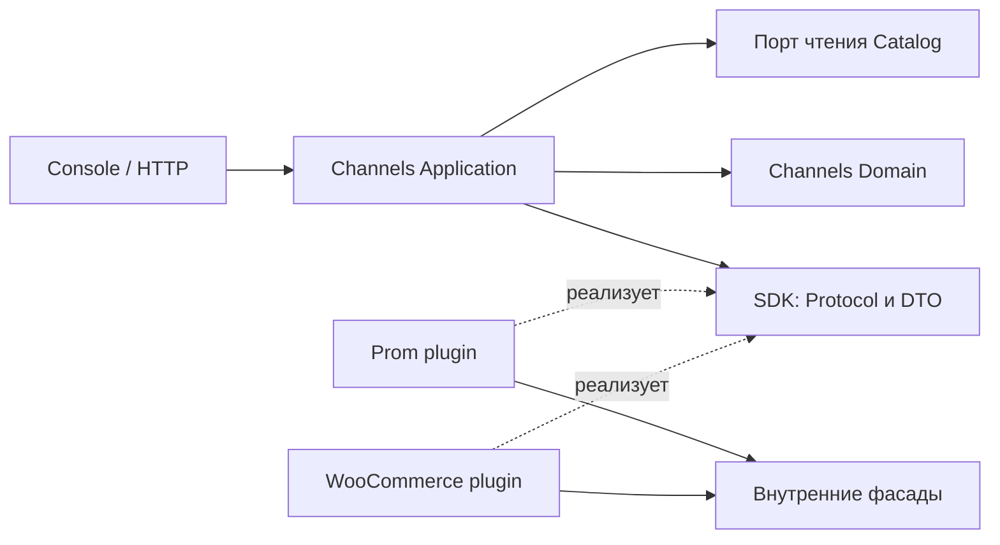

# План модуля интеграций и каналов

Дата обновления: 2026-10-18. Статус: реализованы первый backend-срез и Console для подключения/загрузки; остальное — план развития.

Связанные документы: [Catalog](catalog.md), [архитектурные требования](../architecture/backend.md),
[история tenant-миграций](../data/tenant-migrations.md),
[исследование платформ](channel-platforms/README.md).

Раздел 0 задаёт согласованный объём MVP, разделы 1–14 — полную целевую модель.
Реализована первая итерация: Channel с единственным Connection, verify и read
initialization Prom/WooCommerce, локальные API списка и прогресса. Синхронизация
по умолчанию выключена. Console реализует список каналов, настройку единственного
Connection, verify, прогресс/повтор загрузки и список публикаций с поиском/фильтрами.
Endpoint и секретные поля описываются manifest плагина. Bind/create Catalog Draft
и outbound пока не реализованы.
[Действующее описание](../modules/channels.md) фиксирует API, ограничения и запуск.

Историческое хранение удалено 0027; новые четыре tenant-таблицы создаёт forward
миграция 0028_channels_core. Раздел 15 ниже описывает прежний Rozetka-срез,
не доступную сейчас интеграцию. Исследования описывают внешний контракт, а не
готовность коннектора. Read scope текущих Prom/Woo помечен api_visible_statuses_only;
полный API-обход даёт read_complete=true с partial при ограниченном охвате.

## 0. Первая версия: инициализация публикаций, Catalog Draft и обновление контента

Уточнение от 2026-10-18 имеет приоритет над полным целевым объёмом ниже.
MVP включает автоматическую инициализацию всех публикаций после подключения,
стабильный core списка, явную привязку к Catalog или создание нового Draft.
В Draft переносятся название, SKU, базовая и акционная цена, количество/наличие.
Подробные сценарии и атомарный контракт создания — в разделе 0.7.

Уточнение границы: один Channel — один конкретный источник продаж и максимум
один Connection. Channel — Aggregate Root, Connection — его внутренняя Entity.
До завершения настройки Connection может отсутствовать; после подключения связь
1:1. Это правило всей модели, не ограничение только UI/MVP. Детали — в разделе 2.2.

Исходящая запись по-прежнему обновляет **только существующие внешние карточки**:
Catalog title/body на двух явных locale Connection. Внешние товары/переводы,
характеристики/категории/media/price/stock не создаются и не обновляются этим
outbound-сценарием. Channel.is_enabled по умолчанию false; первичная read
инициализация не зависит от выключенной исходящей синхронизации.

Пара locale задаётся явно; для Prom рассматриваются uk/ru. Нет скрытого fallback,
автоперевода и автоматической перезаписи существующего товара Catalog.
В v1 нет канальных overrides текстов. Явное создание Draft не включает
синхронизацию; дальнейшие правки выполняются обычным редактором Catalog.
Разделы 1–14 сохраняют полную целевую модель, не расширяя обязательный срез v1.

### 0.1. Транспорт WooCommerce и Prom

WooCommerce обновляет только `name` и `description` существующего product ID.
Для двух locale необходимо явно поддержанное мультиязычное расширение/контракт
конкретного магазина и существующие переводы. Например, WPML возвращает language
и translation information; разные переводы могут иметь разные product ID.
Нельзя отправить два последовательных перевода в один одноязычный product и
считать это двуязычной публикацией. Binding адресует цель каждой locale.
Источник: [официальный контракт WooCommerce/WPML](https://wpml.org/documentation/support/wcml-rest-api/).
Механизм конкретного магазина выбирается до реализации adapter; неизвестный
multilingual mode блокирует двуязычную операцию.

Для Prom XML является payload, а API управляет запуском и проверкой импорта:

1. Прочитать Catalog на две locale и проверить существующую связанную карточку.
2. Сформировать неизменяемый XML для выбранного batch. Каждая позиция имеет
   подтверждённый import identity. Теги `name`/`description` и
   `name_ua`/`description_ua` формируются по явным locale bindings.
3. Сохранить артефакт по URL конкретной версии; повторное чтение этого URL
   возвращает тот же файл на всём протяжении внешней обработки.
4. Вызвать `POST /products/import_url`: передать URL, `only_available=false`,
   `mark_missing_product_as="none"` и allowlist только текстовых полей, включая
   необходимый механизм обновления переводов. `force_update` задаётся adapter policy.
5. Сохранить возвращённый import ID и проверять
   `GET /products/import/status/{id}` отдельными bounded jobs.
6. Сверить результат по карточкам/locale; сохранить `succeeded / partial / failed`
   без изменения Catalog. Ответ запуска импорта не является завершением обновления.

Подтверждено по [официальному Swagger Prom](https://prom.ua/cloud-cgi/static/uaprom-static/docs/swagger/index.html#/Products/post_products_import_url):
импорт URL принимает параметры отбора обновляемых полей, возвращает ID процесса;
доступен отдельный endpoint его статуса. Example Value содержит вложенный массив
`updated_fields`. До реализации необходимо закрепить действительный wire shape,
allowlist и семантику переводов контрактными fixtures и тестовым кабинетом;
не превращать пример Swagger в готовый JSON без этой проверки.
Теги языков описаны в [формате YML](https://support.prom.ua/hc/uk/articles/360004963538).

`updated_fields` ограничивает обновляемые поля и **не считается запретом создания**
неизвестных позиций. Нужны подтверждённая привязка каждой позиции, корректный
import identity и проверка отсутствия неожиданно созданных карточек в результате.
Если импорт не гарантирует update-only для исчезнувшей между проверкой и импортом
позиции, этот путь не соответствует строгой границе v1. До внешней записи нужно
подтвердить update-only mode либо выбрать согласованный альтернативный transport;
одной предварительной проверки существования для такой гарантии недостаточно.
В v1 нет постоянной автоматически пересобираемой выгрузки всего ассортимента:
один run получает свой XML выбранных существующих позиций, отсутствующие в нём
карточки должны оставаться без изменения.

### 0.2. Минимальное хранение v1

Все таблицы tenant-scoped; это план, а не созданная SQL-схема.

| Таблица | Состояние первой версии |
| --- | --- |
| `channels` | id, name, platform_kind, is_enabled=false, revision/audit; будущие политики не создают работающих price/stock функций |
| `channel_connections` | id, channel_id NOT NULL UNIQUE, identity, зашифрованные credentials, locale/bindings, adapter mode, read/content capabilities, revisions, initialization status/last run; хранение Entity внутри Channel |
| `channel_external_publications` | connection_id, resource_type/external_id, external_sku, price/sale_price/currency, quantity/stock_status, title/locale, main_image_url, versioned extensions, observed revision и import metadata |
| `channel_product_representations` | connection_id, catalog_item_id, состояние подготовки; UNIQUE(connection_id, catalog_item_id) для simple v1 |
| `channel_external_bindings` | representation_id, external_publication_id, target locale, подтверждённая import identity/translation target; только существующие цели |
| `channel_sync_runs` | connection_id, initialize_publications/content_update, status/progress/scope, remote operation reference, versioned checkpoint/delivery state, audit |
| `channel_sync_run_items` | run_id, representation_id, immutable snapshot двух title/body, content hash, targets, результаты по locale и ошибки |
| `channel_export_artifacts` | run_id, storage reference, checksum, размер, формат, срок доступности; неизменяемый XML данного run |
| `channel_catalog_creation_requests` | idempotency key, publication ID, observed revision, Catalog item ID, сохранённый результат create+bind |

SQL не дублирует snapshot отдельной редактируемой карточкой: canonical content
остаётся в Catalog, snapshots run items — история конкретной операции.
Цена/stock входят во входящую read-модель и явное создание Draft, но не в
исходящий content update. Категории остаются вне MVP; технические поля,
обязательные для файла, adapter берёт только из подтверждённого внешнего scope,
не расширяя список разрешённых обновлений. Внешние валидаторы могут всё равно
требовать определённый набор XML-тегов: минимальный файл проверяется на fixtures
и реальном тестовом импорте до объявления операции доступной.

Taxonomy/schema/dictionary/mapping tables разделов 5–7 не создаются в v1.
Артефакт принадлежит lifecycle SyncRun; отдельный Aggregate Root/CRUD для файла
не нужен. Shared jobs/Outbox используются через существующие публичные порты.

### 0.3. Платформенные таблицы и граница контекста

Один bounded context `channels` владеет Channel, Connection, представлениями,
привязками и запусками. Prom и WooCommerce — adapters этого контекста.
Отдельный бизнес-модуль для каждой площадки в v1 не создаётся.

Платформенная таблица допустима, когда хранит самостоятельные особенности
протокола, требующие колонок/индексов/ограничений. Например,
`channel_prom_imports(run_id, remote_import_id, options, last_status, checked_at)`
может стать расширением хранения SyncRun с UNIQUE(run_id); `run_id` ссылается
на общий запуск внутри Channels. Она не становится Aggregate Root и не получает
независимый write repository только из-за наличия SQL-таблицы.
В v1 достаточно versioned delivery state у run, если нет отдельных запросов
и ограничений, требующих такой таблицы. Один факт не хранится одновременно
как изменяемая истина в JSONB и отдельной таблице.

Таблицы создаются **для типа протокола**, если нужны, а не для каждого экземпляра
подключения: нет `prom_shop_123_products` и динамического DDL при создании Connection.
Общие Domain/Application-контракты оперируют content update, двумя locale,
external targets и delivery result. `updated_fields`, Prom import statuses,
XML-теги и WPML wire fields преобразуются adapters; Domain не импортирует
HTTP clients, ORM, JSONB или классы Infrastructure. Типизированные Application
порты скрывают протокол, не скрывая его асинхронность и частичные результаты.

Платформенные adapters поставляются пакетами плагинов
`infrastructure/plugin/prom/` и `.../woocommerce/` по контракту раздела 0.5.
Они обслуживают несколько roots; общие SDK/registry contracts принадлежат
Application, сборка — внешнему composition root. SQL models находятся по одному
файлу в `infrastructure/persistence/models/`. Plugin package не является
новым bounded context с собственными четырьмя слоями.
Выделение контекста оправдано при появлении собственного бизнес-языка,
независимых жизненных циклов/инвариантов и публичных use cases, а не из-за
сложности XML или наличия нескольких специальных колонок.

### 0.4. Сценарии v1, UI и приёмка

Матрица ниже описывает content update; обязательные initialization/list/create-draft
сценарии и уточнённые состояния добавлены в разделе 0.7.

Настройки Channel/Connection используют отдельные существующие строки плана
раздела 10: создание/чтение/изменение/пауза/архив и verify. Для контента нужны:

| Корень / сценарий | Вход помимо доверенного tenant/actor | execute → |
| --- | --- | --- |
| external_publication/find_existing_publications | connection ID, внешний ID/search, locale pair, pagination | FindExistingPublicationsResultDTO |
| product_representation/bind_existing_publication | connection ID, Catalog item ID, подтверждённые внешние targets двух locale | BindExistingPublicationResultDTO |
| product_representation/preview_content_update | representation IDs, две locale | PreviewContentUpdateResultDTO |
| sync_run/start_content_update | representation IDs и ожидаемые content hashes preview, idempotency key | StartContentUpdateResultDTO |
| sync_run/get_content_update_run | run ID | GetContentUpdateRunResultDTO |
| sync_run/prepare_content_update | run ID, job/lease, bounded item IDs | PrepareContentUpdateResultDTO |
| sync_run/apply_content_update | run ID, lease, typed delivery outcome | ApplyContentUpdateResultDTO |
| sync_run/check_content_update_result | run ID, lease, сохранённый remote operation reference | CheckContentUpdateResultDTO |
| sync_run/complete_content_update | run ID, terminal outcome | None |
| product_representation/get_catalog_usage | Catalog item IDs | GetCatalogUsageResultDTO |

Preview не создаёт внешние объекты: возвращает title/body по locale, content hashes,
origins и issues. Start повторно проверяет hashes и атомарно фиксирует immutable
run items + Outbox/jobs, возвращает run ID; HTTP 202 после commit.
Get run показывает внешнюю обработку и результат по каждому item/locale.
Find/verify используют read adapters; сетевые шаги выполняются между короткими UoW,
read-запрос локального списка не вызывает внешнюю сеть. Binding сохраняется после
проверки targets, принадлежности Connection и отсутствии конфликтующего управления.
Вход bind фиксирует ожидаемую revision существующего representation при изменении.

На каждую строку создаются собственные command/query, handler и dto при результате
по правилам раздела 10; внутренние worker-сценарии не получают фиктивных HTTP API.
Публичные HTTP методы имеют отдельные controller/request/response при необходимости
и именованные Depends. Complete возвращает `-> None`, без пустого DTO.
Generic batch-сценарии и taxonomy CRUD раздела 10 не расширяют обязательный срез v1.
Все методы аннотированы и документированы; фабрики create/restore и бизнес-правила
остаются в Domain, mappers не выполняют I/O или проверку разрешённых переходов.

UI v1: подключить → автоматически загрузить все публикации → связать с Catalog
либо явно создать Draft → при необходимости включить исходящую синхронизацию →
сравнить тексты двух locale → обновить выбранные → просмотреть результат. Редактор категорий/характеристик, настройки
наценок/складов и создание публикаций не выводятся как доступные функции.
Woo может вернуть partial при успехе только одной locale; повторяются только
подтверждённо незавершённые операции после сверки. Prom показывает run accepted,
processing и результат проверки; ответ запуска не называется «Обновлено».

Приёмка outbound-среза v1 проверяет изменение только title/body двух locale,
неизменность остальных внешних полей и существующих товаров Catalog, запрет
создания внешних карточек/переводов. Явный create Catalog Draft и входящий core
проверяются отдельно по разделу 0.7. Остальные проверки:
точный import identity, allowlist и переводные XML-теги, partial/retry/timeout,
неизменяемость URL артефакта до окончания импорта, сохранение import ID и polling,
проверку прочитанных полей после внешней обработки, tenant/CSRF/UoW/rollback,
usage/binding race и общие архитектурные требования. Реальная совместимость
Prom update-only и Woo multilingual остаётся внешним условием приёмки.

### 0.5. Расширяемость: плагины платформ и внутренние фасады

Каждая поддерживаемая платформа поставляется отдельным пакетом адаптера.
Добавление платформы, реализующей существующие capabilities, требует её пакета,
регистрации в одной точке сборки и её контрактных fixtures. Domain, общие handlers,
HTTP-контроллеры, Catalog и страницы Console при этом не меняются.
Разделение CMS/marketplace остаётся метаданными платформы, а не маршрутизацией
бизнес-операций через `if kind == ...` в каждом компоненте.

Плагинная граница — контракт расширения, не отдельный bounded context сама по себе.
В v1 общий контекст Channels владеет бизнес-состоянием; плагины являются его
Infrastructure adapters. Будущая самостоятельная модель marketplace может
получить отдельный контекст, сохранив тот же принцип публичных границ.

#### Ответственность ядра и плагина

| Ядро Channels | Плагин платформы |
| --- | --- |
| Авторизация, tenant/actor, связь Channel/Connection и разрешённые операции | Внешняя аутентификация и проверка identity/прав ресурса |
| Чтение Catalog через публичный контракт, разрешение двух locale, content hash/preview | Поиск/чтение внешних targets и нормализация наблюдаемого контента |
| Outbound только title/body существующих targets; создание Catalog Draft только явным core-сценарием через публичный фасад | Преобразование подготовленного content update в wire format платформы |
| Создание runs/items, leases, checkpoint, Outbox/jobs, commit/rollback | Ограниченный сетевой шаг: API update либо XML + запуск/проверка импорта |
| Общая интерпретация результата, история, локальные query-проекции и UI | Перевод native статусов/ошибок в типизированный результат операции |

Плагин получает immutable batch только разрешённых полей и существующих target
references. Он не получает агрегаты Catalog, его repositories или write facade.
Снимок уже подготовлен ядром; повторное чтение Catalog из кода плагина не требуется.
Общие бизнес-инварианты остаются в Domain, платформенные протокольные ограничения
объявляются через capabilities/validation result. Различие протоколов не является
поводом переносить invariant Channels в mapper или HTTP client.

#### Минимальный SDK и регистрация

SDK — небольшой публичный Application-контракт Channels, не универсальный сервис
со всеми методами платформы. Он состоит из независимых интерфейсов операций:
`VerifyConnectionPlugin`, `ReadExistingPublicationsPlugin`,
`ReadPublicationPagePlugin`, `UpdateContentPlugin`.
Плагин реализует только заявленные capabilities. Создание внешних карточек,
исходящая запись price/stock, taxonomy и moderation не добавляются фиктивными
методами v1. Чтение наблюдаемых price/stock входит в read-publications core.

Manifest объявляет стабильный `kind`, label, категорию платформы, версию SDK,
версию конфигурации, connection JSON Schema/UI schema, реализованные capabilities
и поддерживаемые форматы собственного checkpoint. Секретные поля помечены явно.
Реестр отбрасывает дубликаты kind и несовместимые версии; неизвестная capability
не становится доступной только из-за наличия строки в manifest.
Kind — проверяемый по реестру ключ, без центрального enum всех платформ.
Существующие config/schema definitions поступают из manifest, а не из нескольких
параллельно поддерживаемых списков backend и frontend.

Registry скрыт за Application-портом: handler получает реализацию операции
по Connection и capability. Единственная точка composition root связывает kind
с plugin factory. Domain/Application не импортируют конкретные Prom/Woo классы.
Плагины являются пакетами сборки с явной регистрацией; hot install и выполнение
пользовательских Python-плагинов не входят в v1. При отсутствующем/отключённом
плагине Connection и история сохраняются, операция получает unavailable reason.

Принадлежность компонентов по слоям:

- SDK protocols и типизированные входы/результаты операций —
  `application/<aggregate_root>/port/`, manifest/registry contracts общие для
  нескольких roots — `application/port/`.
- Пакеты `infrastructure/plugin/prom/` и `.../woocommerce/` содержат manifest,
  factory, clients, serializers и реализации connection/read/content ports.
  Общий каталог plugin на уровне Infrastructure обоснован тем, что пакет
  обслуживает несколько Aggregate Roots; порядок модуль → слой сохраняется.
- Registry assembly — `presentation/depends/plugin_registry.py`; эта внешняя
  сборка может импортировать конкретные Infrastructure implementations.
- SQL models — по одному файлу в `infrastructure/persistence/models/`, без
  реэкспортов. Пустые каталоги для будущих capabilities не создаются.

#### Доступ к внутренним возможностям через фасады

Внешняя сборка внедряет только необходимые ограниченные интерфейсы:

| Фасад / порт для плагина | Разрешённая ответственность |
| --- | --- |
| Connection credentials access | Получить credentials текущего Connection для внешнего вызова; без чтения чужих подключений и без SQL session |
| Export artifact access | Создать/прочитать неизменяемый файл и получить URL с достаточным сроком доступности для текущего run |
| HTTP transport | Выполнить ограниченный внешний запрос с общей политикой timeout, размеров, redirects и адресов |
| Clock / безопасная диагностика | Время и диагностические коды текущей операции без credentials и payload |

Публичные Protocol/DTO facade принадлежат Application; реализации — Infrastructure.
Это consumer-контракты конкретного назначения, не доступ к ORM или внутренним
handlers соседнего модуля. Если используются Files или другие модули, только
реализация фасада вызывает их публичный Application-контракт через consumer
adapter. У плагина нет общей `db`, `execute_sql`, session, repository registry,
произвольного event bus или возможности сохранять агрегаты ядра.

Планирование следующего job, смена статуса, запись checkpoint и подтверждение
сохранения выполняются ядром по результату плагина. Плагин не создаёт собственную
независимую очередь и не делает commit. HTTP не удерживает UoW. Metadata/связь
созданного внешнего артефакта фиксируются на Apply в общей транзакции; несвязанные
артефакты при сбое удаляются штатной политикой cleanup владельца файлов.

#### Асинхронный контракт и собственное состояние

UpdateContentPlugin выполняет один ограниченный шаг, а не скрытый бесконечный
polling. Операция получает batch, operation identity/idempotency context и
сохранённый versioned checkpoint; возвращает результат своего шага:

- завершённые результаты по item/locale с подтверждённым содержимым;
- pending с внешней ссылкой на операцию, новым checkpoint и временем следующей
  проверки;
- окончательный отказ с типизированными issues;
- временный сбой с retry hints либо unknown outcome, требующим сверки до повтора.

Для submit/resume/read/verify определяются свои конкретные типы результата;
один универсальный dict не заменяет контракты операций. Это DTO plugin-порта,
а не замена отдельных Command/Query ResultDTO и HTTP-схем раздела 0.4.
Частичный успех двух locale сохраняется явно; completed не означает успешность
каждого item. Терминальный succeeded назначается только после подтверждения
полного согласованного объёма.

Prom checkpoint может содержать import ID и этап обработки; Woo checkpoint —
подтверждённые translation targets и уже завершённые locale. Общее ядро сохраняет
их атомарно с run/items и следующим job, но не интерпретирует native status fields.
Checkpoint не содержит секретов или полного native payload. Plugin/state format
versions закрепляются за run; обновление плагина требует совместимого чтения либо
явной миграции/остановки старых runs, без молчаливого переосмысления состояния.

Сначала используется versioned JSONB состояния run. Если появится необходимость
специальной SQL-таблицы платформы, она сохраняется через отдельный порт состояния
и adapter, собранный на том же внешнем UoW во время Apply. Такое расширение
регистрируется factory; плагин не получает session и не меняет общие таблицы
напрямую. Таблица имеет одного владельца и обычную forward tenant-миграцию,
не создаётся динамически при создании Connection. Это расширение persistence,
не новый Aggregate Root из-за структуры SQL.

#### UI и критерий расширяемости

Console получает каталог, формы подключения и capabilities с backend.
Она использует общий набор разрешённых widgets и экраны content update;
не содержит `if prom`, `if woocommerce` или отдельных списков platform kinds.
Статические возможности manifest пересекаются с проверенными правами/ограничениями
ресурса. Недостаточная поддержка двух locale делает операцию недоступной с причиной.
Неизвестный widget или версия схемы дают понятное ограничение, не выполнение
произвольного frontend-кода из manifest.

Проверка расширяемости: тестовый третий plugin, реализующий существующий content
contract, подключается только новым пакетом/fixtures и регистрацией в composition
root. Общие handlers, controllers, DTO Catalog и страницы Console не меняются.
Обязательны архитектурные проверки импортов, contract suite каждого плагина,
проверки Completed/Pending/Partial/UnknownOutcome, lease/revision/tenant fencing,
отсутствие записей Catalog из plugins/initialization и внешних изменений вне
разрешённых title/body; явное core-создание Draft проверяется отдельно.
Поведение общих экранов проверяется на manifest тестового плагина.

Гарантия относится к **новой платформе с уже поддержанной операцией**.
Новая бизнес-возможность — например, создание offer или обработка модерации —
требует отдельного use case, версии контракта и при необходимости UI. Добавление
её через произвольный payload/action в обход модели не считается расширяемостью.

### 0.6. Конкретные файлы, SDK-контракты и цепочка content update

Дерево content update дополняется read-initialization и create-draft файлами
раздела 0.7; ограничения на доступ plugins к Catalog остаются прежними.

Этот раздел сохраняет согласованную в чате структуру реализации v1. Это целевые
пути и эскизы контрактов, а не созданные backend-файлы. Применяются
[архитектурные правила backend](../architecture/backend.md), владельцы состояния
и ограничения разделов 0–0.5. Во всех путях ниже корень модуля —
`src/modules/channels/`. Перенос архитектурных правил в backend.md не меняет
правил направления зависимостей и группировки по Aggregate Root.

#### 0.6.1. Границы зависимостей и владельцы



Внешняя сборка зависимостей подключает реализации. Application и Domain не
импортируют классы Prom/WooCommerce. SDK принадлежит Application; стрелки
плагин → facade означают использование публичного Protocol, а не импорт
конкретной реализации. Catalog читает ядро; плагин получает подготовленные
name/description и существующие внешние targets.

| Объект / граница | Ответственность |
| --- | --- |
| Channel, Aggregate Root | Конкретный источник продаж, включение интеграции, бизнес-политики и lifecycle единственного Connection |
| Connection, внутренняя Entity Channel | Техническая identity ресурса, настройки, доступ и возможности; собственного write repository нет |
| ProductRepresentation | Связь CatalogItem с внешними целями |
| ExternalPublication | Наблюдаемая внешняя карточка |
| SyncRun | Зафиксированные изменения, прогресс, попытки и результаты |

ExternalBinding и RunItem не получают самостоятельные write repositories.
Агрегаты/Entity используют create/restore и доменные методы; invariants не
переносятся в DTO, mapper или фасады. Domain не импортирует SDK DTO: Application
переводит результат плагина в собственные Domain values для перехода состояния.

#### 0.6.2. Структура ядра

```text
channels/
├── domain/
│   ├── channel/
│   │   ├── aggregate.py
│   │   ├── repository.py
│   │   ├── entity/connection.py
│   │   └── error.py
│   ├── product_representation/
│   │   ├── aggregate.py
│   │   ├── repository.py
│   │   ├── entity/external_binding.py
│   │   └── error.py
│   ├── external_publication/
│   │   ├── aggregate.py
│   │   ├── repository.py
│   │   └── error.py
│   └── sync_run/
│       ├── aggregate.py
│       ├── repository.py
│       ├── entity/run_item.py
│       ├── value_object/status.py
│       ├── value_object/delivery_progress.py
│       └── error.py
│
├── application/
│   ├── channel/
│   │   └── command/verify_connection/
│   │       ├── command.py
│   │       ├── handler.py
│   │       └── dto.py
│   ├── product_representation/
│   │   ├── command/bind_existing_publication/
│   │   ├── query/preview_content_update/
│   │   └── port/catalog_content.py
│   └── sync_run/
│       ├── command/start_content_update/
│       ├── command/prepare_content_update/
│       ├── command/apply_content_update/
│       ├── command/check_content_update_result/
│       ├── command/complete_content_update/
│       ├── query/get_content_update_run/
│       ├── port/query_repository.py
│       ├── port/jobs.py
│       └── service/content_update_runner.py
│
├── infrastructure/
│   ├── product_representation/
│   │   └── adapter/catalog_content.py
│   ├── sync_run/
│   │   ├── persistence/repository.py
│   │   ├── persistence/mapper.py
│   │   ├── persistence/query_repository.py
│   │   └── persistence/query_mapper.py
│   └── persistence/models/
│       ├── channel.py
│       ├── connection.py
│       ├── product_representation.py
│       ├── external_publication.py
│       ├── external_binding.py
│       ├── sync_run.py
│       ├── sync_run_item.py
│       └── export_artifact.py
│
└── presentation/
    ├── depends/
    │   ├── uow.py
    │   ├── plugin_registry.py
    │   └── plugin_services.py
    ├── sync_run/
    │   ├── router.py
    │   ├── depends.py
    │   └── http/
    │       ├── controller/start_content_update.py
    │       ├── request/start_content_update.py
    │       ├── response/start_content_update.py
    │       ├── controller/get_content_update_run.py
    │       └── response/get_content_update_run.py
    └── jobs/
        └── content_update.py
```

Дерево показывает основные файлы content-среза; общие сценарии настроек
Channel/Connection из раздела 10 сохраняют собственные файлы. Для каждой команды
в показанном scenario directory обязательны command.py и handler.py, dto.py при
результате; для query — query.py, handler.py, dto.py. Complete возвращает
`-> None`, без dto.py с пустым результатом. Для каждого изменяемого корня
реализуются собственные persistence repository/mapper, для чтения — Application
query port и Infrastructure query repository/mapper по фактическим сценариям.

В частности, bind и preview получают самостоятельные controllers/requests/responses
в `presentation/product_representation/http/`, verify — в
`presentation/channel/http/`. `router.py` регистрирует маршруты, `depends.py`
собирает обработчики на общей UoW-зависимости. Worker-сценариям фиктивные HTTP API
не создаются. `get_content_update_run` не имеет request schema с пустым body.

#### 0.6.3. Расположение SDK

SDK — публичные контракты внутренних слоёв, распределённые по владельцам.
Отдельного бизнес-модуля sdk не создаётся.

```text
channels/application/
├── port/
│   ├── plugin_manifest.py
│   ├── plugin_registry.py
│   ├── plugin_credentials.py
│   ├── plugin_http_transport.py
│   └── clock.py
├── channel/
│   ├── port/verify_connection_plugin.py
│   └── plugin_contract/verify_connection.py
├── external_publication/
│   ├── port/read_existing_publications_plugin.py
│   └── plugin_contract/read_existing_publications.py
└── sync_run/
    ├── port/
    │   ├── update_content_plugin.py
    │   └── export_artifacts.py
    └── plugin_contract/
        ├── content.py
        ├── checkpoint.py
        ├── outcome.py
        ├── submit_content_update.py
        ├── resume_content_update.py
        └── reconcile_content_update.py
```

Здесь только Protocol, immutable DTO и ошибки контрактов. SQLAlchemy, HTTP clients,
реализации facade и native DTO провайдера сюда не входят. __init__.py остаются
пустыми; imports идут из файлов определений. DTO plugin-портов не заменяют
собственные Command/Query ResultDTO или HTTP-контракты сценариев.

#### 0.6.4. Пакеты Prom и WooCommerce

```text
channels/infrastructure/plugin/
├── registry.py
├── prom/
│   ├── manifest.py
│   ├── factory.py
│   ├── verify_connection.py
│   ├── read_existing_publications.py
│   ├── update_content.py
│   ├── checkpoint.py
│   ├── client.py
│   ├── native_contract.py
│   ├── xml_serializer.py
│   ├── import_options.py
│   └── result_normalizer.py
└── woocommerce/
    ├── manifest.py
    ├── factory.py
    ├── verify_connection.py
    ├── read_existing_publications.py
    ├── update_content.py
    ├── checkpoint.py
    ├── client.py
    ├── native_contract.py
    ├── content_serializer.py
    ├── result_normalizer.py
    └── multilingual/
        ├── contract.py
        └── wpml.py
```

Каждый пакет обслуживает несколько агрегатов. WooCommerce factory выбирает
поддержанный multilingual adapter по конфигурации своего Connection; общее ядро
получает нормализованные targets двух locale. Ветки по provider-specific режиму
остаются внутри соответствующего плагина. WPML здесь — конкретный кандидат
adapter, совместимость которого проверяется на тестовом магазине до включения.

#### 0.6.5. Входные DTO content update

Эскизы ниже показывают поля и сигнатуры; импорты вспомогательных контрактов
опущены. Они не являются реализацией фабрик/валидации Domain.
`plugin_contract/content.py` содержит вложенные DTO операции:

```python
from dataclasses import dataclass
from uuid import UUID


@dataclass(frozen=True, slots=True)
class LocalizedContentDTO:
    """Содержит разрешённые к передаче тексты одной локали."""

    locale: str
    name: str
    description: str


@dataclass(frozen=True, slots=True)
class ExistingContentTargetDTO:
    """Адресует существующую внешнюю цель выбранной локали."""

    locale: str
    external_id: str
    import_identity: str | None


@dataclass(frozen=True, slots=True)
class ContentUpdateItemDTO:
    """Передаёт зафиксированное изменение двух локалей."""

    run_item_id: UUID
    content: tuple[LocalizedContentDTO, LocalizedContentDTO]
    targets: tuple[ExistingContentTargetDTO, ExistingContentTargetDTO]
    content_hash: str
```

До формирования DTO ядро проверяет две разные ожидаемые locale, наличие
переводов Catalog, соответствие content/target locale, подтверждённую
принадлежность targets Connection и отсутствие конфликтующего управления.
Отсутствующее значение не становится автоматическим очищением внешнего поля;
намеренно сохранённая пустая строка обрабатывается по явной политике content.
У Prom две locale могут адресовать одну карточку; у Woo переводы могут иметь
разные product ID. Price/stock/categories и свободный payload сюда не входят.

#### 0.6.6. Контракт плагина и результаты шага

`sync_run/port/update_content_plugin.py`:

```python
from typing import Protocol


class UpdateContentPlugin(Protocol):
    """Реализует ограниченные шаги обновления внешнего контента."""

    async def submit(
        self,
        request: SubmitContentUpdateRequestDTO,
    ) -> SubmitContentUpdateResultDTO:
        """Начинает передачу подготовленных изменений."""
        ...

    async def resume(
        self,
        request: ResumeContentUpdateRequestDTO,
    ) -> ResumeContentUpdateResultDTO:
        """Продолжает операцию по сохранённому checkpoint."""
        ...

    async def reconcile(
        self,
        request: ReconcileContentUpdateRequestDTO,
    ) -> ReconcileContentUpdateResultDTO:
        """Выясняет результат операции с неизвестным исходом."""
        ...
```

| DTO | Поля |
| --- | --- |
| SubmitContentUpdateRequestDTO | operation ID, idempotency key, immutable items |
| ResumeContentUpdateRequestDTO | operation ID, immutable items, checkpoint |
| ReconcileContentUpdateRequestDTO | operation ID, immutable items, последний checkpoint и reference попытки |

`plugin_contract/checkpoint.py`:

```python
from dataclasses import dataclass


@dataclass(frozen=True, slots=True)
class PluginCheckpointDTO:
    """Хранит сериализованное состояние продолжения без секретов."""

    format_version: int
    payload_json: str
```

Ядро проверяет размер/формат envelope и сохраняет его с plugin/version context.
Платформенные поля интерпретирует только соответствующий plugin; checkpoints
не содержат credentials, download grants или полных native payload.

У submit/resume/reconcile свои ResultDTO. Их вложенный результат шага является
типизированным discriminated union, а не произвольным dict:

| Результат | Содержимое |
| --- | --- |
| Completed | Результаты по item/locale |
| Pending | Checkpoint, подтверждённые промежуточные результаты, время продолжения и нормализованный этап |
| Rejected | Окончательные причины отказа |
| RetryableFailure | Причина и допустимое время повтора |
| UnknownOutcome | Данные для сверки без разрешения слепой повторной отправки |

Completed означает завершение обработки, а не автоматический успех всех items.
Domain определяет succeeded/partial/failed по всему объёму. Apply идемпотентно
сохраняет подтверждения item/locale; повтор сообщения не теряет подтверждённые
locale и не создаёт дополнительный job. Pending может продолжать подготовку
немедленно либо ожидать внешний процесс; это различается нормализованным этапом,
чтобы UI не называл создание XML обработкой на стороне Prom.

#### 0.6.7. Контракты внутренних фасадов

Фасады создаются внешней сборкой и ограничиваются текущими Connection/Run.
Плагин не передаёт произвольный tenant/connection ID для доступа к чужим данным.

```python
from datetime import datetime
from typing import Protocol
from uuid import UUID


class PluginCredentialsFacade(Protocol):
    """Предоставляет credentials только текущего подключения."""

    async def resolve(self) -> ConnectionCredentialsDTO:
        """Возвращает credentials для текущего внешнего шага."""
        ...


class PluginHttpTransportFacade(Protocol):
    """Выполняет запросы в пределах разрешённого внешнего ресурса."""

    async def request(
        self,
        request: PluginHttpRequestDTO,
    ) -> PluginHttpResponseDTO:
        """Выполняет запрос с заданными инфраструктурой лимитами."""
        ...


class ExportArtifactsFacade(Protocol):
    """Обслуживает неизменяемые артефакты текущего запуска."""

    async def create_immutable(
        self,
        request: CreateExportArtifactRequestDTO,
    ) -> ExportArtifactReferenceDTO:
        """Создаёт файл по стабильному operation key и checksum."""
        ...

    async def get_download_url(
        self,
        artifact_id: UUID,
        required_until: datetime,
    ) -> ExportArtifactDownloadURLDTO:
        """Возвращает URL с достаточным сроком доступности."""
        ...


class ClockFacade(Protocol):
    """Предоставляет время выполнения шага."""

    def now(self) -> datetime:
        """Возвращает текущий момент UTC."""
        ...
```

Расположение: credentials/HTTP/clock — общие Application ports, export artifacts —
порт sync_run. DTO facade определяются рядом со своим контрактом и сохраняют
конкретное назначение; новые классы не реэкспортируются через __init__.py.

| Контракт данных | Существенные свойства |
| --- | --- |
| ConnectionCredentialsDTO | Immutable secret fields, исключённые из repr; не попадают в jobs/checkpoint/logs |
| PluginHttpRequestDTO | Метод, адрес/путь, headers/body; transport ограничивает адреса, размер и время, чувствительные поля исключены из repr/logs |
| PluginHttpResponseDTO | HTTP status, разрешённые headers и ограниченное тело; не выдаётся как публичный HTTP response Channels |
| CreateExportArtifactRequestDTO | Стабильный operation key, содержимое, формат, checksum и срок хранения |
| ExportArtifactReferenceDTO | Artifact ID и checksum; не download URL |
| ExportArtifactDownloadURLDTO | URL и срок доступности для внешней обработки, без сохранения grant в checkpoint |

Credential facade не удерживает SQL session во время HTTP. Artifact facade
работает с внешним файлом; link/metadata текущего run фиксируются на Apply
в общей транзакции. Повтор create_immutable с тем же operation key и другим
checksum даёт конфликт, а не переписывает файл уже отправленного импорта.

Фасад Catalog доступен ядру, а не плагинам;
`application/product_representation/port/catalog_content.py`:

```python
from typing import Protocol


class CatalogContentReadFacade(Protocol):
    """Читает канонический контент для подготовки изменений."""

    async def read_two_locales(
        self,
        request: ReadCatalogContentRequestDTO,
    ) -> ReadCatalogContentResultDTO:
        """Возвращает согласованный контент выбранных товаров."""
        ...
```

Его Infrastructure consumer adapter вызывает существующий публичный
GetCatalogItemsPublicationSnapshot для двух locale в одном согласованном read
UoW с единым as_of и выбирает title/body. Снимок Catalog не получает connection ID,
внешнюю schema или expected Catalog revisions. Content hash считает ядро Channels
по используемым полям двух locale, без неиспользуемой цены, audit и времени чтения.

#### 0.6.8. Регистрация

Только `presentation/depends/plugin_registry.py` знает конкретные factories:

```python
def get_plugin_registry() -> PluginRegistryPort:
    """Собирает реализации платформ из зарегистрированных пакетов."""
    return StaticPluginRegistry(
        factories=(
            PromPluginFactory(),
            WooCommercePluginFactory(),
        ),
    )
```

StaticPluginRegistry реализует Application-порт и находится в
`infrastructure/plugin/registry.py`. Manifest каждой factory объявляет kind,
совместимую версию SDK, connection schema, реализованные capabilities и версии
checkpoint. Facades внедряются при создании runtime реализации для конкретного
шага. Handler выбирает операцию через registry, не импортирует factory и не
получает ветки `if kind == "prom"`.

Добавление третьей платформы с существующим content contract требует нового
пакета/fixtures и регистрации factory, без изменений общих handlers, controllers,
Catalog DTO и страниц Console. Новая бизнес-возможность требует отдельного
сценария/версии контракта по правилу раздела 0.5.

#### 0.6.9. Общая цепочка вызовов и транзакции

| Этап | Кто выполняет | Транзакция |
| --- | --- | --- |
| Предпросмотр | Controller → PreviewContentUpdateHandler → Catalog facade | Короткий согласованный read UoW |
| Подтверждение | StartContentUpdateHandler → Domain → repositories + Outbox/jobs | Один write UoW |
| Подготовка шага | PrepareContentUpdateHandler: lease, активность, revisions, актуальность контента | Короткий UoW |
| Внешний шаг | Runner → PluginRegistry → plugin → facades | Без SQL-транзакции |
| Сохранение результата | ApplyContentUpdateHandler → Domain → run/items/checkpoint + следующий job | Один write UoW |
| Чтение истории | GetContentUpdateRunHandler → QueryRepository | Read UoW |

ContentUpdateRunner координирует один фоновый шаг через порты. Handlers одного
модуля не вызывают друг друга: worker composition root собирает и последовательно
запускает отдельные сценарии в собственных коротких UoW. CheckContentUpdateResult
используется для стадии проверки результата через resume/reconcile контракты;
он не вызывает Apply handler изнутри. Единственный apply-процесс атомарно сохраняет
полученный outcome и продолжение. Complete также выполняется отдельным сценарием.

В Prepare фиксируются attempt/operation identity и состояние передачи до HTTP.
При повторном получении задания после сбоя между HTTP и Apply нельзя считать,
что запрос не отправлялся: требуется reconcile или явное разрешение неопределённости.
После сетевого шага Apply проверяет lease/revisions/identity. Старый результат
не продвигает актуальный run; факт уже отправленного запроса сохраняется для
сверки согласно разделу 11. Нет общей транзакции между SQL и внешним API.

Start принимает ожидаемые hashes preview, проверяет актуальные title/body, создаёт
immutable run items и Outbox/jobs в одной транзакции. HTTP 202 с run ID отправляется
после commit. Prepare повторно проверяет источник перед отправкой; изменившийся
контент требует нового preview, а не скрытой замены подтверждённого payload.

#### 0.6.10. Цепочка WooCommerce

Один шаг ограничен одной локалью/внешним действием:

```text
submit
  → PUT существующего target uk
  → Pending

resume
  → прочитать target uk
  → подтвердить name/description
  → Pending с результатом uk

resume
  → PUT существующего target ru
  → Pending

resume
  → прочитать target ru
  → подтвердить name/description
  → Completed
```

После каждого шага ядро сохраняет checkpoint/результат и следующий job.
Пара uk/ru иллюстрирует две явно настроенные locale, не создаёт скрытый fallback.
Если uk подтверждена, а ru завершилась ошибкой, запуск получает partial.
История uk сохраняется, повтор работает с незавершённой частью после сверки.
Ни отсутствующий товар, ни отсутствующий перевод автоматически не создаются.
WPML/native wire-поля остаются внутри Woo plugin; общий контракт не меняется
при добавлении другого поддержанного multilingual adapter.

#### 0.6.11. Цепочка Prom

```text
submit
  → сформировать XML
  → ExportArtifactsFacade.create_immutable(...)
  → Pending с artifact reference

[ядро сохраняет ссылку и планирует продолжение]

resume
  → получить URL сохранённого XML
  → POST /products/import_url
  → Pending с import ID

[ядро сохраняет import ID]

resume
  → GET /products/import/status/{id}
  → Pending, пока обработка продолжается

resume
  → получить результат импорта
  → перейти к проверке карточек

resume
  → прочитать name/description двух locale
  → Completed с результатами сверки
```

Файл и его связь с run сохраняются до отправки URL Prom. URL адресует конкретную
неизменяемую версию, доступную до окончания внешней обработки. Результат запуска
не объявляется успешным обновлением до завершения импорта и проверки текстов.
Большой batch и сверка карточек разбиваются на ограниченные порции.

После сбоя между внешним вызовом и сохранением ответа состояние — UnknownOutcome;
следующий шаг выполняет сверку, не слепой повтор потенциально выполненного запроса.
Если надёжная сверка недоступна, нужна ручная обработка неопределённости.
Гарантии exactly once для внешнего API не заявляются.

Остаются условия приёмки раздела 0.1: подтверждённый Prom update-only, точный
updated_fields/переводы/минимальные XML-теги и проверенный Woo multilingual adapter
с существующими targets двух locale. Эскиз SDK не доказывает соблюдение этих
внешних контрактов и не разрешает создание неизвестных товаров.

### 0.7. Уточнение MVP: инициализация, список публикаций и создание Catalog Draft

Этот раздел дополняет структуру и SDK 0.5–0.6 и уточняет направления обмена:
входящая инициализация сохраняет публикации в Channels; пользователь может
явно создать из выбранной публикации новый Draft в Catalog. Исходящая запись
остаётся ограничена title/body существующих внешних карточек на двух locale.
**Базовая и акционная цена копируются в новый Draft** — решение пользователя.
Автоматической перезаписи уже существующего CatalogItem из источника нет.

#### 0.7.1. Инициализация при подключении

Создание Channel само по себе не делает HTTP-вызовы: без Connection внешнего
ресурса ещё нет. CreateConnection сохраняет настройки и задачу проверки доступа
через Outbox/jobs. После успешной проверки identity и права чтения ядро автоматически
создаёт initialize_publications run для этого Connection независимо от выключенной
исходящей синхронизации. Запись verified-состояния и планирование инициализации
атомарны в одном внешнем UoW. Handlers одного модуля не вызывают друг друга;
общая Application-координация использует порты и доменные методы.

На одну подтверждённую identity/generation допускается одна первичная
инициализация; повтор доставки verification event не создаёт второй run.
Ротация credentials того же ресурса сохраняет публикации/привязки, останавливает
старые сетевые порции и допускает продолжение/повтор после проверки. Новая
identity требует нового Channel со своим Connection. Канал без подтверждённого чтения остаётся
доступным для исправления настроек, но не получает ложный успешный импорт.

Инициализация загружает **все публикации согласованного scope**: все страницы,
разрешённые статусы, детали/вариации и дополнительные потоки, если они нужны
платформе. Матрица охвата подтверждается отдельно для каждого плагина;
недоступные по правам статусы показываются как ограничение. Одна страница,
выборка только активных либо лимит первых N карточек не считаются полным успехом.
Не обещается транзакционный snapshot меняющегося внешнего каталога.

ReadPublicationPagePlugin выполняет ограниченные порции. Ядро сохраняет
нормализованные публикации, checkpoint, счётчики и следующий job атомарно.
Одинаковая публикация определяется по Connection + resource_type + external_id,
а не по SKU или названию. Повтор страницы/задания не создаёт дубль. Отсутствие
прогресса или повтор cursor останавливает run с ошибкой, а не зацикливает worker.
Внешняя сеть выполняется между короткими UoW.

`initialization_status`: not_started/queued/running/succeeded/partial/failed/cancelled,
отдельно от verification и пользовательского включения синхронизации.
UI показывает сохранённые строки по мере загрузки, число уникальных публикаций,
этап, ошибки и время. Total/процент показываются только при достоверном total
источника. Пустой полный источник — succeeded с нулём. Ошибка сохраняет уже
полученные публикации и допускает повтор/продолжение с checkpoint.
Публикации, не встреченные в неполном обходе, не удаляются и не получают quantity=0.
Первичная загрузка и её повтор никогда автоматически не создают товары Catalog.

#### 0.7.2. Обязательный core внешней публикации

Core имеет стабильные типы, собственную format version и отдельные SQL-поля
для списка/поиска/сортировки. Он не зависит от разборки всего native JSON в UI.
Connection, internal publication ID и технические отметки назначает ядро,
не внешний плагин. SKU не уникален и не является идентификатором публикации.

| Поле | Тип / смысл |
| --- | --- |
| external_id | Обязательная непустая строка; native identity внутри scope/resource_type |
| external_sku | Nullable string; внешний артикул, независимо от Catalog SKU |
| price | Nullable Decimal; нормализованная базовая цена по подтверждённой семантике источника |
| sale_price | Nullable Decimal; явно полученная акционная цена, не догадка по неизвестным полям |
| currency | Nullable ISO-код; обязателен для переноса цены в Catalog, не угадывается по tenant или символу |
| quantity | Nullable Decimal; исходное числовое количество без округления до int |
| stock_status | in_stock/out_of_stock/on_backorder/unknown; это наличие, не модерация/публикационный статус |
| title / title_locale | Nullable title и его подтверждённая locale; неполная карточка остаётся видна с предупреждением |
| main_image_url | Nullable безопасный внешний URL главного изображения; не создаёт Files/Catalog gallery |
| source_updated_at | Nullable время изменения у источника с проверенной timezone |
| first_seen_at / last_seen_at | Время наблюдения в нашей системе |
| last_successful_read_at / last_import_run_id | Связь со свежестью и запуском чтения |
| observed_revision / content_fingerprint | Локальная версия и hash наблюдаемого состояния для preview/идемпотентности; это не Catalog revision |
| warnings / read_status | Типизированные безопасные коды неполноты/ошибок отдельных полей |

Деньги/quantity в JSON/HTTP передаются Decimal-строками. `null`, 0 и отсутствие
акционной цены различаются. Если источник вернул некорректное optional-значение,
нормализатор сохраняет nullable core + предупреждение и исходные данные в
разрешённом payload, не теряя всю строку. Без валидного external_id публикацию
нельзя надёжно upsert: ошибка фиксируется в run и влияет на полноту результата.
Цена без известной валюты остаётся наблюдаемой ценой с предупреждением, но
не может стать Money Catalog без явного исправления preview.

Локализованные тексты и остальные платформенные данные хранятся в versioned
`extensions`/native JSONB и валидируются backend по схеме плагина. Это схема
read-документа конкретной платформы, не будущая schema внешней категории и не
Catalog.ProductType. Extension schema определяет типы, структуру и допустимые
значения; бизнес-инварианты Catalog и Channel проверяются их владельцами.
Общие list DTO получают core, detail/preview — типизированные projections
под конкретный use case. Неизвестная версия extension schema видна как
ограничение детализации; доступный core остаётся читаемым.

Для outbound сравнения плагин предоставляет отдельные проверенные title/body
двух locale. Неполнота перевода не запрещает сохранять наблюдаемую строку,
связывать её с товаром или открыть preview создания Draft; она может блокировать
исходящее обновление двух locale. HTML/изображения проходят общую sanitization
и URL policy. Credentials и auth tokens не сохраняются в core/extensions/logs.

#### 0.7.3. Действия с публикацией

У несвязанной строки два явных действия: «Связать с товаром» и «Создать товар».
Связывание выбирает существующий CatalogItem по ID и сохраняет binding;
не обновляет его SKU, цену, наличие или тексты. SKU/название могут помогать поиску,
но совпадение не создаёт автоматическую связь. Неполный набор переводных targets
допустим для связи и помечается как препятствие отдельного outbound preview.

«Создать товар» открывает preview по сохранённой observed_revision. Значения
предзаполнены из публикации; пользователь явно подтверждает перенос и исправляет
неоднозначные/невалидные поля. MVP копирует только:

- Название в доступных подтверждённых locale выбранной публикации → Catalog title.
  Отсутствующие переводы не генерируются; нужная locale выбирается явно.
- external_sku → SKU, если задан. Коллизия SKU требует исправления или явного
  выбора «Связать с существующим»; нет автоматического объединения.
- Базовую и акционную цену в подтверждённой валюте. Сохранённые границы акции
  переносятся только при подтверждённой семантике; даты не вычисляются из догадок.
  sale <= regular, precision и прочие правила проверяет Domain Catalog.
- Количество/наличие по правилам ниже.
- Status всегда Draft, product_type_code=default, virtual=false.

Body/описание, изображения, категории, характеристики, metadata и прочие
платформенные данные не копируются в Catalog в этом create-срезе. Default
разрешается Catalog по коду в tenant UUID и не создаётся заново Channels.
Главное изображение остаётся preview внешней публикации.

Правило наличия:

- Если quantity — целое, можно перенести его как manage_stock=true и
  stock_quantity. Политика backorders указывается явно в preview; начальное
  предложение no, для подтверждённого предзаказа пользователь выбирает её явно.
- Если quantity отсутствует, переносится известный ручной stock_status при
  manage_stock=false. Unknown требует выбора в preview, не становится in_stock.
- Дробное количество не округляется. Пользователь исправляет его до поддержанного
  Catalog значения либо явно выбирает ручное наличие без количества.
- Если числовое количество и наблюдаемый status противоречат вычисляемой модели
  Catalog, preview показывает конфликт и требует явного решения.

Создание сначала проверяет tenant-scoped idempotency receipt: завершённый запрос
с тем же key и входом возвращает сохранённый результат до проверки текущей
observed_revision/binding; другой вход с прежним key даёт конфликт. Новый запрос
использует общий внешний tenant UoW: получить/заблокировать исходную публикацию,
повторно проверить receipt, observed_revision и отсутствие binding, зарезервировать
idempotency key, вызвать публичный create-draft контракт Catalog через consumer
adapter, затем сохранить representation/binding и receipt. Commit фиксирует
товар, связь, receipt и нужный Outbox вместе. Ошибка любого шага откатывает всё;
нет промежуточного пустого товара, последовательно коммитимых Create+PATCH
или orphan CatalogItem при ошибке binding. Сеть в этой транзакции не вызывается.

Повтор того же idempotency key возвращает тот же Catalog item ID; конкурентные
команды для одной публикации не создают два товара. Уже связанная публикация
предлагает открыть товар/показывает конфликт, а не создаёт дубль. Изменившийся
после preview observed snapshot требует нового preview. Binding и создание
Draft не включают исходящую синхронизацию и не ставят update-content job.

После commit созданный товар становится самостоятельным источником истины.
Следующая инициализация обновляет observed Channels, но не меняет существующий
CatalogItem. Пользователь редактирует Draft в Catalog обычными средствами.

#### 0.7.4. Фасад создания и новые файлы

Catalog в текущем checkout создаёт пустой Draft через CreateCatalogItemCommand;
этого входа недостаточно для атомарного переноса title/SKU/prices/stock.
Планируется отдельный публичный сценарий Catalog:
`CreateDraftCatalogItemCommand` → `CreateDraftCatalogItemResultDTO(id)`.
Он принимает доверенные tenant/actor, локализованные titles, SKU, price specification,
stock specification и product_type_code=default; Draft задаётся сервером, не body.
Он не принимает platform kind, external_id, native JSON или Channels ORM.
Handler использует Domain create/update и общие Application services/ports;
не вызывает CreateCatalogItemHandler и UpdateCatalogItemHandler друг из друга.

Нужные файлы Catalog:
`application/catalog_item/command/create_draft_catalog_item/{command,handler,dto}.py`.
Схема/locale/currency, SKU uniqueness и stock/price validation принадлежат Catalog;
его write repository и внешний UoW используются штатно. Самостоятельный HTTP
endpoint Catalog для этого consumer-сценария не требуется.

В Channels добавляются:

- `application/product_representation/port/catalog_drafts.py` —
  CatalogDraftCreationFacade и конкретные consumer input/result DTO.
- `infrastructure/product_representation/adapter/catalog_drafts.py` — adapter
  публичного CreateDraftCatalogItem на том же внешнем UoW.
- `application/sync_run/command/start_publication_initialization/`,
  `prepare_publication_initialization/`, `apply_publication_initialization/`,
  `complete_publication_initialization/` — свои command/handler/dto при результате.
- `application/sync_run/query/get_publication_initialization/`,
  `application/external_publication/query/list_external_publications/` и
  `get_external_publication/` — свои query/handler/dto.
- `application/product_representation/query/preview_catalog_draft/`,
  `command/create_catalog_item_from_publication/` — отдельные contracts/handlers/DTO.
- `application/external_publication/port/read_publication_page_plugin.py` и
  `plugin_contract/read_publication_page.py` — независимая SDK capability
  read_publications с bounded cursor/page input и типизированным core output.
- Prom/Woo `infrastructure/plugin/<platform>/read_publication_page.py`,
  `core_normalizer.py`, `publication_read_schema.py` — реализации и schema read
  extensions; общий registry не получает условий по kind.
- `infrastructure/persistence/models/catalog_creation_request.py` — receipt
  идемпотентного создания, не самостоятельный Aggregate Root.

В `channel_external_publications` добавляются core-поля, core/extension schema
versions и import metadata. Индексы списка привязаны к Connection, stable identity,
external_sku, title, stock_status и пагинации; SKU не получает UNIQUE.
`channel_sync_runs` получает operation=initialize_publications и progress scope;
`channel_connections` — initialization status/last run. Дополнительная таблица
`channel_catalog_creation_requests` хранит tenant-scoped idempotency receipt,
publication ID, source revision и созданный Catalog item ID. Нет FK в чужую
Catalog ORM; существование/usage проверяются через публичные контракты.

Для связывания с существующим item и конкурентного удаления используется порядок:
публичная блокировка Catalog item у его владельца → locks публикаций Channels
в стабильном порядке → сохранение binding. Delete Catalog проверяет usage под
той же item-блокировкой. Для нового Draft source publication блокируется до
создания ещё невидимого другим транзакциям нового item; idempotency/uniqueness
защищают повтор. Ранее удалённые tenant-wide reference guards Catalog не возвращаются.

CatalogDraftCreationFacade доступен **только ядру Channels**, не plugin runtime.
ReadPublicationPagePlugin возвращает core/extensions, но не вызывает Catalog.
Все фасады полностью аннотированы и имеют docstrings; Domain фабрики/методы,
use-case DTO, разделение HTTP request/response и внешние UoW сохраняются.

#### 0.7.5. Сценарии и HTTP

Пути относительно `/api/console/channels`; tenant/actor берутся из Identity.

| Сценарий | Вход | execute → | HTTP |
| --- | --- | --- | --- |
| start_publication_initialization | connection ID, origin initial/manual_retry, idempotency context | StartPublicationInitializationResultDTO | POST /connections/{id}/initialization → 202; первичный запуск внутренний |
| prepare_publication_initialization | run ID, lease, checkpoint | PreparePublicationInitializationResultDTO | Worker |
| apply_publication_initialization | run ID, lease, typed page/core outcome | ApplyPublicationInitializationResultDTO | Worker |
| complete_publication_initialization | run ID, terminal result | None | Worker |
| get_publication_initialization | connection ID/run ID | GetPublicationInitializationResultDTO | GET /connections/{id}/initialization |
| list_external_publications | connection ID, locale, search/filter, offset/limit | ListExternalPublicationsResultDTO | GET /connections/{id}/publications |
| get_external_publication | publication ID, locale | GetExternalPublicationResultDTO | GET /publications/{id} |
| preview_catalog_draft | publication ID, observed revision, явные locale | PreviewCatalogDraftResultDTO | GET /publications/{id}/catalog-draft-preview |
| create_catalog_item_from_publication | publication ID, expected observed revision, idempotency key, подтверждённые typed fields preview | CreateCatalogItemFromPublicationResultDTO | POST /publications/{id}/catalog-item → 201 |

CreateCatalogItemFromPublicationResultDTO содержит Catalog item ID, representation
ID и binding IDs; preview возвращает предложенные значения, origins и issues,
а не создаёт товар. Для каждой публичной строки — отдельные controller/request
при body/response, router и именованный Depends у соответствующего root.
Worker/consumer сценарии не получают фиктивных HTTP-контрактов; None не создаёт
пустой DTO. Frontend API/DTO/mapper/query/mutation/page-state/UI разделены по
[правилам frontend](../architecture/frontend.md); деньги не превращаются в float.

#### 0.7.6. Выключенная по умолчанию синхронизация

Channel.is_enabled создаётся как false: это пользовательское разрешение
**исходящей синхронизации**, не состояние инициализации. Domain default,
SQL default и UI согласованы. Проверка подключения, первичная загрузка/повтор
чтения, локальное чтение списка, bind и явное создание Catalog Draft разрешены
при false. Они не включают Channel автоматически.

Исходящий start_content_update и его отправляющие шаги запрещены до явного
включения Channel, разрешённой операции Connection и успешного preview.
Binding/создание Draft сами по себе не являются согласием на внешнюю запись.
Периодическая/событийная синхронизация остаётся вне v1; после включения пользователь
по-прежнему вручную подтверждает конкретный content update.
Connection.is_paused или архивирование Channel останавливает сетевые порции,
включая initialization;
отключение только исходящей синхронизации не прерывает первичное чтение.
Уже отправленный write-запрос требует сохранения результата/сверки даже после
выключения, без новых отправок.

В UI после проверки подключения сразу открывается список с прогрессом
инициализации и отдельным индикатором «Синхронизация выключена». Core строки
показывают главное изображение, title, SKU, цены/валюту, quantity/stock status,
связь с Catalog и актуальность. У несвязанной строки — link/create; у связанной —
открыть Catalog, состояние и preview обновления. Список читает локальную БД,
не вызывает внешний API на каждом открытии. Query keys включают tenant,
Connection, filters/locale/pagination; смена tenant отменяет запросы/черновики.
Повтор Create с неизвестным исходом использует прежний idempotency key и сначала
проверяет результат; refetch не стирает ввод исправлений preview.

Приёмка: полный paginated initialization при sync=false; отсутствие дублей и
ложного success; 0/null/false, скидка и неизвестная валюта; версия core/extensions;
create Draft с названием/SKU/regular+sale/stock и атомарным binding; отсутствие
копирования body/images; SKU collision, дробное/неизвестное количество и конфликт
status; concurrent create/link/delete, rollback/commit failure и idempotent replay;
повторный импорт не меняет созданный Catalog; default false не включает отправку;
двухлокальное outbound обновляет только title/body после явного включения.
Существующие fixtures/реальные проверки Prom/Woo дополняются всем read scope.

## 1. Решения и границы

**Catalog — источник истины о товаре для исходящей публикации.** Автоматический
импорт, обновление справочников и ответы площадки не создают и не перезаписывают
товары Catalog. Исключение — явное пользовательское «Создать товар» по разделу 0.7:
оно атомарно создаёт новый Draft и binding; последующие импорты его не обновляют.

**Channel** — конкретный источник продаж, например «Prom: магазин A» или
«WooCommerce: shop.example». Он задаёт название, платформу, включение исходящей
синхронизации, выбор обслуживающих складов, наценку, отбор и подготовку товаров.
Один магазин/кабинет/site — отдельный Channel со своими правилами.

**Connection** — единственная техническая часть Channel: подтверждённая identity
внешнего магазина/кабинета/site, credentials, языки и валюта ресурса,
разрешённые операции и техническая доступность. Это внутренняя Entity Channel,
её lifecycle и изменения контролирует Channel.

**Connector** — Infrastructure adapter платформы/транспорта за Application-портом.
Это реализация обмена, а не пользовательское подключение или Aggregate Root.

**ExternalPublication** — наблюдаемая внешняя карточка. **ProductRepresentation** —
подготовленная на основе Catalog публикация для конкретного Connection.
Наблюдаемое и желаемое состояния хранятся раздельно; внешний ответ не становится
новой канонической карточкой товара.

## 2. Channel и Connection

### 2.1. Принадлежность настроек

| Настройка | Владелец | Правило |
| --- | --- | --- |
| Название и `platform_kind` | Channel | Платформа неизменна после создания; несколько Channel одной платформы допустимы |
| `is_enabled` | Channel | По умолчанию false; разрешение исходящей синхронизации. Verify, initialization, read, bind и явный Catalog Draft от него не зависят |
| Обслуживающие склады и правила доступного количества | Channel | Только ссылки на владельца складского учёта и политика использования |
| Наценка, округление, отбор товаров | Channel | Общие бизнес-правила подготовки публикаций |
| Внешний магазин/кабинет, marketplace/site, endpoint | Connection | Определяют изолированную идентичность ресурса |
| Credentials и проверенные права | Connection | Секреты шифруются, публичное чтение показывает только их наличие |
| `resource_currency`, `resource_locales`, `locale_bindings` | Connection | Валюта и языки внешнего ресурса, явные соответствия языкам Catalog |
| `enabled_operations` и расписание | Connection | Независимый выбор операций, поддержанных адаптером и разрешённых ресурсом |
| `is_paused`, `verification_status`, доступность операций | Connection | Ручная пауза, проверка доступа и наблюдаемое техническое состояние разделены |
| Категории, требования и dictionaries площадки | Channels, внешний scope Connection | Собственные справочники интеграций, без изменений справочников Catalog |
| Category/attribute/value mappings | Channels, конкретный Connection | Интерпретация канонических ID для внешней схемы |
| Overrides публикации | ProductRepresentation | Только разрешённые различия внешнего представления; Catalog остаётся источником |

JSON Schema формы подключения, схема требований внешней категории и схема
контента `Catalog.ProductType` — три разных контракта. Внешний product type
не заменяет фиксированный Default в Catalog.

Коды валют и locale валидируются через публичные контракты `reference_data`,
поддержка ресурсом — через adapter. Обнаруженные и выбранные значения
различаются: нельзя просто переименовать неизвестную валюту входящей цены
в currency Connection. Ручное значение допустимо только как явная настройка
подтверждённого контракта ресурса; иначе цена остаётся с неизвестной валютой.

### 2.2. Связи и идентичность

Целевое отношение: `Channel 1 → 0..1 Connection`; у подключённого Channel —
ровно один Connection. Отсутствие допустимо только до подключения. Второй
Connection запрещён Domain, Application и SQL, включая конкурентные запросы.
Это постоянная граница модели. Channel представляет конкретный источник продаж;
правила принадлежат этому источнику. Юридическое лицо, организация продавца
или объединение магазинов не являются ответственностью Channel.

Например: «Prom: магазин A», «Prom: магазин B» и «WooCommerce: основной сайт» —
три независимых Channel, даже при одинаковых складах/наценках или общих credentials.
Нет коллекции подключений и выбора подключения при управлении публикациями канала.
Если позже понадобятся общие шаблоны правил или группировка, это отдельная
возможность, не основание добавлять Connections в существующий Channel.

Channel — Aggregate Root; Connection с собственным стабильным ID — его Entity.
ChannelRepository загружает/сохраняет агрегат вместе с Connection. Все изменения
подключения, verification result, pause/resume и ротация секрета проходят через
доменные методы Channel. Собственного ConnectionRepository и независимого
archive/delete Connection нет. Архивирование Channel архивирует источник целиком
и запрещает новые сетевые порции. До него отключить все сетевые операции можно
паузой Connection, а только исходящую синхронизацию — is_enabled=false.

Файлы connection-сценариев, их ports/adapters/HTTP/Depends располагаются под root
`channel` во всех слоях. Query возвращает отдельные DTO без восстановления
агрегата. Изменения Channel/Connection сохраняются одним repository в общем UoW;
expected revision относится к Channel. Settings/credentials/policy revisions
нужны для точной проверки актуальности jobs и не создают самостоятельный агрегат.

SQL сохраняет отдельную таблицу `channel_connections`: `channel_id NOT NULL`,
FK на channels внутри tenant и безусловный UNIQUE(channel_id). Ограничение
действует и для архивных строк: нет схемы «один активный, остальные исторические».
History/audit хранится отдельно от изменяемой Entity. Наличие двух таблиц не
означает два Aggregate Roots. Публикации/runs сохраняют connection_id как стабильный
технический scope. В write-сценариях владелец определяется по Channel; Connection
не загружается отдельным Domain repository и не переносится между Channel.

Connection хранит проверенный `resource_identity` (account/shop/site и иные
части scope), а не определяет его по введённому названию. Одна и та же цель
записи не может одновременно управляться несколькими Connections tenant:
после проверки identity сервер отклоняет дубликат управления. В первом срезе
проще запретить дубликат ресурса целиком. Непроверенное подключение не пишет наружу.

`credentials_revision` меняется при ротации секрета и останавливает старые jobs,
но сохраняет identity публикаций и bindings при подтверждении того же ресурса.
`settings_revision` и `policy_revision` Channel служат для проверки актуальности
задания. Они не являются ревизиями Catalog. Новые credentials сначала сохраняются
как кандидат; до подтверждения identity рабочие не заменяются.
Смена подтверждённого магазина, аккаунта или site требует нового Channel и его
единственного Connection. Старый Channel можно архивировать; его публикации,
bindings и история не становятся объектами нового ресурса. Исправление настроек
до первой успешной проверки допустимо в том же Connection, пока identity не закреплена.

Внешний ключ: `(connection_id, resource_type, external_id)`, при необходимости
с явным provider scope. SKU, подпись и URL не устанавливают идентичность.
`resource_identity` фиксируется после проверки и далее неизменна.

### 2.3. Выключение и доступность

Исходящая операция обмена, включая ручной запуск, разрешена только при включённом
неархивном Channel, неприостановленном Connection, включённой операции, доступной
реализации и достаточных проверенных правах ресурса. Для записи обязательна
подтверждённая identity. Сервер проверяет условия и при постановке job,
и перед выполнением/сохранением результата; UI использует серверные причины отказа.

`verification_status`: `unverified / verified / error`. По каждой операции отдельно
возвращаются `available` и `reason_code`: например, `not_implemented`,
`unsupported_by_resource`, `permission_missing`, `paused`, `channel_disabled`.
Результат запуска `queued / running / succeeded / partial / failed / cancelled`
не является статусом Connection.

Выключение Channel запрещает новые исходящие вызовы и их дальнейшие порции.
Read initialization/ручной read-retry доступны при is_enabled=false. Пауза
Connection или архивирование Channel останавливает все новые сетевые порции,
включая initialization. Уже отправленный внешний запрос отозвать нельзя: его
неоднозначный исход требует сверки. Выключение не снимает товары с продажи,
не удаляет внешние карточки и не очищает сохранённые данные. Локальное чтение
и настройка остаются доступны. Verify, initialization, bind и явный create Catalog
Draft доступны при выключенном Channel и не включают его автоматически.

## 3. Операции подключения

Общий переключатель «Товары» недостаточен: чтение публикаций, создание карточек
и управление остатками имеют разные права и последствия.

| Ключ операции | Направление и результат | Источник данных |
| --- | --- | --- |
| `import_publications` | Внешний ресурс → observed публикации Channels | Внешние карточки, никогда не запись Catalog |
| `refresh_taxonomy` | Внешний ресурс → справочники и требования Channels | API либо подтверждённый файл/шаблон |
| `create_publications` | Создание внешней карточки из desired representation | Snapshot Catalog + Channel rules + Connection + mappings |
| `update_publication_content` | Изменение контента связанной внешней карточки | Те же канонические источники |
| `update_prices` | Обновление внешних цен | Цена Catalog и политика наценки Channel |
| `manage_stock` | Обновление количества/наличия на площадке | Явно выбранный внутренний источник, правила Channel |
| `unpublish` | Явное снятие внешней карточки | Отдельное действие с собственными правами |

Создание не включает обновление цен или остатков автоматически. Коннектор
декларирует поддержанные операции, транспорт каждой операции, ограничения
и необходимые права; Connection выбирает разрешённое подмножество.
Фактически доступные операции — пересечение реализации, возможностей ресурса,
прав доступа и настроек пользователя. Возможность API площадки сама по себе
не означает реализацию операции в платформе.

Заказы, клиенты, доставка, оплата, внешние бизнес-статусы и leads — последующие
срезы со своими владельцами данных. Их disabled-состояния не подменяют готовность
товарного обмена. Экспорт вариативных карточек зависит от Catalog v2; текущий
MVP Catalog даёт только самостоятельные простые товары.

## 4. Цена, наличие и склады

Channel хранит **политику**, а не копию складских остатков. В текущем Catalog
есть заявленное наличие карточки, но нет складов, движений и резервов.
Будущий stock-срез поддерживает явный `stock_source=catalog_declared`; настройка
`stock_source=warehouses` недоступна до появления публичного контракта владельца
складов. Список warehouse ID без такого контракта не считается работающим учётом.
Склады не добавляются в Catalog ради интеграции.

Будущий warehouse-port возвращает доступное к продаже количество по выбранным
складам с учётом резервов у владельца. Channel задаёт фильтр складов, буфер,
лимит экспорта и поведение отсутствующего количества. Один источник не
суммируется повторно из-за нескольких публикаций. Отсутствие данных не означает
ноль и блокирует отправку, если нет явно утверждённого правила. Экспорт одного
запаса в несколько магазинов не резервирует этот запас и не решает overselling;
реальный учёт требует отдельного сценария заказов/резервирования.

Для цены начальная политика: процент наценки `p >= 0`, затем фиксированная
надбавка `a >= 0` в валюте ресурса, затем явно заданное округление:
`export_price = round(convert(catalog_price) × (1 + p / 100) + a)`.
Без наценки `p=0, a=0`; Decimal, без float. Источник — вычисленная цена Catalog
на `as_of`. Передача старой/акционной цены — отдельная поддержанная возможность,
не догадка адаптера. Политика Channel не содержит валюту внешнего ресурса:
фиксированная надбавка трактуется в валюте единственного Connection канала
и видна в preview.

Connection задаёт валюту цели; конвертация выполняется только по явной политике
с зафиксированными курсом, источником и моментом. Реализация использует
Application-порт с адаптером к публичному контракту владельца курсов `currency`;
если подходящего consumer-контракта нет, он проектируется отдельно.
Пока конвертация не реализована, несовпадение валют блокирует экспорт.
Нет цены, курса, подходящего перевода или разрешённого значения — ошибка
подготовки публикации, а не автоматическое изменение товара.

## 5. Категории и требования маркетплейса

Внутренняя `Catalog.Category` — классификация нашей платформы. Внешние категория,
раздел магазина, browse node, product type и шаблон характеристик могут быть
разными сущностями. Adapter сохраняет вид классификации и внешний ID;
одного универсального числового `category_id` для всех платформ недостаточно.

Connection получает `taxonomy_scope`: платформа, marketplace/site, account/shop,
язык определения, версия API/шаблона и контекст операции. В первом срезе
справочники изолированы по tenant и Connection. Общее кеширование публичных
справочников между ресурсами допустимо позднее, только при подтверждённом
совпадении scope; данные продавца не становятся глобальными.

Выбор внешней категории определяет применимые характеристики: тип,
обязательность/условия, единицы, допустимые значения, кратность, ограничения
и участие в вариациях. `create`, `update`, `offer`, `price/stock` могут иметь
разные требования. Не предполагаем, что категория однозначно задаёт все правила:
адаптер учитывает product type, шаблон и прочие необходимые selectors.

| Компонент | Содержимое |
| --- | --- |
| TaxonomyRelease | Версия полученного дерева, scope, время, checksum, статус полноты |
| ExternalCategory | Внешний ID, parent ID, вид классификации, labels, путь, selectable/status, ссылка на release |
| ExternalCategorySchema | Требования конкретной категории/шаблона и операции в заданном scope |
| ExternalDictionary | Справочник значений характеристики/брендов/единиц, version, поиск и страницы |
| PublicationMapping | Ссылки Catalog ID → внешние category/attribute/option ID в контексте Connection и схемы |

Нет API справочников — адаптер может принять версионированный экспорт или шаблон
из кабинета с указанным происхождением. Частичная документация не считается
полной схемой и не даёт статус ready. Загрузка неизвестного формата, неподдержанных
условий или неразрешённого `$ref` возвращает явную причину ограничения.
Произвольные внешние ссылки не исполняются и не скачиваются при открытии формы.

## 6. Хранение и формат JSONB

Выбран гибрид: отдельные строки категорий для дерева/поиска плюс JSONB-документы
требований. Единый JSONB всего marketplace не читается при каждом открытии списка.
SQL/JSONB — Infrastructure; Domain работает с типизированными immutable snapshots.

| Планируемое tenant-хранение | Поля и ограничения |
| --- | --- |
| `channels` | id, platform_kind, name, is_enabled, policy_revision, правила политики, audit |
| `channel_connections` | id, channel_id NOT NULL UNIQUE с FK на channels, resource identity, currency/locales, operation settings, revisions, audit; Entity Channel, секреты отдельным ciphertext |
| `channel_external_taxonomies` | id, connection_id, scope key, active_release_id, revision; UNIQUE(connection_id, scope key) |
| `channel_taxonomy_releases` | id, taxonomy_id, version/checksum, completeness, fetched_at, staging/published status |
| `channel_external_categories` | release_id, external_id, parent_external_id, kind, labels JSONB, selectable; UNIQUE(release_id, kind, external_id) |
| `channel_external_category_schemas` | id, connection_id, release_id optional, category/type selector, operation, schema_version, checksum, raw_schema JSONB, normalized_schema JSONB |
| `channel_external_dictionary_values` | schema/dictionary version, attribute ID, external value ID, labels и unit; страницы без загрузки всего enum |
| `channel_publication_mappings` | id, connection_id, revision, source Catalog IDs, target selectors/schema ID, bindings JSONB |
| `channel_product_representations` | id, connection_id, source item IDs, mapping ID, overrides/desired JSONB, snapshot metadata/hash |
| `channel_external_publications` | id, connection_id, resource_type/external_id, native JSONB, read document, observed_at |
| `channel_sync_runs` | id, connection_id, operation, revisions, checkpoint, counters/status/error codes |

Имена таблиц — проектируемые, не существующие runtime-таблицы. Индексы:
Connection/scope/operation для выбора схемы, release/parent для ветвей дерева,
стабильные ID для mappings, connection/resource identity для публикаций.
JSONB-поля валидируются на сервере по версии; нет неограниченного `settings: dict`
вместо доменных правил. GIN добавляется только под измеренный запрос.

Ниже иллюстративный внутренний документ `normalized_schema`, не payload площадки.
IDs намеренно внешние; labels не являются ключами. `external:` — пример namespace.

```json
{
  "format_version": 1,
  "scope": {
    "connection_id": "00000000-0000-4000-8000-000000000001",
    "marketplace": "example-ua",
    "definition_locale": "uk",
    "operation": "create_publications"
  },
  "selector": {"category_id": "external:shoes", "product_type": "footwear"},
  "schema_version": "provider-v17",
  "completeness": "complete",
  "attributes": [
    {
      "id": "external:color",
      "label": "Колір",
      "value_type": "enum",
      "required": true,
      "min_items": 1,
      "max_items": 1,
      "values_source": {"dictionary_id": "external:colors", "version": "v3"}
    },
    {
      "id": "external:length",
      "label": "Довжина устілки",
      "value_type": "decimal",
      "required": false,
      "unit": "cm",
      "constraints": {"exclusive_minimum": "0"}
    }
  ],
  "conditional_rules": [],
  "unsupported_rules": []
}
```

Полный envelope записи также содержит raw source, provenance, fetched_at,
checksum и adapter/normalizer version. `schema_version` провайдера может отсутствовать;
тогда используется собственная версия по checksum. `format_version` — версия нашего
формата; она не заменяет provider version. Decimal-ограничения передаются строками.
Условные правила поддерживают только явный документированный набор операторов;
неизвестное правило попадает в `unsupported_rules` и блокирует готовность.
Большие enums читаются страницами по dictionary ID, а не встраиваются в каждую схему.

UI получает DTO списка категорий, DTO требований выбранной категории и DTO
страницы допустимых значений. Можно вывести обычный список или форму по
`value_type`, `required`, `constraints`, `values_source`; raw JSON в редактор не отдаётся.
Парсинг выполняет backend adapter при загрузке, query читает сохранённую версию.
GET выбранной схемы не вызывает сеть: при отсутствии определения UI предлагает
refresh с явным selector в scope. До его завершения готовность не подтверждается.
UI-компонент не содержит платформенных правил. Типы text/decimal/boolean/enum
внешней схемы не расширяют автоматически enum-only модель Catalog.

### Обновление справочников

Загрузка проходит в staging. Только полный подтверждённый release атомарно
становится активным; ошибка оставляет прежний. Если API даёт только схему
выбранной категории, она публикуется атомарно отдельно и не объявляет всё дерево
полным. Ключ схемы включает её независимую версию и scope.

Сохранённые mappings и preview ссылаются на конкретные schema/dictionary versions.
Новый release не переинтерпретирует их автоматически: изменение используемых
ID, обязательности или ограничений помечает зависимые representations как
`needs_review`, формирует diff и требует повторной проверки. Неизменившиеся
определения могут быть подтверждены сравнением checksums. Старые версии
сохраняются для аудита и незавершённых запусков; устаревшая/удалённая категория
блокирует новую запись, но не удаляет внешнюю карточку или Catalog данные.
Срок свежести и поддержка старой версии задаются adapter policy и видны в UI;
неизвестная применимость старой схемы блокирует отправку.

## 7. Сопоставления и публикационный pipeline

Category mapping: `(connection_id, catalog_category_id)` → внешний selector.
Для товара используется primary Catalog category, если нет явного selector
representation. Несколько подходящих mappings без выбранного приоритета дают
конфликт, а не случайный выбор. Внешняя категория не назначается CatalogItem.

Attribute mapping адресует внешнюю характеристику **в выбранной внешней схеме**.
Источник: конкретное поле Catalog snapshot, `attribute_id/option_id`, typed metadata
с явно указанным ключом или явное канальное значение. Option mapping хранит
устойчивые ID; сопоставление по совпадению переведённых названий запрещено.
Все ссылки на Catalog проверяются через его публичные Application-контракты.

Если внешнее значение отсутствует в Catalog, пользователь либо отдельно
дополняет каноническую карточку средствами Catalog, либо сохраняет специфичное
для площадки значение в representation. Обязательность площадки не делает
характеристику обязательной в Catalog. Overrides ограничены внешней классификацией,
внешними характеристиками и presentation-полями (тексты/медиа); базовая цена,
SKU и учётное количество не получают второй произвольный источник истины.
Цена/наличие преобразуются только явно заданной политикой Channel.

Порядок подготовки:

1. Получить согласованный Catalog snapshot по ID, locale и одному `as_of`.
2. Применить правила Channel: отбор, наценку/округление и политику наличия.
   Конвертация в currency Connection выполняется перед наценкой по разделу 4.
3. Выбрать языки и внешний selector Connection, применить mappings и разрешённые
   representation overrides. Приоритет поля: item override → representation override
   → mapping → каноническое значение. Политики цены/наличия этим не обходятся.
4. Проверить типы, единицы, IDs, required/conditional rules, полноту схемы,
   права и ограничения операции. `None`, `false`, `0` и пустой список различаются.
5. Показать preview: исходные/итоговые значения, происхождение, schema version,
   валюту/курс/наценку, языки, ошибки и предупреждения. Ошибка блокирует отправку,
   но не сохранение канонического товара в Catalog.
6. По явному запросу создать immutable desired payload и job. Worker проверяет
   актуальность Connection/Channel/mapping/schema и повторно получает Catalog
   snapshot перед отправкой; изменение source hash требует нового preview.
7. Сохранить acknowledgement/observed результат и binding в Channels. Дальнейшее
   чтение сверяет расхождения; внешняя правка не перезаписывает Catalog.

Текущий `GetCatalogItemsPublicationSnapshotQuery` принимает tenant, item IDs,
locale и optional as_of; результат — `GetCatalogItemsPublicationSnapshotResultDTO`.
В нём нет Catalog revisions. Channels фиксирует hash канонической сериализации
значимых для payload значений и locale; as_of/audit хранятся отдельно и сами
по себе не делают preview устаревшим. Versions своих правил проверяются отдельно.
Hash — проверка содержимого, не возвращение expected_revision в Catalog API.
Для сравнения цена считается на актуальный момент; пересечение границы акции требует нового preview.
Между последним чтением и внешним HTTP возможна новая правка: отправляется
зафиксированный payload, следующий цикл обнаруживает расхождение. Длительная
блокировка Catalog на время HTTP запрещена.

Locale bindings явны: язык ресурса → locale Catalog; отсутствие перевода блокирует
нужный язык. Выбор другой locale допустим только как видимая настройка Connection,
без скрытого fallback или автоматического перевода/добавления локалей Catalog.

## 8. Импорт, bindings и удаление

Импорт читает все страницы согласованного scope, сохраняет native JSON и безопасный
типизированный read document в Channels. Неполный обход даёт partial/failed;
пустой полный обход — succeeded с нулём. Отсутствие позиции в неполном обходе
не доказывает удаление. Явное связывание публикации с CatalogItem использует ID
и preview, без угадывания по SKU/названию.

Автоматической обратной синхронизации из observed в Catalog нет. В MVP разрешён
отдельный явный сценарий «Создать товар»: новый Draft с title/SKU/regular+sale/stock
и атомарным binding по разделу 0.7. Существующий товар этим сценарием не обновляется.
Дальнейшие правки выполняются в Catalog; повторный read импорт не создаёт товары
и не перезаписывает их значения или справочники.

Channel с историей архивируется вместе со своим Connection. Архивирование не удаляет внешние
публикации, bindings, audit и Catalog. Hard delete и retention проектируются
отдельно. Удаление товара/используемого справочника Catalog проверяет usage через
публичный контракт Channels и отклоняется при активных зависимостях. Архивирование
Channel и его Connection не разрывает bindings: отдельный явный сценарий прекращения управления
должен снять активные ссылки, сохранив immutable историю. До его реализации
удаление используемого источника запрещено. Проверка и создание binding
координируются публичной item-блокировкой владельца Catalog и внешним tenant UoW
по порядку раздела 0.7, закрывая гонку «создать связь / удалить источник» без чужих
ORM/FK и без возвращения удалённых tenant-wide reference guards.

## 9. Aggregate Roots и слои

| Корень в Channels | Собственное состояние и инварианты |
| --- | --- |
| `channel` / Channel | Конкретный источник продаж, платформа, включение, бизнес-политика и единственный Connection: неизменная resource identity, доступ, настройки и разрешённые операции |
| `external_taxonomy` / ExternalTaxonomy | Scope и lifecycle releases, переключение активной версии; категории — versioned read projections |
| `external_category_schema` / ExternalCategorySchema | Неизменяемое определение требований, статус полноты и применимости конкретного selector/операции |
| `publication_mapping` / PublicationMapping | Проверенные соответствия в одном Connection и schema version |
| `product_representation` / ProductRepresentation | Source IDs, собственные overrides, topology/items, состояние подготовки |
| `external_publication` / ExternalPublication | Внешняя identity и наблюдаемое состояние |
| `sync_run` / SyncRun | Одна операция одного Connection, checkpoint, прогресс, terminal status |

Dictionary values и строки категорий не получают независимые write repositories.
Они принадлежат versioned определениям; запись импортированного read-набора
идёт через порт публикации release. Bindings — связи representation items с
внешними ресурсами, не Aggregate Root только из-за отдельной таблицы.
Ссылки между самостоятельными корнями только по ID.

Connection — Entity внутри Channel, не отдельная строка корней. Её файлы —
`domain/channel/entity/connection.py`; сценарии и адаптеры — под root `channel`.
У неё есть create/restore, но нет своего write repository. Инвариант «максимум
один Connection» принадлежит Channel, SQL UNIQUE служит последней защитой гонки.

Структура: `src/modules/channels/<layer>/<aggregate_root>/<responsibility>/`.
Domain содержит фабрики create/restore, доменные методы, VO, errors и write
repository contracts. Application координирует порты и возвращает DTO сценариев.
Infrastructure реализует хранение, платформенные API/форматы, криптографию,
нормализацию схем и adapters публичных контрактов Catalog/reference_data/currency.
Presentation преобразует HTTP и собирает зависимости. Platform registry —
Infrastructure-реализация Application-порта, не импорт Domain.

## 10. Сценарии, результаты и обязательные файлы

Ниже полная целевая матрица; обязательные content-сценарии v1 заданы в разделе 0.4,
initialization/list/create-draft — в разделе 0.7.
Каждая строка — отдельный Command/Query и Handler.execute с указанным результатом.
Tenant/actor поступают из доверенного Identity context и не принимаются из body.
Для мутаций существующих настроек передаётся expected revision владельца;
это новые контракты Channels, не Catalog. Параметры pagination ограничены сервером.
HTTP-пути ниже относительны к `/api/console/channels`.

| Корень / сценарий | Вход помимо tenant/actor | execute → | HTTP |
| --- | --- | --- | --- |
| channel/list_platforms | — | ListPlatformsResultDTO | GET /platforms |
| channel/get_platform_config | kind | GetPlatformConfigResultDTO | GET /platforms/{kind}/config |
| channel/create_channel | name, kind, policy, is_enabled | CreateChannelResultDTO | POST / |
| channel/update_channel_policy | channel ID, revision, name/enabled/policy changes | UpdateChannelPolicyResultDTO | PATCH /{id} |
| channel/get_channel | channel ID | GetChannelResultDTO | GET /{id} |
| channel/list_channels | filters, offset/limit | ListChannelsResultDTO | GET / |
| channel/archive_channel | channel ID, revision | None | POST /{id}/archive → 204 |
| channel/create_connection | channel ID, Channel revision, config version, resource settings, credentials, operations | CreateConnectionResultDTO | POST /{id}/connection → 201; второй запрещён |
| channel/update_connection_settings | channel ID, Channel revision, config version, changes/candidate credentials | UpdateConnectionSettingsResultDTO | PATCH /{id}/connection |
| channel/verify_connection | channel ID, Channel revision | VerifyConnectionResultDTO | POST /{id}/connection/verify → 202 |
| channel/get_connection | channel ID | GetConnectionResultDTO | GET /{id}/connection; отсутствие → 404 connection_not_configured |
| channel/pause_connection | channel ID, Channel revision | None | POST /{id}/connection/pause → 204 |
| channel/resume_connection | channel ID, Channel revision | None | POST /{id}/connection/resume → 204 |
| external_taxonomy/refresh_external_taxonomy | connection ID, scope | RefreshExternalTaxonomyResultDTO | POST /connections/{id}/taxonomy/refresh → 202 |
| external_taxonomy/list_external_categories | connection ID, release ID optional, kind, parent/search, locale, page | ListExternalCategoriesResultDTO | GET /connections/{id}/categories |
| external_category_schema/get_external_category_schema | connection ID, selector, operation, locale, version optional | GetExternalCategorySchemaResultDTO | GET /connections/{id}/category-schema |
| external_category_schema/list_external_attribute_values | connection ID, schema ID, attribute ID, search, page | ListExternalAttributeValuesResultDTO | GET /connections/{id}/attribute-values |
| publication_mapping/save_publication_mapping | mapping ID optional, connection ID, revision if existing, schema ID, explicit bindings | SavePublicationMappingResultDTO | PUT /connections/{id}/mapping |
| publication_mapping/get_publication_mapping | connection ID | GetPublicationMappingResultDTO | GET /connections/{id}/mapping |
| product_representation/save_product_representation | representation ID из URL, connection ID, revision if existing, item IDs, mapping ID, allowed overrides | SaveProductRepresentationResultDTO | PUT /connections/{id}/representations/{representation_id} |
| product_representation/get_product_representation | representation ID | GetProductRepresentationResultDTO | GET /representations/{id} |
| product_representation/preview_product_representation | representation ID, operation, locales | PreviewProductRepresentationResultDTO | POST /representations/{id}/preview |
| sync_run/start_sync_run | connection ID, operation, representation/preview IDs for write, idempotency key | StartSyncRunResultDTO | POST /connections/{id}/runs → 202 |
| sync_run/get_sync_run | run ID | GetSyncRunResultDTO | GET /runs/{id} |
| external_publication/list_external_publications | connection ID, filters, page | ListExternalPublicationsResultDTO | GET /connections/{id}/publications |
| external_publication/get_external_publication | publication ID, locale | GetExternalPublicationResultDTO | GET /publications/{id} |
| product_representation/bind_external_publication | representation/item ID, publication ID, revision | BindExternalPublicationResultDTO | POST /representations/{id}/bindings |
| product_representation/get_catalog_usage | Catalog item/category/attribute/option IDs | GetCatalogUsageResultDTO | Публичный Application-контракт, без HTTP |

Create/update/save DTO содержат ID и revision соответствующего корня; Get/List
имеют собственные детали/строки/страницы. Preview DTO содержит preview ID, срок
действия, итоговые поля, происхождение, source hash, versions и typed issues.
Verify DTO содержит verification job ID, не утверждение успешной проверки;
refresh/start DTO — run ID и queued status. Получение Connection показывает
последний результат проверки, подтверждённую identity и причины недоступности.
Get schema возвращает normalized attributes/constraints/version/completeness;
list values — только страницу значений в закреплённой версии.
Usage DTO содержит активные зависимости конкретных IDs.

Connection-сценарии принадлежат Channel: Create/UpdateConnection result возвращает
channel_id, connection_id и revision Channel. ListConnections не существует.
GetChannel содержит optional connection summary и состояние «не настроено»;
GetConnection — детали единственного подключения. Технические resource routes
`/connections/{id}/publications`, `/initialization`, `/runs` сохраняют стабильный
connection_id, но не означают коллекцию подключений у Channel. Проверка их
принадлежности/доступности выполняется через Channel. Архивирование — только
archive_channel; переключение внешнего ресурса создаёт новый Channel.

В будущем срезе сопоставлений один mapping profile на Connection; payload содержит набор правил по
категориям/схемам, а не единственную внешнюю категорию для всех товаров.
Для создания representation UUID задаётся в URL и проверяется как новый;
обновление требует revision. HTTP request не имеет второго противоречащего ID.

Для каждого сценария обязательны:

- `application/<root>/command/<scenario>/command.py` либо
  `query/<scenario>/query.py`, `handler.py`, `dto.py` при результате.
  Имена классов следуют сценарию: CreateConnectionCommand, CreateConnectionHandler,
  CreateConnectionResultDTO. Вложенные DTO принадлежат тому же use case.
- `presentation/<root>/http/controller/<scenario>.py`, собственные
  `request/<scenario>.py` при body и `response/<scenario>.py` при JSON-ответе;
  `router.py` только регистрирует, `depends.py` содержит именованный handler Depends.
  None-операция → `-> None`, 204, без пустых DTO/Response.
- `domain/<root>/repository.py` для write Aggregate Root,
  `application/<root>/port/query_repository.py` для готовых use-case DTO;
  `infrastructure/<root>/persistence/{repository,mapper,query_repository,query_mapper}.py`
  по используемому поведению. По одной SQL-модели в
  `infrastructure/persistence/models/<model>.py`.

Основные Application-порты: `channel/port/resource_gateway.py` (проверка identity
и прав), `external_taxonomy/port/source.py` и `release_store.py`,
`external_category_schema/port/source.py` и `dictionary_query.py`,
`product_representation/port/catalog.py`, `reference_data.py`, `rates.py`,
`stock.py`, `publication_delivery.py`, `sync_run/port/jobs.py`.
Адаптеры располагаются в Infrastructure соответствующего владельца;
общие locks/clock/uuid/outbox/credential storage подключаются через порты слоя.

Workers выполняют отдельные внутренние сценарии `prepare_sync_batch` →
PrepareSyncBatchResultDTO, `apply_sync_batch` → ApplySyncBatchResultDTO,
`complete_sync_run` → None в `application/sync_run/command/`.
Их command/handler/dto создаются по тем же правилам, HTTP не нужен.
Проверка доступа имеет отдельный job entry point и внутренний
`apply_connection_verification` → None в `application/channel/command/` со своими
command/handler и портами Channel; результат применяется доменным методом Channel;
сетевой шаг находится между короткими UoW. Набор DTO batch фиксируется
для каждой реализуемой операции до написания её worker; универсальный dict
не заменяет контракт taxonomy/publication/verification результата.
Пустые каталоги и сценарии отложенных операций заранее не создаются.

## 11. Транзакции и гарантии доставки

Один атомарный процесс использует общий внешний tenant UoW и одну session
для своих repositories, bindings и Outbox. Depends/worker composition root
открывает UoW; Domain/Application не знают SQLAlchemy. Repository не выполняет
commit/rollback. Commit завершается до успешного HTTP-ответа.

Prepare фиксирует bounded job/snapshot, затем UoW закрывается. Сетевой вызов
выполняется без SQL-транзакции. При выключении интеграции запись исхода уже
отправленной write-операции допускается только как acknowledgement/reconciliation,
без продолжения отправки; иначе теряется возможность безопасно сверить результат.
Устаревший acknowledgement привязывается к исходному run/payload и не заменяет
актуальную проекцию нового ресурса. Apply в новом коротком UoW проверяет lease,
revisions, resource identity и checkpoint; сохраняет результат/прогресс/следующий
job атомарно. Опубликованный release также переключается одной транзакцией.
Секреты, токены и native payload не попадают в jobs, логи или публичные DTO.

Сообщения Outbox записываются до commit вместе с изменением; доставка после
commit. Повторы чтения идемпотентны по внешнему ключу и версии содержимого.
Для create используется provider idempotency key, если он поддержан. При timeout
с неизвестным исходом выполняется сверка по подтверждённому внешнему идентификатору;
слепой повтор создания запрещён. Без надёжной сверки запуск требует ручного
разрешения неоднозначности, а не обещает exactly once.

## 12. Console

Текущий реализованный read-срез: `/channels` и `/channels/:channelId` с вкладками
«Публикации»/«Подключение», декларативным endpoint, автоматической проверкой и
загрузкой, pause/resume и явными повторами. Прогресс не обещает total источника;
partial/read_complete и прерванный partial различаются. Связывание с Catalog,
Draft, «Правила канала» и outbound из целевого описания ниже ещё не реализованы.
Состояния и проверки описаны в [действующем модуле](../modules/channels.md#console).

Список каналов показывает конкретные источники продаж, бизнес-активность и статус
единственного подключения каждого. В карточке: «Правила канала» (склады/наличие,
наценки, отбор), «Подключение», «Публикации». Нет списка/селектора Connections
или действия «Добавить ещё подключение» внутри канала. В Connection: ресурс
и credentials, языки/валюта, операции и их причины
недоступности, история проверки и запусков, внешние категории/характеристики.

Мастер создаёт Channel и Connection отдельными шагами; ошибка проверки ресурса
не теряет Channel. После подтверждения identity автоматически запускается полная
read initialization даже при is_enabled=false. В списке доступны link/create Draft.
Исходящая запись требует явного включения синхронизации, preview и запуска.
Неизвестная схема/неподдержанная операция видна как недоступная с причиной.

Для категории доступны дерево/поиск, затем список требований и допустимых значений,
сопоставление с Catalog и preview. Пустые обязательные поля показываются здесь;
они не запрещают сохранять исходный товар в Catalog. В каталоге товаров нет
редактора credentials, канальных категорий или динамического внешнего product type.

Frontend получает доступность с backend; query keys включают tenant, channel,
connection, scope, schema version, locale и фильтры по необходимости. Секреты
не попадают в cache/web storage. Переключение tenant очищает формы/таймеры/запросы.
Отдельно показываются ошибки доступа, загрузки справочника, неполного mapping
и внешней модерации. Последняя не является ошибкой сохранения Catalog.

## 13. Этапы и приёмка

| Этап | Результат и проверяемая граница |
| --- | --- |
| 1. Ядро v1 | Channel/Connection, is_enabled=false, verify/read capabilities и автоматический initialization run |
| 2. Публикации и Catalog v1 | Полный paginated core import и локальный список, bind либо явный Draft с title/SKU/regular+sale/stock, atomic receipt/binding, usage protection |
| 3. Обновление v1 | После явного включения: title/body snapshot двух locale, preview/hash, Woo API и Prom XML/import_url/status после проверки update-only |
| 4. Приёмка v1 | Нет автоматически созданных Catalog или новых внешних карточек; явный Draft атомарен; init/core/null/precision, sync off, isolation, retries/partial, архитектура |
| 5. Последующие срезы | Создание карточек, taxonomy/schema/dictionaries/mappings, overrides/media, наценки/цены/наличие — отдельные утверждаемые объёмы |
| 6. Расширение | Warehouse stock через владельца учёта, Catalog v2 topology, новые платформы и операции |

Новая реализация получает новые forward tenant-миграции от актуального head.
Старые `0013/0014/0027` и Catalog baseline не переписываются; downgrade новой
схемы не восстанавливает удалённые исторические данные. Изменение плана не
запускает миграции и не изменяет рабочую БД. Каждая платформа объявляется доступной
после готовности своего пути и проверки внешнего контракта; исторический список
21 платформы можно показывать с disabled-причинами.

Обязательные проверки реализации:

- Полное архитектурное review по `docs/architecture/backend.md`: структура по
  Aggregate Root, imports, create/restore, invariants в Domain, `__post_init__`
  только VO, все методы аннотированы (включая `__init__ -> None`, execute),
  содержательные русские docstrings, пустые `__init__.py`, прямые imports.
- Для каждой строки реализуемого среза — свои Command/Query, Handler, DTO,
  ports/adapters, HTTP request/response и Depends согласно разделу 10.
  Query не восстанавливает агрегат ради списка, mapper без I/O/бизнес-правил.
- Domain/HTTP: Channel → 0..1 Connection, для настроенного — 1:1; запрет второго
  подключения в Domain/HTTP/SQL, включая concurrent create и архивную строку;
  Connection изменяется только через Channel; запрет дубликата resource identity,
  pause/disable без unpublish, ротация секрета без потери bindings, новый ресурс
  отдельным Channel, права/unsupported operations и CSRF/tenant.
- Taxonomy: неполный/сбойный refresh сохраняет активную версию; parent/search/page,
  большие enums, unknown conditions, deleted IDs, provider `$ref`, version conflict,
  отсутствующий перевод; `false/0/empty` не теряются.
- Catalog isolation: импорт, taxonomy refresh, mapping/override, publish, ошибка
  или удаление Connection не изменяют товар/справочники/аудит Catalog. Один item
  публикуется в две разные внешние категории без смены его Catalog.Category.
- Preview/delivery: отсутствующие required values блокируют только публикацию,
  неверная option принадлежность, unit/currency/rounding, expired FX/schema/preview,
  смена Catalog hash и правил, timeout/duplicate create, безопасные media.
- PostgreSQL: два tenant, ограничения/FK внутри Channels, usage/delete race,
  rollback данных/checkpoint/Outbox/job, lease/revisions fencing, конкурентные
  refresh/bind/verify, upgrade/downgrade/upgrade и autogenerate без drift.
- Console: отдельные настройки Channel/Connection, дерево/список характеристик,
  preview/errors, mobile, смена tenant, нет секретов в cache. Целевые unit,
  архитектурные тесты, Black; frontend lint/typecheck/build и browser QA.

Функциональные тесты не заменяют архитектурное review. Реальные API-права,
охват данных и лимиты проверяются на тестовом ресурсе; fixtures не доказывают
готовность реального подключения.

## 14. Решения перед реализацией конкретного adapter

Для v1 сначала закрываются внешние условия раздела 0: Prom update-only/allowlist
переводов и механизм существующих Woo translations. Остальные пункты ниже
относятся к будущим операциям с категориями, характеристиками и созданием.

- Подтвердить внешнюю identity, scope категорий/типов, доступные языки/валюты,
  права операций, API/file transport и способ получения полных требований.
- Зафиксировать supported rules/type conversions, лимиты, freshness и поведение
  исчезнувших карточек; не объявлять недоступную схему полной.
- Детализировать payload DTO сетевых порций, provider idempotency/reconciliation
  и тестовые fixtures. Точный порядок adapters можно изменить без смены границ.

Channel/Connection, JSONB requirements в Channels и отсутствие обратной записи
в Catalog — принятые решения этого плана. Склады и вариативность являются
отдельными зависимостями, а не условиями первого read-среза.

История: 2026-10-04–07 — прежний read-срез и исследование платформ;
2026-10-18 — разделены Channel/Connection, определены внешние справочники,
публикационный pipeline и независимость Catalog; учтено удаление старого модуля.
Дальнейшее уточнение 2026-10-18: v1 ограничена обновлением title/body существующих
карточек на двух locale; учтён API запуска/проверки XML-импорта Prom.
Уточнение MVP: автоматическая полная initialization, стабильный core списка,
явный Catalog Draft с базовой/акционной ценой и default off исходящей синхронизации.
Зафиксирован plugin SDK: платформенные пакеты, внутренние фасады, декларативная
регистрация и contract suite без platform-specific условий в общем ядре/UI.
Уточнена граница: Channel — конкретный источник продаж с единственным Connection;
Connection стал Entity агрегата Channel, модель 1:N и ListConnections исключены.

## 15. Исторический срез Rozetka: контракт и результаты

Этот раздел сохранён как история прежней реализации, удалённой из текущего
checkout вместе с Channels. Его Channel совмещал обязанности нового Connection;
пути файлов, старые DTO и критерии не являются инструкцией восстановления.
Для новой реализации действуют разделы 0–14; внешние API требуют повторной проверки.

Исторический статус: Read-коннектор реализован по документированному контракту. Проверка
реального кабинета ещё не выполнена. `kind=rozetka`, `type=marketplace` доступны
в реестре; конфигурация и импорт включены в коде. Цель этапа — подключить кабинет
продавца, сохранить доступные товарные позиции и показывать их в Console через
вкладки «Публикации» и «Настройки подключения».

Первый срез включает авторизацию, первоначальный и ручной повторный импорт,
пагинацию, получение деталей карточек, native JSON, типизированный Read документ,
прогресс и ошибки. Заказы, изменение цен/остатков, создание и редактирование
публикаций, XML-обмен, расписание и привязка Catalog относятся к последующим
этапам. Наличие методов записи в API не включает их в этот срез.

### 15.1. Подтверждённый внешний контракт

Проверено 2026-10-07 по [официальной документации Seller API](https://api-seller.rozetka.com.ua/apidoc/),
на которую ссылается [справочный центр продавца](https://sellerhelp.rozetka.com.ua/p170-general.html).
Проверка выполнена по документации; запросы к реальному кабинету не выполнялись.

| Операция | Контракт | Использование |
| --- | --- | --- |
| Авторизация | `POST /sites`, `username`, пароль в base64; ответ содержит `access_token` | Получение Bearer-токена внутри адаптера |
| Список | `GET /goods/all`, `page`, `pageSize`; `content.items` и `content._meta` | Обход позиций кабинета |
| Детали | `GET /goods/details`, `item_id` либо `rz_item_id`, при необходимости `sync_source_id` | Полная Read-карточка и характеристики |
| Архив | `GET /goods/archive` | Отдельный поток, если архив не покрывается списком |

Базовый адрес фиксирован: `https://api-seller.rozetka.com.ua`. Для товарных
запросов используются Bearer и `Content-Language`; в первом срезе выбирается
`uk`, локализованные native поля сохраняются. Источник может выполнять свой
fallback названия; мы отображаем возвращённые поля и не создаём переводы Catalog.

Актуальная документация использует `/goods/*`. Реализацию не строить на старом
`/items/search` без отдельного подтверждения. Проверять не только HTTP-статус,
но и `success`, структуру `content` и безопасную классификацию `errors`.

### 15.2. Настройки и авторизация

- В реестре добавить явную JSON Schema подключения: обязательные `username`
  (текст) и `password` (секрет, `writeOnly`, password-widget).
- Пароль хранится существующим Fernet-хранилищем Channels. Base64 используется
  только при отправке запроса Rozetka и не заменяет шифрование хранения.
- Пользователь не задаёт API host и не копирует временный Bearer-токен в форму.
  Токен не сохраняется в Channel, native карточке, checkpoint, job payload,
  query cache или логах.
- Авторизация выполняется за пределами UoW. Один токен используется для всех
  запросов текущей ограниченной порции. Для следующего задания можно получить
  новый токен; межзаданийный cache не обязателен в первом срезе.
- При подтверждённой ошибке истечения токена повторить авторизацию и исходный
  GET один раз. Ошибка пароля/прав завершает запуск безопасным кодом; временные
  отказы используют существующие retries shared jobs.
- Сохранение настроек сохраняет существующую семантику `connection_revision`.
  Worker со старой ревизией или утраченным lease не записывает карточки.

Текущий helper `connection()` считает каждое публичное поле URL. Его нужно
расширить явным описанием типа/widget/format либо задать схему Rozetka отдельно:
`username` должен быть обычной строкой без `https-store-url`. Renderer уже
поддерживает text-widget. Форму и контракты Prom/WooCommerce сохранить совместимыми.

### 15.3. Идентичность, охват и обход

1. Область канала — аккаунт магазина, доступный данным подключения; не задавать
   необязательный фильтр одного `sync_source_id` для всего запуска.
2. Внешнюю идентичность строить по стабильному native `item_id` в пределах
   канала/ревизии подключения: `resource_type=product`, `external_id=str(item_id)`.
   До реализации подтвердить уникальность и стабильность ID на фикстурах и
   тестовом кабинете. `rz_item_id` и `price_offer_id` сохранять отдельно в native
   данных. Отсутствие `rz_item_id` у позиции на модерации не делает её ошибочной.
   Не переключать ключ между `item_id` и `rz_item_id` при изменении статуса.
3. Получать все страницы списка. Использовать `_meta` для продолжения, проверять
   повтор страницы, отсутствие прогресса и некорректные ID. Изменения набора между
   запросами не выдавать за гарантированный snapshot маркетплейса.
4. Подтвердить охват активных, скрытых, неактивных, новых, модерации, удалённых
   из прайса и архивных позиций. У `available` документирован default `0,1`;
   `2` означает удаление из прайса. Поэтому `/goods/all` без проверки фильтров
   недостаточно для заявления «загружены все позиции».
5. Зафиксировать проверенную матрицу фильтров/потоков. Если нужны дополнительные
   обходы, включить их в тот же run и устранить пересечения по `item_id`.
   Недоступный по правам поток не выдавать за полный успех согласованного scope.
6. Для каждой позиции получать детали по `item_id`; поля списка использовать
   для дополнения отсутствующих полей. Сохранять оба native фрагмента без
   произвольного удаления неизвестных полей. При конфликте полей приоритет
   деталей подтвердить фикстурами.
7. Не делать до 100 detail-запросов в одном задании. Checkpoint хранит текущий
   поток/страницу и оставшиеся позиции страницы; token/пароля там нет. Начальная
   порция — одна карточка. Бюджет login/list/detail должен укладываться в lease;
   размер порции повышать только после проверки timeout и лимитов API.
8. Позицию сохранять один раз после успешного получения её деталей, вместе с
   продвинутым checkpoint и следующим job. Не записывать сначала урезанную,
   затем полную карточку при каждом повторном импорте: одинаковый результат
   должен сохранять ID и ревизию.
9. При сбое детали checkpoint не продвигается; ранее сохранённые карточки
   остаются. Итог — partial/failed, как у существующих каналов. Пустой полный
   обход — succeeded с нулём ресурсов. Успех наступает после всех потоков,
   страниц и запланированных деталей.

Проверить обёртку ответа деталей: официальный пример содержит массив
`content.item`, тогда как описание относится к одной позиции. Допустимые формы
разобрать явно, проверить совпадение запрошенного ID; не брать первый элемент
произвольного массива. На случай исчезновения позиции между list/detail отдельно
согласовать результат; молча считать карточку успешно импортированной нельзя.

### 15.4. Read-карточка

Использовать существующие `ExternalPublication` и `PublicationReadDocumentVO`.
Новый Aggregate Root не нужен. Native JSON сохраняется полностью, HTTP Read API
по-прежнему выдаёт поля DTO. Формат для будущей записи проектируется отдельно.

| Данные Rozetka | Поля Read документа / правило |
| --- | --- |
| `name`, `article`, `url` | Название, SKU, внешняя ссылка |
| `description`, `description_ua`, `docket`, `docket_ua` | Очищенные полное и краткое описания по выбранной локали |
| `photo`, `photo_preview` | Изображения и preview; учитывать nullable/array формы и безопасные URL |
| `price`, `price_old`, `price_promo`, `prices` | Decimal-цены; исходную цену сохранять, правило обычной/скидочной цены подтвердить с учётом `price_type` и `new_flow_old_price` |
| `stock_quantity`, `available` | Остаток и наличие; ноль отличается от отсутствия |
| `rz_category`, `price_category` | Категории с внешними ID и подписями |
| `params` | Название, скалярное/списочное значение, единица; Boolean и ноль не теряются |
| `upload_status`, `rz_status`, `rz_sell_status` | Не смешивать модерацию, состояние регистрации и продаж; выбрать публичное представление и сохранить исходные коды |
| `rz_group_id` | Native связь группы; не трактовать как parent/variation без подтверждения topology |

Пустые/неизвестные поля остаются `None` с предупреждением. Семантику нулевого
`price_old`/`price_promo` и валюту подтвердить до реализации; не вычислять скидку
из несовместимых полей и не назначать валюту без подтверждённого контракта.
Не группировать товары по совпадающему SKU или названию. Если нужны дополнительные
Read поля статусов/идентификаторов, сначала определить совместимое расширение
документа, отдельного DTO `get_publication` и HTTP response. Это не требует
выдавать raw JSON вместо карточки.

### 15.5. Backend: сценарии и файлы

Перед реализацией перечитать `docs/architecture/backend.md` и составить перечень
применимых требований. Проверить весь diff по требованиям слоёв, фабрик, ID Value
Objects, DTO, аннотаций методов, docstrings и транзакций. `__post_init__` допускается
только у Value Objects; инварианты остаются в агрегатах. Существующие корни —
`channel`, `external_publication`, `publication_import_run`.

Переиспользовать сценарии и их конкретные результаты:

| Сценарий | Вход / результат | Изменение для Rozetka |
| --- | --- | --- |
| create_channel | CreateChannelCommand → CreateChannelResultDTO | Схема/валидация подключения и первоначальный импорт |
| update_channel | UpdateChannelCommand → UpdateChannelResultDTO | Безопасная замена пароля и fencing текущей ревизии |
| start_publication_import | StartPublicationImportCommand → StartPublicationImportResultDTO | Разрешить поддержанный kind |
| prepare_publication_import | PreparePublicationImportCommand → PreparePublicationImportResultDTO или None | Snapshot подключения для нового адаптера |
| import_publication_page | ImportPublicationPageCommand → ImportPublicationPageResultDTO | Атомарная порция и checkpoint без платформенной логики в handler |
| complete_publication_import | CompletePublicationImportCommand → None | Существующие окончательные ошибки |
| get_publication_import_run | GetPublicationImportRunQuery → PublicationImportRunDetailsDTO или None | Прогресс сохранённых порций; `_meta.pageCount` не подменяет это число |
| list_publications / get_publication | ListPublicationsQuery → PublicationPageDTO / GetPublicationQuery → PublicationDetailsDTO | Существующие поля и при необходимости отдельное расширение детализации |

Новые HTTP use cases и маршруты для Rozetka в первом срезе не нужны. Auth —
внутренний шаг адаптера, не контроллер для выдачи Bearer пользователю. Для
существующих сценариев сохраняются command/query, handler, dto, ports,
собственные request/response там, где они предусмотрены, и Depends.

Необходимые изменения:

- `infrastructure/channel/definitions/registry.py`: схема, can_configure,
  `capabilities.read_publications`; включать только после готовности коннектора.
- `infrastructure/publication_import_run/source/rozetka.py`: реализация
  `PublicationSourcePort.read_page` → `PublicationSourcePage`.
- `infrastructure/publication_import_run/source/rozetka_auth.py` и
  `rozetka_normalizer.py`: login, разбор native DTO и сборка Read документа.
  Rozetka не должна попадать в текущую ветку нормализатора «не Woo → Prom».
- `source/http_client.py`: добавить ограниченный JSON POST для фиксированного
  auth-endpoint, сохранив HTTPS/public IP, pinned DNS, timeout, лимит размера,
  отключение redirects/proxy и отсутствие credentials в ошибках.
- `source/registry.py` и `presentation/publication_import_run/depends.py`:
  сборка/регистрация нового адаптера за тем же Application-портом.
- `application/publication_import_run/service.py` и
  `application/channel/command/create_channel/handler.py`: заменить проверки
  только Prom/Woo проверкой возможностей из `ChannelRegistryPort`; Domain не
  импортирует реестр Infrastructure. Проверку активности сохранить.

SQL-схему и migrations не менять, если существующих полей достаточно. Новый
state/cursor помещается в текущий checkpoint. Сеть выполняется между короткими
UoW, repositories не делают commit, shared jobs подключаются через публичный
порт и внешний composition root.

### 15.6. Console

- Сделать Rozetka доступной в существующем мастере через конфигурацию backend.
- Переиспользовать вкладки, список, карточку, кнопку обновления, ошибки и
  существующую форму настроек. Показывать label платформы из реестра.
- Убрать проверки `[prom, woocommerce]` из `ChannelPublicationsPage.vue` и
  `ChannelEditorPage.vue`; доступность чтения брать из capabilities backend.
  Обновить подпись платформы в `ChannelPage.vue`.
- Статусы Rozetka показывать осмысленными подписями с сохранением неизвестного
  кода, без подмены статуса канала результатом импорта.
- Console читает сохранённые карточки; открытие вкладки или карточки не вызывает
  внешний API. Секреты не попадают в cache и защищены существующим renderer.

### 15.7. Очерёдность и приёмка

1. Зафиксировать реальные list/detail/auth fixtures тестового кабинета: права,
   формы ответов, identity, статусы/архив, сортировку, пагинацию, цены, валюту,
   nullable поля, rate limits и бюджет lease. Ответы обезличить.
2. Реализовать схему и общий механизм capabilities, затем HTTP POST/auth,
   источник и отдельную нормализацию Rozetka.
3. Подключить фоновые порции и действующие Read-контракты. Включить конфигурацию
   Rozetka после готовности всего пути создания и повторного импорта.
4. Проверить Console и регрессии Prom/WooCommerce. Обновить описание реализованного
   функционала в `docs/modules/channels.md`.

Критерии приёмки:

- Активный канал Rozetka создаётся и запускает импорт; выключенный не запускает.
- Получены все доступные позиции согласованной матрицы статусов, страниц,
  источников и архива; карточки без `rz_item_id` сохраняются по `item_id`.
- Каждая позиция имеет сохранённые native данные и Read поля; фото, HTML,
  характеристики, цены/скидки и нулевые остатки проходят через HTTP до UI.
- Повтор одинакового импорта сохраняет ID и ревизию; пересечения потоков не
  создают дубли. Пустой источник завершается успешно.
- Ошибки HTTP и `success=false`, отказ прав, истечение токена, 429, timeout,
  некорректные ответы и сбой detail дают корректный retry/partial/failed.
- PostgreSQL-тесты подтверждают rollback карточки/checkpoint/следующего job,
  параллельный старт, tenant isolation, смену credentials и потерю lease.
- Контрактные тесты проверяют fixtures нескольких источников, отсутствие
  публичного ID, price_old/price_promo, Boolean/list params и nullable фото.
- Browser QA проверяет создание, обе вкладки, открытие карточки, обновление,
  ошибку/частичный результат и мобильную ширину. Prom/WooCommerce не регрессируют.
- Архитектурные и статические проверки проходят. Пароль и токен не попадают
  в Read API или логи; логин возвращается только в публичных настройках подключения.

Для подтверждения реальной интеграции требуется тестовый кабинет с правом чтения
товаров. Контрактная часть реализована на документации и синтетических fixtures;
поддержка полного scope и готовность реального подключения остаются
неподтверждёнными до проверки. Фактические решения и ограничения описаны
в [историческом срезе выше](#15-исторический-срез-rozetka-контракт-и-результаты).
