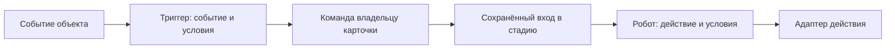

# План MVP: Lead, Deal и Funnel

Дата: 2026-10-18. Статус: проектирование, до реализации.

Документ описывает будущие backend, API и интерфейс Console. Наличие сценария,
таблицы или файла в плане не означает, что соответствующая возможность реализована.
Нормативные источники: [backend-архитектура](../architecture/backend.md),
[frontend-архитектура](../architecture/frontend.md).
Связанный контекст: [план Catalog](catalog.md).

Уточнение от 2026-10-18: Basket выделяется в самостоятельный агрегат CRM,
доступный через внутренние адаптеры. Модель, контракты и порядок внедрения
корзины описаны в разделе 4.3 этого же документа. Funnel, редактор стадий,
конфигурации триггеров/роботов и будущий runtime подробно раскрыты в разделах
4.5–4.6; автоматическое исполнение остаётся отдельным следующим этапом.

## 1. Цель и границы MVP

В CRM появляются два самостоятельных объекта:

- **Lead** — неподтверждённый контакт, заявка или обращение. Содержит контактные
  данные, название компании, contact_points и предварительную корзину.
- **Deal** — сделка, заказ или намерение приобрести товары и услуги. Содержит
  участников, корзину, валюту и сумму. Не управляет выполнением заказа,
  производством, доставкой или оказанием услуги.

Отдельный модуль **Funnel** задаёт воронки и последовательности стадий для внешних
объектов. В MVP он обслуживает `crm.lead` и `crm.deal`, не импортируя их внутренние
доменные модели. Каждая воронка отображается отдельным канбаном.

Basket — третий новый Aggregate Root CRM: общий механизм хранения перечня
намерений для Lead, Deal и будущих документов. Собственного HTTP API у него нет.

В обязательный объём входят:

1. Создание и редактирование лида с ручными данными либо выбором существующего
   **контакта**. Это уточнение пользователя заменяет исходную формулировку
   «привязка существующего лида».
2. Товары и услуги из Catalog и произвольные позиции без записи в Catalog.
3. Дополнительные данные отдельных позиций корзины.
4. Семь режимов конвертации лида в новые Contact, Company и Deal.
5. Несколько контактов и компаний в сделке.
6. Корзина, цены строк и итог сделки в одной валюте заказа.
7. Заглушка выбора валют с USD, EUR и UAH.
8. Хотя бы одна доступная воронка лида и одна сделки для каждого tenant.
9. Создание нескольких воронок каждого типа, редактор стадий и перемещение
   карточек между стадиями канбана.
10. Модель и редактор настроек триггеров и роботов каждой стадии.

В MVP не включаются операционное исполнение заказа, платежи, складские резервы,
доставка, налоги, скидки, валютная переоценка и автоматическое объединение дублей.

Фраза «заложить» триггеры и роботов трактуется как требование подготовить
конфигурацию, контракты и редактор. Запуск автоматизаций вынесен в отдельный этап.
В разделе 4.6 предложены правила будущего исполнения; начальные типы событий,
действий и их адаптеры ещё требуют утверждения. В MVP is_enabled=false, интерфейс
явно показывает, что настройки сохранены, а исполнитель не подключён.

## 2. Исходное состояние проекта

На момент подготовки плана:

- CRM уже содержит самостоятельные Contact и Company, их API и связь many-to-many.
- Общий модуль contact_points предоставляет телефоны, email и привязки по
  `model_key + record_id`. CRM уже использует его через Application port и adapter.
- Catalog предоставляет самостоятельные товары; интерфейс различает товар
  и услугу через существующий признак `virtual`.
- В проекте уже существуют reference_data, CurrencyVO, настройки валют tenant
  и пользователя, а также модуль курсов. Новая сделка не должна зависеть от
  текущей валюты отображения пользователя.
- Console написана на Vue 3 и TypeScript. Существующие CRM-страницы располагаются
  в `frontends/apps/console/src/modules/crm/`.
- Общий HTTP UoW и выбор tenant-схемы уже реализованы.

Следует расширять эти контракты, не создавать параллельные реализации контактов,
компаний, каталога или контактных данных. Если существующий пример противоречит
архитектурным правилам, приоритет имеет нормативный документ.

## 3. Применимые архитектурные требования

Оба актуальных архитектурных документа прочитаны полностью. Перечень ниже
применяется к backend, API, хранению и соответствующей frontend-документации.

Обязательный перечень для последующей реализации:

- Бизнес-модель определяется до таблиц. Lead, Deal и Basket — отдельные Aggregate Roots
  CRM; Funnel — отдельный bounded context с одним Aggregate Root.
- Структура CRM: `модуль / слой / aggregate_root / ответственность`.
  У модуля Funnel с единственным корнем нет повторяющейся папки `funnel`
  внутри каждого слоя.
- Domain не импортирует Application, Infrastructure, Presentation, SQLAlchemy,
  FastAPI или Pydantic. Application не импортирует Infrastructure.
- Каждый агрегат и внутренняя Entity имеют явные фабрики `create` и `restore`.
  Изменения выполняются только доменными методами.
- `__post_init__` разрешён только в Value Objects. Инварианты агрегата нельзя
  переносить в VO или persistence mapper ради обхода этого правила.
- Между самостоятельными агрегатами хранятся ID, а не ссылки на Python-объекты.
  Для внешних бизнес-решений используются специализированные snapshots.
- Basket получает собственный Domain Repository. Его позиции и стадии Funnel —
  внутренние Entity своих агрегатов без самостоятельных Domain Repository.
- Domain Repository возвращает агрегат. Query Repository находится в Application
  и возвращает проекции конкретных сценариев без восстановления агрегата
  только ради списка или карточки.
- У каждого сценария собственные Command/Query, Handler и Result DTO.
  Совпадающие поля разных use cases не заменяются универсальным DTO.
  Для сценария без результата используется `-> None`, без пустого DTO.
- Обработчики координируют порты и domain-методы. Общую orchestration можно
  выделять в Application services; обработчики одного модуля не вызывают друг друга.
- Взаимодействие CRM, Funnel, Catalog и contact_points проходит через Application
  ports и Infrastructure adapters, использующие публичные Application-контракты.
- Один атомарный процесс использует одну сессию общего внешнего UoW.
  Repository не вызывает commit/rollback, Application не получает AsyncSession.
- UoW открывается в Depends и завершается до успешного HTTP-ответа.
  Tenant определяется доверенным контекстом; клиент не передаёт имя SQL-схемы.
- Каждый HTTP endpoint имеет собственный controller-файл. Request и Response
  находятся в разных файлах соответствующего сценария. Для GET без тела
  нет фиктивного Request, для 204 нет пустого Response.
- Router регистрирует маршруты, схемы, статусы и зависимости. Depends собирает
  адаптеры на общей сессии. Контроллер явно преобразует DTO в Response.
- Аутентификация импортируется из Identity Presentation напрямую. Мутации
  используют действующие authentication/CSRF dependencies.
- Все методы имеют аннотации аргументов и результата, включая `__init__ -> None`
  и `Handler.execute`. Классы и методы имеют русские docstrings.
- Импорты идут из файлов определений; новые `__init__.py` пустые.
- Domain не логирует. В логах отсутствуют ФИО, телефоны, email и полные payload.
  Завершение handler не объявляется успешным commit.
- Если следующий этап добавит интеграционные события, запись Outbox выполняется
  в общей транзакции с изменением агрегата, доставка — после commit.

Дополнительные требования frontend:

- API/DTO/mappers, чистые модели форм, queries, mutations и page state разделены.
- Page собирает сценарий, UI получает типизированные props/emits и не импортирует
  HTTP client, DTO, router, stores или query cache.
- Данные сервера принадлежат TanStack Vue Query; черновик отделён от query,
  refetch не стирает ввод. Межмодульные импорты — через публичный index.ts.
- Query keys учитывают tenant/owner/фильтры; поздние ответы старого контекста
  игнорируются. Decimal не теряет точность, конфликты и pending явно отображаются.
- Для изменения только документации проверяются ссылки, согласованность и diff;
  сборка и browser QA требуются при последующей реализации UI.

Успешные функциональные тесты не заменяют отдельную проверку этого перечня.

## 4. Модель предметной области

### 4.1. Lead

Самостоятельный Aggregate Root в `crm/domain/lead/`.

| Данные | Назначение |
| --- | --- |
| `id`, `title` | Идентичность и название заявки для списка и канбана |
| `first_name`, `last_name`, `middle_name` | Необязательные части ФИО неподтверждённого контакта |
| `company_name` | Название компании, указанное в заявке |
| `contact_id` | Необязательная ссылка на выбранный существующий Contact |
| `company_id` | Необязательная ссылка на существующую Company |
| `basket` в read-проекции | Собственный Basket владельца `crm.lead`; валюта, строки и сумма берутся через внутренний порт |
| `funnel_positions` | Стадии лида в назначенных ему воронках |
| `conversion_result` | ID созданных объектов, выбранный режим и время конвертации |
| Audit | Время и автор создания/изменения |

Телефоны и email хранятся в contact_points с target `crm.lead`, а не дублируются
в собственных строковых колонках CRM.

Правила:

- Лид может быть неполным: отсутствие имени или компании не запрещает принять
  обращение. Название карточки обязательно; UI может предложить начальное значение.
- При выборе существующего контакта его ФИО и contact_points копируются в лид.
  Ссылка на контакт сохраняется. Позднейшее редактирование лида не меняет Contact.
- Снимок лида не обновляется автоматически при последующем изменении контакта.
- При конвертации в Contact имя обязательно; при конвертации в Company обязательно
  название компании. Остальные режимы не требуют неиспользуемых данных.
- Конвертация не удаляет исходный лид и его корзину. Результаты доступны из карточки.
- Предлагаемое поведение MVP: после конвертации лид становится доступным для чтения,
  а дальнейшая работа ведётся с результатами. Повторная конвертация не создаёт дублей.

Предполагаемые domain-методы: `create`, `restore`, `revise_details`,
`ensure_commercial_data_editable`, `move_in_funnel`, `ensure_convertible`,
`complete_conversion`. Изменение позиций делегируется агрегату Basket через
Application-сценарий владельца.

### 4.2. Deal

Самостоятельный Aggregate Root в `crm/domain/deal/`.

| Данные | Назначение |
| --- | --- |
| `id`, `title` | Идентичность и название сделки |
| `contact_ids` | Набор связанных контактов |
| `company_ids` | Набор связанных компаний |
| `basket`, `currency`, `total` в read-проекции | Данные самостоятельного Basket владельца `crm.deal`; не второе состояние Domain Deal |
| `source_lead_id` | Источник при создании из лида; необязателен для прямого создания |
| `funnel_positions` | Стадии сделки в её воронках |
| Audit | Время и автор создания/изменения |

Правила:

- В сделке допустимы несколько контактов и компаний, без повторения одной связи.
- Участники ссылаются только на объекты текущего tenant.
- Удаление участника из сделки удаляет связь, не сам Contact или Company.
- Корзина сделки независима от корзины исходного лида и текущих цен Catalog.
- Basket — единственный источник суммы и валюты заказа. Поле `total` нельзя
  независимо редактировать или дублировать как авторитетное состояние Deal.
- Воронка отражает коммерческий процесс; её стадии не создают складские,
  производственные или сервисные обязательства.
- Прямое создание сделки используется тем же интерфейсом, что и редактирование
  результата конвертации. Контакт или компания не обязательны для черновой сделки.

Предполагаемые domain-методы: `create`, `restore`, `revise_details`,
`ensure_commercial_data_editable`, `replace_participants`, `move_in_funnel`.
Расчёт и изменение строк выполняет Basket, а не Domain Deal.

### 4.3. Basket: внутренний агрегат перечня намерений

Уточнение пользователя имеет приоритет над первоначальной моделью встроенной
корзины. Basket теперь самостоятельный агрегат CRM. Ниже — его детализация;
отдельный документ или модуль для этого этапа не создаётся.

#### 4.3.1. Решение и назначение

**Basket** — самостоятельный Aggregate Root внутри CRM, отвечающий за перечень
товаров и услуг, которые рассматриваются в конкретном обращении или документе.
Написание в коде и контрактах — `Basket`; `backet` считается опечаткой.

Его используют Lead, Deal, а в дальнейшем счёт и другие объекты. В текущем MVP
реализуются только владельцы Lead и Deal; упоминание счёта не добавляет его создание
или бухгалтерские правила в объём работ.

Basket владеет позициями, их порядком, коммерческими снимками, дополнительными
данными, валютой и расчётом суммы. Он не управляет стадиями Lead/Deal, оплатой,
резервированием, исполнением услуг или содержимым Catalog.

Это отдельная граница согласованности внутри контекста CRM. Выделение нового
bounded context и самостоятельного модуля `basket` пока не требуется.

У Basket **нет собственного публичного HTTP API**, router или отдельной страницы.
Все пользовательские операции проходят через API объекта, которому он назначен.
Доменный агрегат при этом имеет методы создания и изменения: требование
«без публичных методов» трактуется как отсутствие внешних endpoints; доменное
поведение остаётся необходимой частью архитектуры.
Infrastructure adapters не заменяют domain-методы и не содержат бизнес-инварианты.

#### 4.3.2. Граница агрегата и связь с владельцем

```text
CRM
  Lead                 Deal                 Будущий счёт
     │                   │                       │
     └── владелец ────────┴───────────────────────┘
                         │
                         ▼
                    Basket
                      ├── BasketItem
                      ├── BasketItem
                      └── BasketItem
```

Каждый объект имеет **свою** корзину. Лид и сделка не разделяют изменяемый Basket,
даже если сделка создана из этого лида.

В MVP:

- Одна корзина на пару `(model_key, record_id)` внутри tenant.
- Владелец обязателен; бесхозная корзина не создаётся через прикладной контракт.
- При создании Lead/Deal в том же UoW создаётся его Basket, в том числе пустой.
- `BasketOwnerVO` содержит стабильный model_key и EntityIdVO записи владельца.
- Начальные ключи — `crm.lead` и `crm.deal`. Ключ будущего счёта регистрирует
  его модуль при подключении; Basket не импортирует Invoice Aggregate.
- Basket хранит владельца. В Lead/Deal не добавляется вторая дублирующая связь
  `basket_id`; этот ID можно возвращать в проекции карточки.
- Владелец и Basket не содержат друг друга как Python-объекты.
- Перепривязка существующей корзины другому владельцу в MVP отсутствует.

BasketItem — внутренняя Entity Basket. Его нельзя загружать или сохранять
через самостоятельный Domain Repository.

##### Аналогия с contact_points

Перенимаются адресация через model_key/record_id, owner-specific ports/adapters,
сборка на общей сессии и отсутствие прямого доступа потребителя к SQL расширения.

У contact_points значения могут переиспользоваться через разные bindings.
У Basket другие правила: даже совпадающие позиции принадлежат разным корзинам.
Глобального справочника BasketItem и дедупликации по Catalog ID нет. Отдельная
таблица basket bindings при одной корзине на владельца также не нужна.

#### 4.3.3. Данные Basket и BasketItem

##### Basket

| Поле | Смысл |
| --- | --- |
| `id` | BasketIdVO, собственная идентичность агрегата |
| `owner` | BasketOwnerVO с model_key и record_id |
| `currency` | Единая валюта цен и итогов корзины |
| `items` | Упорядоченные внутренние BasketItem |
| `total` | Сумма строк, вычисляемая агрегатом |
| `state` | `editable` или `frozen`; защита коммерческого снимка |
| `source_basket_id` | Необязательная ссылка на источник при копировании |
| `revision` | Версия корзины для обнаружения устаревшего редактирования |
| Audit | Время и автор создания/изменения |

##### BasketItem

| Поле | Смысл |
| --- | --- |
| `id` | BasketItemIdVO; уникальная строка внутри корзины |
| `position` | Порядок отображения |
| `kind` | Товар или услуга |
| `catalog_item_id` | Необязательная ссылка на CatalogItem |
| `name`, `sku` | Снимки названия и артикула на момент добавления |
| `quantity`, `unit` | Количество и единица измерения |
| `unit_price` | Цена за единицу в валюте Basket |
| `line_total` | Рассчитанная стоимость строки |
| `custom_fields` | Дополнительные данные конкретного намерения |

Один CatalogItem допускается в нескольких строках одной корзины: параметры,
комментарии, количество и договорная цена могут различаться. Совпадение Catalog ID
не означает автоматического объединения строк. Дублирование item ID запрещено.

Ручная позиция имеет `catalog_item_id = null`, но сохраняет тип, название и остальные
данные. Она не создаёт запись Catalog автоматически. Изменение полей позиции
не меняет CatalogItem. Удаление или архивирование товара не уничтожает ранее
сохранённый коммерческий снимок.

При добавлении каталожной позиции тип/название/артикул берутся из разрешённой
Application-проекции Catalog на выбранной locale; изменения снимка оператором
передаются явно. Locale нужна для получения исходного текста, но не делает
корзину динамическим представлением текущего перевода Catalog.

Произвольные поля первой версии — строки «ключ — значение». Они принадлежат
позиции Basket, а не атрибутам Catalog. Типизированный конструктор полей отложен.

#### 4.3.4. Инварианты и ответственность

Basket проверяет:

1. Принадлежность всех переданных item ID этой корзине и отсутствие повторов.
2. Непрерывный порядок строк; перестановка сохраняет item ID.
3. Положительное конечное количество и неотрицательную конечную цену.
4. Одну валюту всех строк; точные Decimal и согласованную точность.
5. Сумму каждой строки и общий итог; клиент не задаёт вычисляемые суммы.
6. Уникальность ключей дополнительных полей и согласованные ограничения размера.
7. Запрет изменения frozen-корзины, включая очистку и смену валюты.
8. Запрет смены владельца; копирование создаёт новый Basket.

Owner Aggregate проверяет право изменения коммерческой части в своём состоянии.
Например, конвертированный Lead может запрещать изменение корзины. Такие правила
не кодируются в Basket через `if owner.model_key == 'crm.lead'`.

Application проверяет внешние ссылки через ports, получает время/ID, координирует
repositories. Persistence mapper только преобразует сохранённое представление.
Уникальность корзины владельца дополнительно защищена ограничением БД.

Публичные внутри Domain методы: `create`, `restore`, `replace_items`,
`freeze`, `calculate_total`, фабрика создания копии по проверенному снимку.
Добавление/изменение/удаление отдельных строк в UI в MVP сохраняется как замена
полного набора, а не требует отдельных HTTP методов или item repositories.

В `replace_items` существующие строки передаются с ID, новые — без ID во входном
Application-контракте и получают серверные ID. Пропущенная строка удаляется.
Передача чужого ID отклоняется; очистка — явный пустой список.

Весь кандидат проверяется до принятия состояния: неверная последняя строка
не оставляет первые строки частично изменёнными.

##### Деньги и источник истины

Basket — единственный источник валюты, цен и расчёта итогов. Lead/Deal возвращают
их через свои read-проекции; отдельного независимо редактируемого `Deal.total`
или второго вычисления по таблицам Lead/Deal нет.

В MVP сохраняются правила общего плана: USD/EUR/UAH, Decimal, округление строки
до двух знаков `ROUND_HALF_UP`, итог как сумма округлённых строк. Цена задаётся
явно; цена 0 — именно нулевая цена. Поддержку «цена ещё неизвестна» нужно вводить
отдельным состоянием, а не маскировать нулём; в текущий срез она не добавляется.

В API деньги передаются десятичными строками. Валюта пользователя не меняет
корзину. Обновление непустой корзины с новой валютой передаёт полный пересмотренный
набор цен одним действием; автоматической конвертации валют нет.

Если позже счёт потребует обязательную непустую корзину, реквизиты или налоговые
правила, это проверяет сценарий счёта по immutable коммерческому snapshot.
Доменный Basket не приобретает правила бухгалтерского документа.

#### 4.3.5. Внутренние порты, адаптеры и сценарии

Путь записи:

```text
HTTP Lead/Deal
  → Application-сценарий владельца
  → OwnerBasketPort
  → OwnerBasketAdapter
  → BasketApplicationService
  → BasketRepository.get_for_update
  → Basket domain methods
  → BasketRepository.save
```

Путь чтения карточки использует owner-specific read port, Basket Query Repository
и проекцию. Агрегат не восстанавливается для отображения. При batch-чтении канбана
суммы нескольких корзин получаются одним пакетным запросом, без N+1.

- Application владельца зависит от порта, а не от конкретного адаптера.
- Адаптер связывается с фиксированным model_key во внешней сборке. Клиент API
  Lead не может передать `model_key=crm.deal` или произвольный Basket ID.
- Порт предоставляет только необходимые сценарии: create, get, replace, freeze,
  copy и remove для явного жизненного цикла владельца.
- Adapter преобразует owner-specific входы/результаты и вызывает Basket Application
  service; он не считает суммы, не меняет ORM и не проверяет domain-инварианты.
- Чтобы не строить цепочку handler → handler внутри CRM, общая orchestration Basket
  размещается в Application service. Внутренние Basket handlers делегируют ему;
  адаптер владельца использует тот же service, не вызывает Basket handler из
  Lead/Deal handler.
- Внешний потребитель из другого модуля объявляет собственный порт, реализует
  адаптер к Application-контрактам Basket и собирает его на общем UoW.
- Basket не вызывает ContactPointsAdapter и не использует его Repository:
  аналогия относится к способу интеграции, а не к совместному хранению.

##### Сценарии Basket

Все команды имеют tenant/actor context; внутреннее использование не отменяет
проверку принадлежности и существования владельца в вызывающем сценарии.

| Use case | Вход | Конкретный результат |
| --- | --- | --- |
| `CreateBasket` | Проверенный owner, currency, начальные позиции | `CreateBasketResultDTO`: basket_id, revision, currency, total |
| `GetOwnerBasket` | Проверенный owner | `GetOwnerBasketResultDTO`: детали корзины и её собственные item projections |
| `GetOwnersBasketSummaries` | Набор owner одного tenant | `GetOwnersBasketSummariesResultDTO`: owner, basket_id, revision, currency, total |
| `ReplaceBasketItems` | Owner, expected_revision, полный список строк; при смене валюты — новая currency | `ReplaceBasketItemsResultDTO`: basket_id, новая revision, currency, total и соответствие новых строк |
| `CopyBasket` | Source owner, target owner, expected source revision | `CopyBasketResultDTO`: новый basket_id, revision, currency, total |
| `FreezeBasket` | Owner, expected_revision | `FreezeBasketResultDTO`: basket_id, revision, state |
| `RemoveOwnerBasket` | Проверенный удаляемый owner | `-> None`; пустой DTO не нужен |

Create не является upsert: вторая корзина владельца даёт конфликт. Для удаления
владельца RemoveOwnerBasket допускает уже отсутствующую корзину и выполняется
в той же транзакции; самостоятельного пользовательского удаления Basket нет.
Frozen-корзина не удаляется командой редактирования. Уничтожение истории регулирует
жизненный цикл владельца; физическое удаление финансовых документов сюда не входит.

GetOwnerBasket не создаёт отсутствующую корзину побочным эффектом. В MVP корзина
создаётся вместе с новым владельцем, поэтому её отсутствие у существующей Lead/Deal
считается нарушением целостности, а не пустым массивом по умолчанию.

Replace возвращает item ID новых строк с корреляцией по уникальному `client_line_key`
запроса; он нужен для сопоставления ответа с черновиком и не заменяет серверный ID.
При запросе без фактических изменений revision/audit не увеличиваются.

Copy не переносит item ID, owner, frozen-state или revision источника. Цель получает
новые ID, revision=1 и editable-состояние, прежнюю валюту и точные значения строк.
`source_basket_id` — происхождение, а не живая синхронизация.

##### Результаты и транспорт

Это внутренние Application Command/Query и DTO, а не HTTP endpoints Basket.
Для каждого сценария фиксируются свои `command.py`/`query.py`, `handler.py` и
`dto.py` при результате. Результат `None` не получает `dto.py`.

Бизнес-операции владельца включают корзину в собственный контракт:
CreateLead/CreateDeal создают Basket; UpdateLead/UpdateDeal заменяют явно
переданную корзину; GetLead/GetDeal возвращают проекцию; ConvertLead копирует её.
Неизвестный owner type, чужой item ID или устаревшая revision отклоняются.

HTTP DTO владельца не подменяются общим BasketDTO. Вложенные поля явно собираются
в Response соответствующего сценария. Для expected_revision conflict владелец
возвращает 409; ошибку содержимого строк переводит в полевые ошибки его формы.

В запросах CreateLead/CreateDeal корзина задаётся блоком `basket` с currency и items.
В PATCH отсутствие блока сохраняет корзину; переданный блок содержит
expected_revision и полный набор items. Пустой items очищает корзину, `basket=null`
отклоняется. Корзина отсутствующей валюты не сохраняется; при создании пустой
корзины предлагается валюта tenant, если она входит в MVP-allowlist, иначе UI
требует явного выбора. Скрытого назначения USD или UAH нет.

Ответ UpdateLead/UpdateDeal при изменении корзины содержит подтверждённую revision,
currency, total и соответствие client_line_key → item ID. Каждый метод имеет
собственную вложенную транспортную схему. После создания карточка может загрузить
полный GetLead/GetDeal для продолжения редактирования.

Копирование загружает исходный агрегат под блокировкой для domain-решения,
формирует immutable коммерческий snapshot и создаёт новую корзину через фабрику.
Query DTO не передаётся в Domain как Entity или подмена snapshot.

#### 4.3.6. Транзакции, жизненный цикл и конкурентность

Каждая мутация сначала блокирует Owner Aggregate, проверяет допустимость действия,
затем блокирует Basket и сверяет expected_revision. Порядок «владелец → корзина»
одинаков для всех путей записи. Внутренние Basket service/adapter не открывают UoW.

При работе с несколькими существующими владельцами применяется общий стабильный
порядок их блокировок; порядок корзин следует порядку владельцев. В конвертации
источник существующий, целевые объекты создаются в текущей транзакции.

Замена полного набора требует expected_revision, поскольку без неё блокировка
лишь сериализует устаревшие запросы и не предотвращает потерю чужого редактирования.
Версия Basket независима от изменения стадии или названия владельца.
Read-only GET использует согласованную проекцию без изменяющих блокировок.
Заголовок, revision, позиции и сумма одной read-проекции читаются одним SQL
statement либо в согласованном snapshot, чтобы ответ не смешивал разные версии.

При создании из Lead:

1. ConvertLead блокирует и проверяет Lead и исходную Basket.
2. Создаёт выбранные Contact/Company/Deal и связи.
3. Для Deal выполняет CopyBasket в **новую** корзину целевого владельца.
   Обычный путь CreateDeal с автоматической пустой корзиной не вызывается повторно.
4. Сохраняет результат конвертации Lead. При принятом read-only режиме Lead
   замораживает его исходную корзину в той же транзакции.
5. Один внешний UoW фиксирует все изменения, включая обе корзины и contact_points.

При конвертации без Deal копия не создаётся. Сбой любого шага откатывает корзины
и остальные результаты. Повтор по ключу идемпотентности ConvertLead возвращает
уже созданные объекты, не запускает повторное CopyBasket.

Завершение Deal → счёт в будущем использует такое же независимое копирование.
Изменения исходной Deal не должны переписывать выставленный счёт. Момент
заморозки корзины счёта определяет его собственный сценарий.

#### 4.3.7. Хранение и файлы

Две tenant-таблицы:

- `crm_baskets`: ID, owner_model_key, owner_record_id, currency, state, total,
  source_basket_id, revision, audit.
- `crm_basket_items`: ID, basket_id, position, catalog reference, снимки,
  quantity/unit, unit_price/line_total, custom_fields.

`UNIQUE(owner_model_key, owner_record_id)` защищает одну корзину владельца;
`UNIQUE(basket_id, position)` — порядок. При перестановке SQL-адаптер должен
учитывать промежуточные коллизии индексов. BasketItem FK ведёт на Basket.
Деньги — numeric, параметры — ограниченный JSON/string-набор.

Полиморфный owner не обеспечивается обычным FK на несколько таблиц. Поэтому
проверку и блокировку существования владельца выполняет доверенный сценарий
владельца в той же транзакции. Синтаксически корректного model_key недостаточно.
Внутренний контракт не предоставляет обходного пути создания произвольного owner.
Все пути удаления владельца должны вызывать очистку корзины или согласованное
сохранение истории; удаления только строки владельца через Repository недостаточно.

Ссылка Catalog не должна каскадно удалять позиции. `source_basket_id` сохраняет
происхождение, но не блокирует согласованную очистку источника: политика FK
при удалении источника допускает SET NULL, если хранение ссылки не обязательно.
Ни одна SQL-модель Basket не выходит во внутренние контракты потребителей.

```text
src/modules/crm/
  domain/basket/
    aggregate.py
    entity/item.py
    value_object/identifier.py
    value_object/item_identifier.py
    value_object/owner.py
    value_object/quantity.py
    value_object/item_snapshot.py
    value_object/custom_fields.py
    error.py
    repository.py
  application/basket/
    command/<scenario>/command.py, handler.py, dto.py при результате
    query/<scenario>/query.py, handler.py, dto.py
    service/basket.py
    port/query_repository.py
    port/catalog_selection.py
    port/currency_catalog.py
  application/lead/port/basket.py
  application/deal/port/basket.py
  infrastructure/basket/
    persistence/mapper.py
    persistence/repository.py
    persistence/query_mapper.py
    persistence/query_repository.py
    adapter/catalog_selection.py
    adapter/currency_catalog.py
  infrastructure/lead/adapter/basket.py
  infrastructure/deal/adapter/basket.py
  infrastructure/persistence/models/basket.py
  infrastructure/persistence/models/basket_item.py
  presentation/depends/basket.py
```

Создаются только реально нужные определения. Денежные VO переиспользуются из
Shared, если соответствуют правилам; собственный CurrencyVO с другим смыслом
не дублируется. Reference_data проверяется через Application-контракты,
MVP-allowlist USD/EUR/UAH задаётся заменяемым адаптером политики доступных валют.
Порты времени/ID — существующие Shared-контракты.

`presentation/depends/basket.py` — только внешняя сборка зависимостей общего UoW.
У Basket нет `presentation/basket/router.py`, controllers, Request или Response.
Все новые методы полностью типизированы, документированы; фабрики явные,
`__post_init__` только в VO; package `__init__.py` пустые.

#### 4.3.8. Frontend без отдельного API Basket

Редактор корзины находится в CRM и принимает типизированные draft props/emits.
Он не знает owner model_key, Axios, DTO, router, stores и query cache.
При необходимости другой модуль использует его через публичный `crm/index.ts`,
без глубокого импорта внутренних composables CRM.

- API, request/response DTO и mappers остаются в соответствующих Lead/Deal сценариях.
- Frontend BasketDraft/BasketItemDraft — чистые модели формы, не HTTP DTO.
- Черновик и ошибки живут у формы/оркестратора; mutation сохраняет snapshot запроса.
- Page собирает queries, mutations и UI. UI передаёт действие наверх через emits.
- Queries и mutations используют общий HTTP provider; отдельного basket client нет.
- Refetch не стирает черновик. Подтверждённый ответ сопоставляет строки по
  client_line_key и очищает только отправленные изменения, сохраняя новый ввод.
- После записи обновляются detail и затронутые list/kanban summaries владельца.
- Query keys включают tenant и ID владельца; revision хранится с серверной проекцией,
  а не в отдельном глобальном store Basket.
- Конфликт revision показывает возможность загрузить актуальную корзину и сравнить
  изменения; молчаливое перезаписывание или автоповтор полного набора запрещены.
- Decimal остаётся строковым/точным значением; итог backend авторитетен.
- При смене tenant/session отменяются запросы и очищается связанный черновик.

Предполагаемые UI: BasketEditor, BasketItems, BasketItemForm и BasketTotals
внутри `crm/ui/basket/`. Не создаются отдельные BasketPage, route или меню.

#### 4.3.9. Проверки и порядок внедрения

1. Зафиксировать Basket Aggregate и owner contract; убрать позиции и расчёт
   из Domain Lead/Deal и их отдельных item repositories в общем плане.
2. Описать внутренние Command/Query, конкретные DTO, ports/adapters и общий UoW.
3. Спроектировать таблицы и миграцию. Если к началу реализации появились данные
   старой модели, предусмотреть перенос без потери ID владельцев и денежных снимков.
4. Подключить Create/Update/Get/List Lead/Deal и batch-суммы канбана.
5. Подключить CopyBasket к семи режимам конвертации.
6. Подключить редактор формы и обработку conflicts без отдельного Basket API.

Критерии приёмки реализации:

- Basket действительно самостоятельный Aggregate Root, позиции принадлежат ему.
- Нет публичных Basket endpoints и способов обойти проверку состояния владельца.
- Нет прямых обращений потребителя к SQL Basket или Catalog.
- Две корзины владельца, чужие item ID и устаревшая revision отклоняются.
- Один CatalogItem может иметь несколько независимых строк с разными параметрами.
- Суммы и округление корректны, изменение Catalog не меняет снимки.
- Копирование создаёт новые basket/item ID; редактирование копии не меняет источник.
- Frozen-корзина не меняется; будущие правила счёта не просачиваются в Basket.
- Create/Convert/Remove владельца и его Basket используют одну транзакцию,
  проверены rollback, повторы, гонки и два tenant.
- Чтение канбана использует batch-проекции; нет скрытой записи через GET.
- По diff проверены архитектурные границы, create/restore, типизация, DTO,
  отсутствие handler chains, поведение Repository/mapper и общая сессия.
- Frontend проверен на сохранность ввода, item ID correlation, revision conflict,
  точные деньги и смену tenant; выполнены применимые lint/typecheck/build и UI QA.

Для текущего изменения только документации проверяются ссылки, согласованность
с общим планом и diff. Исполнение сценариев, миграции и UI-тесты не заявляются
выполненными до реализации.

### 4.4. Деньги и валюты

Для выбора валют реализуется заменяемая статическая заглушка с тремя значениями:

| Код | Название | Денежная точность |
| --- | --- | --- |
| USD | Доллар США | 2 знака |
| EUR | Евро | 2 знака |
| UAH | Украинская гривна | 2 знака |

Один и тот же Application port используется списком валют в UI и проверкой
записи заказа. Проверка только на frontend недостаточна.

Предлагаемая граница заглушки — доступные валюты CRM. Существующий глобальный
reference_data и настройки других модулей автоматически не сокращаются:
в проекте они уже обслуживают более широкий справочник. Его sync-проверка
ожидает минимум 150 валют, поэтому передача в неё трёх записей без отдельного
решения была бы ошибкой. Если требуется именно глобальное сокращение,
это отдельное уточнение объёма перед реализацией.

Правила расчёта:

- Числа передаются в API десятичными строками, вычисляются через Decimal,
  хранятся в точных SQL numeric-полях. Float не используется для сохранения денег.
- Количество строго положительно, цена неотрицательна, NaN/Infinity отклоняются.
- `line_total = round(quantity × unit_price, 2)`;
  `deal_total = sum(line_total)` с согласованным округлением `ROUND_HALF_UP`.
- Нулевая сумма и пустая корзина допустимы для незаполненного намерения покупки.
- Если заказ оформлен в USD, цены строк и итог сохраняются в USD.
- Валюта отображения пользователя и курсы не меняют сохранённые суммы заказа.
- Цена Catalog не считается автоматически выраженной в валюте заказа. При
  несовпадении или отсутствии подтверждённой валюты оператор вводит цену явно.
- Смена валюты непустой корзины требует явного пересмотра цен и сохранения
  нового набора строк одной операцией; простая замена подписи валюты недопустима.
- Конвертация лида в сделку сохраняет валюту и точные цены его корзины.

### 4.5. Funnel: определение процесса и стадии

#### 4.5.1. Ответственность и границы

Funnel — отдельный модуль с одним Aggregate Root Funnel в MVP. Он описывает
процесс для одного типа внешних объектов: название, стадии, их порядок,
настройки триггеров и роботов. Lead/Deal не становятся внутренними Entity Funnel.

| Ответственность | Владелец |
| --- | --- |
| Определение воронки, стадии, конфигурации правил | Funnel |
| Допустимость изменения конкретной карточки | Domain Lead/Deal |
| Назначенные воронки и текущая стадия в каждой | Lead/Deal |
| Корзина, валюта, коммерческий итог | Basket |
| Доступ пользователя и доверенный контекст | Identity и сценарий потребителя |
| Запуск действий, попытки и результаты | Будущий исполнитель автоматизаций, вне MVP |

Funnel не читает SQL CRM, не меняет поля Lead/Deal, не рассчитывает Basket и не
объявляет заказ выполненным. Общие правила процесса проверяет Funnel; доменные
ограничения объекта проверяются его владельцем через собственный сценарий.
Например, попадание в колонку «Выиграна» само по себе не создаёт платёж или счёт.

Редактор Funnel имеет публичный HTTP API для управления определением процесса.
Назначение карточки и перемещение — публичные операции Lead/Deal, использующие
внутренний Application-контракт Funnel. Ограничение Basket на отсутствие
собственного HTTP API на редактор Funnel не переносится.

#### 4.5.2. Модель агрегата

| Поле Funnel | Смысл |
| --- | --- |
| `id` | FunnelIdVO, самостоятельная идентичность |
| `model_key` | Тип обслуживаемого объекта: в MVP `crm.lead` или `crm.deal` |
| `name` | Название для выбора воронки и редактора |
| `is_default` | Начальная воронка этого типа для tenant |
| `stages` | Полное упорядоченное определение Stage |
| `revision` | Версия сохранённого определения для конкурентного редактирования |
| Audit | Время и автор создания/изменения |

Stage — внутренняя Entity Funnel:

| Поле Stage | Смысл |
| --- | --- |
| `id` | StageIdVO; сохраняется при переименовании и перестановке |
| `name` | Название колонки канбана |
| `position` | Индекс отображения от 0 |
| `color` | Необязательный токен из ограниченной палитры, без свободного CSS |
| `triggers` | Упорядоченные TriggerConfiguration данной стадии |
| `robots` | Упорядоченные RobotConfiguration данной стадии |

TriggerConfiguration и RobotConfiguration — разные внутренние Entity со
стабильными ID. Их параметры, условия и ссылки описываются immutable VO.
Одинаковые технические поля не требуют универсальной Entity «любая автоматизация».
Stage и конфигурации не имеют самостоятельных Domain Repository.

Модель обращается к другим агрегатам через ID и согласованные snapshots.
Funnel не содержит Contact, Deal, Basket или исполняемые объекты провайдеров.

#### 4.5.3. Инварианты определения

- Один Funnel обслуживает один model_key. Тип нельзя изменить после создания.
- Имена воронки и стадий непустые, нормализуются и ограничиваются согласованной
  длиной. Совпадение названий не объединяет их идентичности; UI предупреждает
  о трудноразличимых названиях стадий, но ссылки используют только ID.
- Есть хотя бы одна Stage. Индексы стадий образуют последовательность от 0
  без пропусков и повторов; индексы правил проверяются отдельно в своих списках.
- Stage ID уникальны в агрегате. Чужая стадия не может быть вставлена как своя.
- ID триггеров/роботов уникальны и принадлежат соответствующему списку Stage.
  Нельзя передать ID робота как триггер или незаметно перенести правило на другую
  стадию. Копирование правила на другую стадию создаёт новый ID.
- Ограничены размеры определения, число стадий/правил, глубина условий и объём
  параметров. Конкретные пределы фиксируются перед реализацией и совпадают в API/UI.
- Переименование, изменение цвета и перестановка не меняют stage/rule ID.
- В MVP сохранённые стадии не удаляются и не архивируются. Непереданный сохранённый
  Stage ID при полной замене определения даёт 422, а не удаляет колонку.
- Несохранённую новую стадию можно удалить из черновика. Правила можно удалять
  из конфигурации; в MVP у них ещё нет запущенных исполнений.
- `is_default` не задаётся произвольным PUT редактора. Его устанавливает bootstrap;
  переключение default воронки потребует отдельного согласованного сценария.

Фабрики `create/restore` проверяют собственные инварианты агрегата и Entity.
Методы Funnel: `replace_process`, `ensure_model_supported`, `select_stage`.
Внутренние методы Stage обновляют её имя/порядок/правила под управлением Funnel.
Application не присваивает состояние напрямую; mapper не исправляет плохую
конфигурацию и не переносит к себе проверки принадлежности ID.

#### 4.5.4. Последовательность и переходы

Индекс Stage задаёт порядок колонок, а не обязательный маршрут. В MVP оператор
может перемещать карточку в любую стадию уже назначенной воронки, если владелец
карточки разрешает изменение. Граф допустимых переходов, обязательные поля
отдельной стадии и ветвления пока не вводятся.

Названия «Квалифицирован», «Выиграна», «Проиграна» не являются системными enum.
Из имени нельзя выводить успех, отказ, право редактирования или конвертацию.
Конвертация Lead — отдельный сценарий, а не неявное действие смены колонки.

При назначении без Stage ID выбирается первая стадия текущего определения.
При явно указанном Stage ID проверяется его принадлежность выбранному Funnel.
Перестановка стадий влияет на начальную стадию **будущих** назначений, но не
перемещает уже существующие карточки. Редактор показывает это предупреждение.

#### 4.5.5. Назначение и текущая позиция карточки

У одного типа объекта доступно много воронок. Рабочее предложение плана — одна
карточка может участвовать в нескольких одновременно; это допущение остаётся
на подтверждение в разделе 12. В каждой воронке позиция независима.

При создании без явного списка выбирается default-воронка типа объекта.
При явном выборе назначаются только выбранные процессы; default не добавляется
скрыто. Новая позиция начинается с position_revision=1.

Позиция внутри Lead/Deal содержит:

- Funnel ID и Stage ID.
- `position_revision`, увеличиваемую только при реальном изменении этой позиции.
- Время и автора последнего назначения/перемещения.

Это внутреннее состояние владельца, не отдельный Aggregate Root Funnel и не
папка объектов CRM внутри Funnel. Уникальность пары `(record_id, funnel_id)`
защищена в таблице назначений владельца. Tenant определяется его схемой.

AssignLeadFunnel/AssignDealFunnel проверяют тип объекта и назначают первую стадию.
Повтор назначения уже присутствующей воронки возвращает существующую позицию,
не сбрасывая карточку в начало. Assign не используется для перемещения.

MoveLead/MoveDeal принимают Funnel ID, Stage ID и `expected_position_revision`.
Проверяется наличие назначения. Запрос не создаёт членство скрытым побочным
эффектом. Устаревшая revision даёт 409; повтор текущего значения с актуальной
revision — no-op без нового audit и будущего события входа.

Перемещение затрагивает только одну позицию. Не меняются остальные воронки,
Basket revision, строки корзины или связанные Contact/Company.
Ручной порядок карточек внутри колонки в MVP не сохраняется: используется
оговорённая стабильная сортировка по времени изменения позиции и ID.

#### 4.5.6. Внутренняя интеграция и транзакция перемещения

```text
HTTP MoveLead / MoveDeal
  → Handler владельца: загрузить и заблокировать Lead/Deal
  → Domain владельца: проверить допустимость изменения
  → FunnelPort → adapter → ResolveFunnelStage
  → Funnel Repository: согласованное определение процесса
  → Domain Funnel: проверить model_key и Stage ID
  → DTO с проверенными ID и revision определения
  → Domain Lead/Deal: изменить свою позицию
  → Repository владельца → commit общего внешнего UoW
```

ResolveFunnelStage — внутренний Query для domain-решения, поэтому восстановление
Funnel здесь обосновано. Карточки редактора и списки читаются Query Repository
через проекции, без восстановления агрегата.

Все адаптеры получают общую сессию текущего UoW, не открывают вложенные транзакции
и не выполняют commit. У записи определения одна изменяющая блокировка Funnel;
у перемещения — блокировка владельца и совместимая читающая блокировка Funnel.
Редактор не блокирует Lead/Deal, поэтому обратного пути «Funnel → карточка» нет.
Порядок для нескольких процессов/карточек должен быть одинаково определён.

Изменение определения не выполняет массовую запись карточек. Сохранённые ID стадий
не исчезают, поэтому переименование/перестановка безопасны для назначений.
Сбой проверки процесса или commit откатывает позицию и не считается успехом API.

#### 4.5.7. Default-воронки и дальнейший жизненный цикл

Tenant-миграция создаёт default Lead Funnel и default Deal Funnel с начальными
стадиями из раздела 8.2. Их revision начинается с 1; триггеры и роботы пустые.
Чтение не выполняет bootstrap. Пользовательские воронки создаются без default-флага.

Удаление воронок, архивирование и перенос карточек из удаляемой Stage отложены.
Для их будущего добавления понадобится отдельный Application port использования
воронки, согласованная защита от гонок и явная политика сохранения истории.
Нельзя реализовать удаление как CASCADE, уничтожающий назначения CRM.

### 4.6. Редактор процесса, триггеры и роботы

#### 4.6.1. Граница MVP и следующего этапа

В этой версии проектируются и впоследствии реализуются определение процесса,
редактор, валидация, сохранение и повторное чтение конфигураций. Исполнитель
автоматизаций не входит в MVP. Все разделы ниже о запуске, очередях и попытках
являются **планом следующего этапа**, а не обещанием работающих действий MVP.

| Возможность | MVP конфигурации | Следующий этап исполнения |
| --- | --- | --- |
| Редактирование стадий, триггеров и роботов | Да | Сохраняется |
| Проверка поддерживаемого типа и схемы параметров | Да | Дополняется доступностью адаптера/подключения |
| Preview порядка стадий и настроек без побочных эффектов | Да, локально в редакторе | Возможна отдельная симуляция событий |
| Автоматическая реакция на событие | Нет | После подключения конкретного источника |
| Выполнение действия робота | Нет | Через согласованный action adapter |
| Планировщик, задержки и retries | Нет | После определения runtime-сценариев |
| Журнал выполнения и ручной retry | Нет | Отдельные use cases и UI |
| Серверный draft, публикация версий, откат процесса | Нет | При появлении самостоятельной потребности |

В MVP один текущий сохранённый процесс с revision; черновик живёт в редакторе.
Сохранение сразу меняет определение для канбана. Оно не перемещает карточки,
не запускает правила и не воспроизводит прошлые события.

#### 4.6.2. Смысл триггера и робота

**Триггер** реагирует на событие и условия. Предлагаемая первая семантика для
будущего runtime: триггер, настроенный на стадии S, запрашивает перевод подходящей
карточки в S. Он не выполняет произвольный набор внешних действий.

**Робот** выполняет конкретное действие. Предлагаемая первая точка активации —
подтверждённый вход карточки в стадию, на которой он настроен. Условия робота
определяют, требуется ли действие при этом входе.

Пример будущего поведения: «получено сообщение → триггер запросил переход
в “В работе” → после сохранения перехода робот создал задачу». Названия событий,
интеграция сообщений и модуль задач здесь иллюстративны; их исполнителей ещё нет.



Диаграмма описывает будущий runtime. В MVP сохраняются только определения T и R.
Первичное назначение воронки в будущем считается отдельным входом; переход
в уже текущую стадию и изменение определения не создают повторного входа.
Повторный реальный выход и возврат в стадию создаёт новый вход с новым ID.
Реакции на выход из стадии, произвольные расписания и цепочки роботов отложены.

Триггер не обязателен для ручного перехода. Робот не определяет принадлежность
карточки стадии и не меняет определение Funnel.

#### 4.6.3. Модель TriggerConfiguration

| Поле | Смысл |
| --- | --- |
| `id` | TriggerIdVO; идентичность настройки |
| `name`, `position` | Название и приоритет среди триггеров стадии |
| `type_code`, `config_version` | Поддерживаемый тип реакции и версия его конфигурации |
| `parameters` | Типизированные параметры выбранного типа |
| `conditions` | Ограниченный набор условий на событие и доступный snapshot карточки |
| `is_enabled` | Намерение включения; в MVP false и недоступно для активации |

Целевая Stage определяется вложенностью, поэтому не дублируется изменяемым
`target_stage_id` внутри parameters. Идентификаторы события и карточки не являются
постоянными параметрами: они приходят в контексте конкретного исполнения.

Если понадобятся ограничения исходной стадии, они задаются структурированным
условием с проверенными ID того же Funnel. Они не превращаются в SQL-условия,
произвольные выражения или скрытую интерпретацию индекса Stage.

Будущий триггер относится только к адресованной карточке текущего tenant и её
назначенным воронкам. Самостоятельное создание карточки или назначение новой
воронки по внешнему событию потребует отдельного явно разрешённого сценария.

#### 4.6.4. Модель RobotConfiguration

| Поле | Смысл |
| --- | --- |
| `id` | RobotIdVO; идентичность настройки |
| `name`, `position` | Название и порядок действий стадии |
| `type_code`, `config_version` | Тип действия и версия его конфигурации |
| `parameters` | Типизированные параметры действия |
| `conditions` | Условия выполнения для конкретного входа в стадию |
| `is_enabled` | В MVP false; сохранённая настройка не считается запущенной |

Вход в стадию — фиксированная точка активации первой будущей версии runtime,
а не произвольный строковый cron в parameters. Первые роботы предполагаются
немедленными и последовательными в порядке position. Отложенные действия,
параллельные ветки, ссылки на результат предыдущего робота и остановка цепочки
по сложным выражениям проектируются отдельно.

Один и тот же тип робота может быть добавлен несколько раз с разными параметрами.
При копировании настройки в UI создаётся новая идентичность, а не ссылка на
общий изменяемый RobotConfiguration.

#### 4.6.5. Каталог типов и проверка конфигураций

Frontend не придумывает type_code и поля произвольным JSON-редактором.
Backend предоставляет read-only каталог типов конфигурации, отдельно для
триггеров и роботов, с фильтром по model_key.

Метаданные типа содержат kind, стабильный code, config_version, название,
описание, поддерживаемые model_key, схему parameters, доступные условия и
`execution_available`. Схема ограничена описанием формы: типы полей, обязательность,
enum и разрешённые ссылки. Она не содержит исполняемые скрипты, Vue-компоненты,
SQL, выражения eval или произвольные URL для автоматического вызова.

В MVP используется небольшой статический реестр конфигураций через Application
port и adapter. Динамическая установка типов и редактор самого реестра не нужны.
Точный начальный набор согласовывается до реализации; без него нельзя объявлять
работающим редактор параметров. Для каждого выбранного типа должны быть
конкретные поля и валидные/невалидные примеры, даже когда execution_available=false.

Предлагаемые кандидаты для обсуждения: триггер изменения выбранного поля объекта
и робот создания задачи. Это **не утверждённые готовые интеграции**: источник
событий, модель задач, разрешённые поля и action contract требуют решения.
Можно принять другие типы, не меняя общий контракт сохранения.

Проверка разделена по слоям:

- Application получает описание разрешённого типа и проверяет внешние ссылки
  через ports. Неизвестные type_code/config_version у новой или изменяемой
  конфигурации дают полевую ошибку 422.
- Domain проверяет инварианты конкретной конфигурации, принадлежность ID,
  условия и весь кандидат Funnel по проверенному immutable descriptor/snapshot.
  Domain не импортирует JSON Schema/Pydantic и не обращается к реестру через I/O.
- HTTP проверяет транспортную форму. Frontend использует те же метаданные для
  формы, но не заменяет серверную проверку.

Недоступность исполнения не делает валидную конфигурацию ошибочной. Однако
включение правил в MVP отклоняется; после появления worker старые настройки
не должны активироваться автоматически. Нужен явный последующий этап включения.

Версия параметров отличается от revision Funnel. Изменение metadata-реестра
не переинтерпретирует сохранённые параметры автоматически. Старые версии должны
оставаться читаемыми; неподдерживаемая версия показывается как требующая миграции,
а её изменение/активация запрещены до явного преобразования. Прочие сохранённые
правила не удаляются из ответа и не обнуляются при сохранении другой стадии.

Неизменённая выключенная настройка неподдерживаемой версии допускается в полном
PUT как сохранённое непрозрачное значение с тем же ID и содержимым. Проверка
использует исходное состояние агрегата, а не доверяет отметке клиента «не изменено».
Restore сохраняет такой снимок, проверяя общие инварианты; он не требует загрузки
актуального реестра через I/O из Domain. Миграция параметров остаётся явным действием.

#### 4.6.6. Условия и ссылки в параметрах

Для первого редактора предлагается один набор условий, соединённых AND.
Произвольные вложенные AND/OR, вычисляемые выражения и пользовательские скрипты
не входят в MVP. Пустой список означает отсутствие дополнительного ограничения.

Условие содержит field_code, operator и типизированное value. Реестр задаёт
разрешённые поля и операторы для model_key и конкретного типа настройки.
Например, сравнение enum допустимо только с его значением, а денежное сравнение
требует валюты. Отсутствующее значение отличается от 0, false и пустой строки;
проверка наличия задаётся отдельным оператором. Неизвестное поле отклоняется.

В параметры сохраняются внутренние ID разрешённых сущностей, а не отображаемые
имена или произвольные внешние credentials. Модуль, которому принадлежит ссылка,
подтверждает её через Application-контракт. В будущем action adapter повторно
проверяет доступность подключения перед исполнением; конфигурация не даёт
бессрочное право обойти актуальные ограничения владельца или tenant.

Секреты, токены и пароли не хранятся в parameters и не возвращаются редактору.
Ссылки на интеграции не запускают сетевую проверку или действие при простом GET
либо локальном preview. Неизвестные поля parameters не молча отбрасываются.

#### 4.6.7. Сценарий редактора

Редактор — последовательность стадий, а не графовый BPMN canvas. Основной экран:
название и тип воронки; лента стадий; панель выбранной стадии; отдельные вкладки
«Триггеры» и «Роботы»; кнопка сохранения и статус черновика.

1. Создать воронку: выбрать Lead/Deal, задать название и хотя бы одну Stage.
2. Добавить, переименовать, перекрасить или переставить стадии. ID существующих
   стадий сохраняются; новые имеют локальный client_key до ответа сервера.
3. Выбрать стадию и добавить триггер либо робот из каталога допустимых типов.
4. Заполнить форму параметров и условий; увидеть ошибки у конкретных полей.
5. Переставить, скопировать или удалить настройку. Копия получает новый client_key
   и не отправляет старый ID как идентичность нового правила.
6. Просмотреть последовательность и конфигурации без выполнения действий.
7. Нажать «Сохранить»: отправляется полный кандидат определения и expected_revision.
8. После успеха получить новую revision и соответствие client_key → серверные ID
   новых стадий/правил; обновить канбан и список воронок.

Существующая стадия не имеет кнопки удаления в MVP; новая несохранённая имеет.
Для первого этапа глобальная кнопка «Включить автоматизацию» отсутствует.
Показывается «Настройки сохранены. Исполнение не подключено», а не зелёный статус
«Работает». is_enabled не становится true в скрытом transport mapper.

Настройки не сохраняются отдельными запросами при каждом вводе. Одна кнопка
сохраняет всё определение атомарно. Черновик можно отменить с явным отказом от
несохранённого ввода. Смена выбранной стадии не уничтожает её черновик.

В локальном preview нет API исполнения, вызовов провайдеров или обещания результата
реального события. Отдельный серверный сценарий симуляции в этот срез не добавляется.

#### 4.6.8. Сохранение, ID и конфликты

CreateFunnel создаёт серверные ID всех новых Stage/Trigger/Robot и revision=1.
UpdateFunnel принимает expected_revision, название и полное упорядоченное дерево.
model_key и is_default не входят в изменяемые поля. Новые вложенные элементы
имеют client_key без server ID; сохранённые — свой server ID.

После проверки всего кандидата Domain применяет замену одним методом.
Несовпадение revision даёт 409 без частичного изменения стадий или правил.
При no-op не увеличиваются revision/audit. Ключи корреляции новых элементов
уникальны во всём запросе, не подменяют идентичность и не сохраняются как Domain ID.

UpdateFunnelResultDTO возвращает Funnel ID, revision и отдельные карты ID
созданных стадий/триггеров/роботов. CreateFunnelResultDTO возвращает аналогичный
результат своего сценария. HTTP Responses у этих методов самостоятельные.
Ошибки 422 адресуются по client_key/существующему ID и пути поля, чтобы смена
порядка не прикрепила ошибку к другой строке.

Повторное получение ответа после неопределённого сетевого исхода не решается
автоматическим повтором Create. Для CreateFunnel предлагается idempotency key:
одинаковый ключ и payload возвращают прежний результат, другой payload даёт 409.
Повтор PUT со старой revision не создаёт новые правила: клиент сначала читает
сохранённый процесс и сверяет результат, сохраняя свой черновик.

Подтверждение сохранения очищает только отправленный snapshot. Если пользователь
продолжил ввод во время запроса, новый ввод остаётся dirty; соответствие server ID
применяется к уцелевшим локальным элементам. Опоздавший ответ старого tenant или
другой воронки не применяется к открытому редактору.

Ни изменение имени, ни изменение правил не переписывают позиции карточек.
Уже текущая Stage не считается повторно посещённой при увеличении revision Funnel.

#### 4.6.9. Application-сценарии и API Funnel

| Use case | Вход | Конкретный результат |
| --- | --- | --- |
| `CreateFunnel` | actor/tenant, model_key, name, полное дерево новых стадий/правил, idempotency key | `CreateFunnelResultDTO`: id, revision, карты новых ID |
| `UpdateFunnel` | actor/tenant, Funnel ID, expected_revision, name и полное дерево | `UpdateFunnelResultDTO`: id, revision, карты новых ID |
| `GetFunnel` | Funnel ID и доверенный контекст доступа | `GetFunnelResultDTO`: определение, revision, доступные права/возможности редактора |
| `ListFunnels` | model_key, search, ограниченная pagination | `ListFunnelsResultDTO`: элементы, default-флаг, revision, краткие стадии и total |
| `ListAutomationTypes` | model_key, optional kind trigger/robot | `ListAutomationTypesResultDTO`: версии, схемы и возможности типов |
| `ResolveFunnelStage` | model_key, optional Funnel ID/Stage ID | `ResolveFunnelStageResultDTO`: проверенные Funnel ID/Stage ID и revision определения |

Сценарии перемещения остаются у Lead/Deal. Входы и результаты дополняются
expected_position_revision/подтверждённой position_revision. Resolve не получает
сырой HTTP Request или SQL session через Application-контракт.

В плане сохраняются GET/POST `/funnels` и GET/PUT `/funnels/{funnel_id}`;
добавляется GET `/funnels/automation-types` с Query-параметрами. Статический маршрут
регистрируется перед `/{funnel_id}`, чтобы имя справочника не разбиралось как UUID.
Схемы справочника принадлежат этому сценарию; PUT не становится универсальным
CRUD для отдельных таблиц Stage/Robot/Trigger.

В MVP нет `/run`, `/retry`, `/publish`, публичного `/resolve-stage` или общего
endpoint, позволяющего Funnel менять карточку по произвольному model_key/record_id.

Права чтения и управления определением проверяются на backend через действующую
авторизацию Identity. Capability в ответе управляет доступностью UI, но не заменяет
проверку команды. Право перемещать карточку не равно праву изменять процесс tenant.
Мутации используют CSRF; недоступный tenant не раскрывается через ID, ошибки ссылок
и каталог типов. Конкретное сопоставление ролей/permissions фиксируется до реализации.

#### 4.6.10. Backend-структура и хранение

У модуля один корень, поэтому в каждом слое нет дополнительной папки funnel:

```text
src/modules/funnel/
  domain/
    aggregate.py
    stage.py
    trigger_configuration.py
    robot_configuration.py
    value_object/{funnel_id,stage_id,trigger_id,robot_id,condition,rule_parameters}.py
    error.py
    repository.py
  application/
    command/create_funnel/{command,handler,dto}.py
    command/update_funnel/{command,handler,dto}.py
    query/get_funnel/{query,handler,dto}.py
    query/list_funnels/{query,handler,dto}.py
    query/list_automation_types/{query,handler,dto}.py
    query/resolve_funnel_stage/{query,handler,dto}.py
    port/query_repository.py
    port/automation_type_catalog.py
    port/configuration_references.py
  infrastructure/
    persistence/{repository,mapper,query_repository,query_mapper}.py
    persistence/models/{funnel,stage,trigger_configuration,robot_configuration}.py
    adapter/automation_type_catalog.py
    adapter/configuration_references.py
  presentation/
    depends.py
    router.py
    http/controller/<http_scenario>.py
    http/request/<http_scenario>.py
    http/response/<http_scenario>.py
```

Фигурные скобки обозначают отдельные файлы, не буквальные имена каталогов.
Request отсутствует у GET без тела. Импорты из файлов определений, init пустые,
все методы типизированы и имеют docstrings; __post_init__ только в VO.

Funnel Domain Repository хранит целое определение, не предоставляет list/search.
Funnel Query Repository читает Get/List DTO без восстановления агрегата.
AutomationTypeCatalogPort отдаёт read-only metadata; ConfigurationReferencesPort
проверяет внешние ссылки через Application-контракты их владельцев. Ни один порт
не раскрывает SQLAlchemy или конкретные HTTP SDK.

Одна tenant-транзакция сохраняет строки funnels, funnel_stages,
funnel_stage_triggers и funnel_stage_robots. У stages/rules стабильные UUID,
FK на родителя, position; у rules отдельные type_code/config_version/is_enabled,
ограниченные parameters/conditions. У Funnel — revision/audit и частичная
уникальность default по model_key. Constraints порядка учитывают промежуточные
коллизии при SQL-перестановке строк.

Удаление конфигурации правила при полной замене не должно каскадно затрагивать
историю будущего runtime. Для нового этапа история получает собственные snapshots
и независимый жизненный цикл. Таблицы выполнения и очередей не создаются в MVP.

#### 4.6.11. Frontend-структура и состояние

Отдельный frontend-модуль `modules/funnel/` владеет API, типами, queries,
mutations, page state, редактором и маршрутами. CRM использует его небольшой
публичный index.ts для выбора/отображения определения. Funnel UI не импортирует
внутренние API/composables CRM и не создаёт циклическую зависимость.

```text
frontends/apps/console/src/modules/funnel/
  api/funnel.api.ts
  api/funnel.dto.ts
  api/funnel.mapper.ts
  model/funnel.types.ts
  model/funnel.query-keys.ts
  model/use-funnels-query.ts
  model/use-funnel-query.ts
  model/use-automation-types-query.ts
  model/use-create-funnel.ts
  model/use-update-funnel.ts
  model/use-funnels-page-state.ts
  model/use-funnel-editor-draft.ts
  pages/FunnelsPage.vue
  pages/FunnelEditorPage.vue
  ui/results/FunnelsBody.vue
  ui/results/FunnelsList.vue
  ui/forms/FunnelForm.vue
  ui/forms/StagesEditor.vue
  ui/forms/StageForm.vue
  ui/forms/TriggersEditor.vue
  ui/forms/RobotsEditor.vue
  ui/forms/AutomationRuleForm.vue
  routes.ts
  index.ts
```

Это распределение ответственности, а не требование создавать пустые компоненты.
Общий RuleForm допустим как форма полей; он не подменяет разные trigger/robot
модели и не импортирует собственный HTTP client.

| Состояние | Владелец |
| --- | --- |
| Списки, детали, каталог типов и их pending/error | Query composables Funnel |
| Поиск, pagination, model_key списка | Page-state composable и URL |
| Выбранная стадия/вкладка редактора | Локальный page state; deep link только со стабильным server ID |
| Несохранённое дерево, local keys и полевые ошибки | Draft composable редактора |
| Сохранение и invalidation | Отдельные Create/Update mutations |
| Отображение и доступные действия | UI через типизированные props/emits |

Queries передают AbortSignal в общий API provider, mutations не управляют
диалогами. Query keys учитывают tenant, Funnel ID, фильтры и registry version,
если версия реестра влияет на ответ. Refetch не перезаписывает черновик.

После сохранения обновляются детали/списки Funnel; CRM через публичный контракт
получает актуальные названия и порядок колонок. Funnel mutation не импортирует
внутренние query keys CRM. Позиции/карточки остаются серверными данными CRM.

При конфликте 409 форма остаётся открытой, показывается возможность загрузить
актуальную версию и сверить различия. Молчаливое force-save недоступно. При 422
ошибки показываются на соответствующих стадиях/правилах; ошибка скрытой вкладки
имеет индикатор. Повторный submit заблокирован на время запроса.

Нужны loading/empty/error/retry, доступные подписи и фокус, keyboard-перестановка
стадий и правил, мобильный режим с отдельной панелью настроек выбранной Stage.
Уход с несохранённым вводом требует явного решения сохранить/отказаться.
Смена tenant/session отменяет запросы, очищает draft и исключает поздние ответы.
Сохранённый процесс не копируется в Pinia как второй серверный кеш.

#### 4.6.12. Будущий runtime: события и граница исполнения

Следующий этап использует существующие Shared Outbox/Inbox и jobs-контракты,
но не добавляет исполняющее поведение в Domain Funnel или HTTP-сохранение.
Потребуются отдельные агрегаты состояния исполнения и прикладные сценарии;
точное размещение runtime и группировка слоёв определяются до начала этого этапа.
Funnel/Stage не содержат mutable список всех попыток карточек.

Событие источника содержит event_id, tenant, model_key/record_id, event_code,
occurred_at, schema version и correlation/causation. Из внешнего payload нельзя
принимать доверенный tenant или произвольного actor: adapter выводит их из
проверенного подключения и передаёт минимальные согласованные данные.

Триггер запрашивает изменение через порт владельца карточки. Владелец проверяет
текущее состояние, права автоматизации и позицию, затем сохраняет переход и
сообщение о входе в Stage в одной транзакции Outbox. Funnel не пишет CRM SQL.
Publisher доставляет сообщение после commit; worker запускает подходящих роботов.
Если владельцу запрещён переход, автоматизация не обходит ограничение.

При первичном назначении воронки нужен отдельный факт входа, отличный от реального
перехода и от повторного назначения. При конвертации источника и создании Deal
эти события относятся к разным карточкам, даже при общем correlation ID.

В нескольких воронках обрабатывается только адресованная позиция. Реакция сразу
в нескольких воронках требует явных настроек каждой и не подразумевается по
совпадению названий стадий.

#### 4.6.13. Будущий runtime: порядок, повторы и изменения процесса

Предлагаемые правила первой работающей версии:

- На один event и Funnel выбирается не более одного триггера перехода. Кандидаты
  проверяются в стабильном порядке Stage.position → Trigger.position → ID;
  первый подходящий определяет реакцию, остальные помечаются skipped.
  Это предложение о приоритете подтверждается до включения runtime.
- Для одного входа роботы рассматриваются последовательно по position. Условие
  оценивается по согласованному snapshot входа и payload события; зависимости
  от результатов предыдущих действий не возникают скрыто.
- Каждый вход получает stage_entry_id и номер перехода позиции. Повторная доставка
  того же сообщения не считается новым входом. Возврат в Stage после выхода — новый вход.
- Ключ исполнения включает tenant, карточку, Funnel, stage_entry_id/event_id,
  Rule ID и версию захваченной конфигурации. Повтор не создаёт новое действие
  только из-за позднего изменения revision Funnel.
- При принятии события фиксируется неизменяемый execution plan: версии параметров,
  порядок и необходимые значения. Его создание дедуплицируется по исходному событию
  и адресованной позиции, а не только по текущей revision Funnel. Retry использует
  этот план, а не текущую
  отредактированную конфигурацию. Отдельная политика задаёт отмену старых заданий.
- Если карточка ушла из Stage до начала робота, ещё не начатое действие предлагается
  отменять как stale. Начатое внешнее действие не считается автоматически обратимым.
  Смена состояния и начало исполнения требуют согласованной проверки/сериализации,
  а не двух несвязанных GET, между которыми можно обойти это правило.
- Ошибка робота по умолчанию приостанавливает оставшуюся последовательность
  данного входа, не откатывая уже подтверждённые внешние действия. Пропуск/продолжение
  допускаются только как явная будущая политика.
- Таймаут с неизвестным исходом провайдера не вызывает слепой повтор. Нужны
  idempotency key провайдера или сверка результата; иначе требуется внимание оператора.
- Гарантия доставки — с повторами и идемпотентной обработкой, без обещания exactly-once
  для произвольного внешнего действия. Inbox защищает обработку события, а не
  заменяет защиту конкретного действия от дублей.
- Просроченные/переставленные события проверяются по номеру перехода или контракту
  источника; время occurred_at само по себе не считается надёжной версией объекта.
- Защита от циклов включает correlation/causation и ограничение глубины реакции.
  Триггер не должен бесконечно реагировать на собственные изменения. Команды
  автоматизации используют те же проверки и no-op правила, что ручные команды.

В будущей истории отдельно хранятся выполнение, шаг, попытка и итог с безопасным
кодом причины. Предлагаемые статусы: queued, running, succeeded, skipped, failed,
cancelled, requires_attention. Это не статусы Stage или Deal.

Повтор из журнала получает отдельный авторизованный use case и проверяет
идемпотентность действия; нажатие «Повторить» не означает создание нового входа
в Stage и не запускает заново все успешно завершённые шаги.

#### 4.6.14. Приёмка Funnel и редактора

MVP конфигурации считается готовым после проверки:

1. Создания/чтения нескольких процессов Lead и Deal и наличия двух default-воронок.
2. Стабильности Stage ID при переименовании/перестановке и отсутствия массового
   перемещения карточек при сохранении определения.
3. Отказа для чужих Stage/Rule ID, повторов ID/client_key, удаления сохранённой Stage,
   новых/изменённых неподдерживаемых types/versions и неверных parameters/conditions.
   Неизменённые выключенные legacy-настройки сохраняются без потери содержимого.
4. Полного rollback неверного дерева и сохранности прежней конфигурации при 422/409.
5. No-op сохранений, concurrent Update по expected_revision и повторов Create.
6. Независимости позиции карточки в разных воронках и конфликта stale position_revision.
7. Сохранения и повторного чтения обоих видов правил без их активации и запуска.
8. Отсутствия внешних действий, jobs и сообщений запуска при Save/Get/preview.
9. Целостности прочитанного дерева и registry metadata, batch-чтения там, где оно нужно,
   tenant isolation, общей сессии назначения/перемещения и завершения UoW до ответа.
10. UI ошибок внутри вкладок, client_key/ID mapping, нового ввода во время Save,
    refetch, смены Stage, ухода со страницы и смены tenant/session.
11. Keyboard/mobile сценариев и корректного обновления колонок CRM после Save.
12. Разделения Query/Mutation/Page/UI, отсутствия циклических deep imports между
    CRM и Funnel, конкретных DTO/HTTP-схем и архитектурного аудита всего diff.

Для будущего runtime отдельно требуются тесты повторов событий, конкуренции,
стабильного приоритета триггеров, повторного входа в Stage, изменения конфигурации
между попытками, отмены stale действий, ограничений циклов и неопределённого
результата внешнего провайдера. Эти проверки не объявляются выполненными в MVP.

Порядок внедрения: Domain и read-контракты → хранение/default → CRUD определения
и каталог типов → интеграция позиций Lead/Deal → редактор → конфликты и QA.
Исполнитель подключается отдельным срезом только после утверждения конкретных
типов, источников событий, действий и правил их активации.

## 5. Конвертация лида

### 5.1. Режимы

В API используется один явный enum режима, а не три независимых флага с
допустимой пустой комбинацией.

| Режим | Новый Contact | Новая Company | Новая Deal |
| --- | --- | --- | --- |
| `contact` | Да | — | — |
| `company` | — | Да | — |
| `contact_company` | Да | Да | — |
| `contact_deal` | Да | — | Да |
| `company_deal` | — | Да | Да |
| `contact_company_deal` | Да | Да | Да |
| `deal` | — | — | Да |

Режимы означают создание новых объектов. Привязанный существующий контакт
сам по себе не превращает «Создать контакт» в переиспользование или обновление:
предупреждение о возможном дубле отображается до отправки команды.
В режиме только Deal новые Contact/Company не создаются.

### 5.2. Копирование данных и связей

| Источник | Результат |
| --- | --- |
| ФИО лида | Поля нового Contact |
| Название компании | `legal_name` новой Company; отдельное торговое название не добавляется скрыто |
| contact_points лида | Новые привязки тех же значений к созданным объектам; bindings лида не переносятся и не удаляются |
| Новый Contact + новая Company | Создаётся связь между ними |
| Выбранный существующий Contact/Company | Существующие ссылки сохраняются у источника и включаются в Deal |
| Созданные Contact/Company | Включаются в Deal, если выбран соответствующий режим |
| Существующие связи выбранного контакта с компаниями | Показываются при подготовке конвертации; подтверждённые связи включаются в Deal |
| Корзина и валюта лида | Независимая копия в Deal с новыми line ID и прежними ценами/атрибутами |
| Название лида | Начальное название Deal, редактируемое в форме конвертации |
| ID лида | `source_lead_id` новой Deal |

Существующие объекты не перезаписываются данными лида. В наборе участников Deal
совпадающие ID объединяются. ФИО и компания должны оставаться доступны при
режиме только Deal: карточка показывает сохранённые сведения источника,
а не требует создания фиктивных участников.

При отсутствии разграничения личных и корпоративных contact_points предлагается
копировать все точки лида в каждый создаваемый Contact/Company. Это допущение
нужно подтвердить: перенос личного телефона в Company может быть нежелателен.
Отдельные привязки к Deal предусмотрены только если нужно хранить контактные
данные заказа независимо от просмотра источника и участников; это уточнение
зафиксировано в разделе 12.

### 5.3. Атомарность и повтор запроса

Одна команда конвертации выполняет следующие действия в общей транзакции:

1. Загружает и блокирует Lead, проверяет его состояние и выбранный режим.
2. Проверяет обязательные данные, ссылки текущего tenant и назначение Deal воронке.
3. Создаёт требуемые Contact/Company через их domain-фабрики и repositories.
4. Создаёт необходимые связи и новые contact_points bindings.
5. При необходимости создаёт Deal с участниками и новый Basket через внутреннюю
   операцию CopyBasket; источник и копия получают независимые идентификаторы.
6. Фиксирует результат конвертации в Lead и сохраняет его.
7. Внешний UoW фиксирует все изменения вместе либо откатывает их при ошибке.

Сбой любого шага не оставляет частичных Contact/Company/Deal или bindings.
Конкурирующие конвертации одного лида сериализуются блокировкой источника.
Предлагаемая семантика повторов: запрос с тем же ключом идемпотентности и тем же
содержимым возвращает сохранённый результат; другой режим уже завершённой
конвертации возвращает конфликт. Один ключ с другим содержимым отклоняется.

## 6. Application-сценарии и результаты

Во всех изменяющих сценариях actor и tenant берутся из доверенного контекста.
Списки имеют ограниченную пагинацию; фильтры воронки и стадии согласованы.

| Use case | Вход | Конкретный результат / возвращаемый тип |
| --- | --- | --- |
| `CreateLead` | Данные заявки, optional contact/company, points, корзина, валюта, выбранные воронки | `CreateLeadResultDTO` с ID |
| `UpdateLead` | Lead ID и явно переданные изменённые поля/наборы | `UpdateLeadResultDTO` с ID и подтверждённой версией/суммами/новыми ID строк при изменении Basket |
| `GetLead` | Lead ID | `GetLeadResultDTO` с деталями, points, корзиной и результатом конвертации |
| `ListLeads` | Поиск, funnel/stage, состояние конвертации, pagination | `ListLeadsResultDTO` со своими строками и total |
| `AssignLeadFunnel` | Lead ID, Funnel ID | `AssignLeadFunnelResultDTO` с начальной или уже существующей позицией и position_revision |
| `MoveLead` | Lead ID, назначенная Funnel ID, Stage ID, expected_position_revision | `MoveLeadResultDTO` с сохранённой позицией и position_revision |
| `ConvertLead` | Lead ID, режим, параметры создаваемой Deal, подтверждённые связи, idempotency key | `ConvertLeadResultDTO` с nullable contact/company/deal ID |
| `CreateDeal` | Название, участники, корзина, валюта, выбранные воронки | `CreateDealResultDTO` с ID |
| `UpdateDeal` | Deal ID и явно переданные изменённые поля/наборы | `UpdateDealResultDTO` с ID и подтверждённой версией/суммами/новыми ID строк при изменении Basket |
| `GetDeal` | Deal ID | `GetDealResultDTO` с участниками, корзиной, суммой и источником |
| `ListDeals` | Поиск, funnel/stage, pagination | `ListDealsResultDTO` со своими строками и total |
| `AssignDealFunnel` | Deal ID, Funnel ID | `AssignDealFunnelResultDTO` с начальной или уже существующей позицией и position_revision |
| `MoveDeal` | Deal ID, назначенная Funnel ID, Stage ID, expected_position_revision | `MoveDealResultDTO` с сохранённой позицией и position_revision |
| `ListOrderCurrencies` | Пустой Query | `ListOrderCurrenciesResultDTO` с тремя доступными валютами |
| `CreateFunnel` | Тип объекта, название, стадии/правила, idempotency key | `CreateFunnelResultDTO` с ID, revision и картами новых Stage/Trigger/Robot ID |
| `UpdateFunnel` | Funnel ID, expected_revision, название, полное дерево стадий/правил | `UpdateFunnelResultDTO` с ID, revision и картами новых вложенных ID |
| `GetFunnel` | Funnel ID и контекст доступа | `GetFunnelResultDTO` с определением, revision и возможностями редактора |
| `ListFunnels` | Optional model_key/search, pagination | `ListFunnelsResultDTO` со своими элементами, краткими стадиями и total |
| `ListAutomationTypes` | model_key, optional kind | `ListAutomationTypesResultDTO` с разрешёнными типами/версиями и схемами форм |
| `ResolveFunnelStage` | model_key, optional Funnel ID/Stage ID | `ResolveFunnelStageResultDTO` с проверенной парой ID и revision определения; внутренний контракт |

Для UpdateLead/UpdateDeal применяется PATCH: отсутствие поля сохраняет значение,
`null` очищает только nullable-поле, переданный набор заменяется целиком.
Нельзя отправить только новый `total`. Переданный блок корзины с expected_revision
заменяется через внутренний Basket port в том же UoW; инварианты проверяет Basket.
Смена стадии или других данных владельца без изменения корзины не меняет её revision.
Неизвестные поля, пустой PATCH и нарушение итоговых инвариантов отклоняются.

Команды создания воронки передают новые стадии/правила с client_key без server ID;
сервер создаёт их идентификаторы и возвращает карты корреляции. При обновлении
существующие элементы передаются со своими ID, новые — с client_key без ID.
Клиент не может подменить принадлежность стадии/правила другому процессу.
В MVP настройки сохраняются выключенными; отдельный этап runtime описан в 4.6.

Сценарии удаления, отвязки от воронки и самостоятельного исполнения автоматизаций
не объявляются реализуемыми неявно. При их добавлении до проектирования файлов
нужно определить семантику, отдельный use case и результат. Если операция ничего
не возвращает, её Handler.execute имеет `-> None`, а HTTP — 204 без DTO.

### 6.1. Необходимые порты и адаптеры

| Контракт | Владелец | Назначение и реализация |
| --- | --- | --- |
| Lead/Deal Domain Repository | CRM Domain соответствующего корня | add, load-for-update, save полного агрегата |
| Lead/Deal Query Repository | CRM Application соответствующего корня | Карточки и списки конкретных сценариев через SQL projections |
| Funnel Domain Repository | Funnel Domain | Полное определение процесса для изменения и доменной проверки назначения |
| Funnel Query Repository | Funnel Application | Проекции редактора и страницы списка, без восстановления агрегата |
| `AutomationTypeCatalogPort` | Funnel Application | Read-only типы/версии/схемы параметров; статический adapter MVP |
| `ConfigurationReferencesPort` | Funnel Application | Проверка внешних ссылок настроек через Application-контракты владельцев |
| `FunnelPort` | CRM Application | Проверка типа, воронки и стадии; adapter вызывает публичный Application-контракт Funnel |
| Basket Domain/Query Repositories | CRM Domain/Application Basket | Полный агрегат для записи и отдельные read-проекции |
| Lead/Deal Basket ports | CRM Application соответствующего владельца | create/get/replace/copy/freeze/remove через внутренние adapters к Basket Application service |
| `CatalogSelectionPort` | CRM Application Basket | Проверка выбранных Catalog ID через публичные Application-контракты Catalog |
| `ContactPointsPort` | CRM Application | Переиспользование существующего порта для target `crm.lead` и копирования bindings |
| Contact/Company repositories и link ports | CRM, существующие контракты | Создание результатов и связей в общем UoW |
| `OrderCurrencyCatalogPort` | CRM Application | Список и проверка трёх валют; статический adapter, заменяемый позднее |
| Clock/UUID ports | Shared, существующие контракты | Время и генерация идентификаторов без скрытых зависимостей |

Чтение default-воронки для назначения может восстанавливать Funnel: здесь нужен
проверяемый Domain выбор стадии. Обычные списки и редактор читают Query DTO.
Ни один adapter не открывает независимый UoW внутри конвертации.

### 6.2. Расположение обязательных файлов

Для публичных сценариев Lead/Deal:

```text
src/modules/crm/
  domain/lead|deal/
    aggregate.py
    error.py
    repository.py
    value_object/...
  application/lead|deal/
    command/<scenario>/command.py
    command/<scenario>/handler.py
    command/<scenario>/dto.py
    query/<scenario>/query.py
    query/<scenario>/handler.py
    query/<scenario>/dto.py
    port/...
  infrastructure/lead|deal/
    persistence/repository.py
    persistence/mapper.py
    persistence/query_repository.py
    persistence/query_mapper.py
    adapter/...
  infrastructure/persistence/models/<model>.py
  presentation/lead|deal/
    depends.py
    router.py
    http/controller/<scenario>.py
    http/request/<scenario>.py
    http/response/<scenario>.py
```

Это шаблон структуры, а не буквальные каталоги с символом `|`.
Basket имеет отдельные `domain/basket/`, `application/basket/` и
`infrastructure/basket/` по дереву раздела 4.3. Позиции находятся только внутри
Basket. Его внешняя сборка — `presentation/depends/basket.py`; собственного
router/http-контрактов нет. Общие вложенные значения не подменяют отдельные DTO
верхнего уровня use cases.

Подробные backend/frontend-деревья Funnel приведены в разделах 4.6.10–4.6.11.
Используются `domain/aggregate.py`, `domain/stage.py` и отдельные внутренние
TriggerConfiguration/RobotConfiguration; `application/command|query/<scenario>/`,
ports, persistence/adapters и `presentation/http/`. Router/Depends — в
`funnel/presentation/`. Frontend-модуль `modules/funnel/` имеет небольшой публичный
index.ts для CRM; нет глубоких циклических импортов и универсального Funnel DTO.

Request-файлы создаются только для методов с телом. Имена HTTP-файлов отражают
конкретный endpoint: например `patch_lead.py`, даже если он вызывает UpdateLead.
Регистрация routers и моделей выполняется во внешней сборке проекта.

## 7. Предлагаемые HTTP-контракты

Префикс Console API: `/api/console`. Все endpoints tenant-scoped и требуют
действующей аутентификации; изменения также требуют CSRF.

| Метод и путь | Сценарий |
| --- | --- |
| `GET /crm/leads` | ListLeads |
| `POST /crm/leads` | CreateLead, 201 |
| `GET /crm/leads/{lead_id}` | GetLead |
| `PATCH /crm/leads/{lead_id}` | UpdateLead |
| `POST /crm/leads/{lead_id}/funnels` | AssignLeadFunnel |
| `PUT /crm/leads/{lead_id}/funnels/{funnel_id}/stage` | MoveLead |
| `POST /crm/leads/{lead_id}/convert` | ConvertLead |
| `GET /crm/deals` | ListDeals |
| `POST /crm/deals` | CreateDeal, 201 |
| `GET /crm/deals/{deal_id}` | GetDeal |
| `PATCH /crm/deals/{deal_id}` | UpdateDeal |
| `POST /crm/deals/{deal_id}/funnels` | AssignDealFunnel |
| `PUT /crm/deals/{deal_id}/funnels/{funnel_id}/stage` | MoveDeal |
| `GET /crm/order-currencies` | ListOrderCurrencies |
| `GET /funnels?model_key=crm.lead` | ListFunnels с search/pagination; аналогично crm.deal |
| `GET /funnels/automation-types?model_key=crm.lead` | ListAutomationTypes, optional kind; статический маршрут перед `/{funnel_id}` |
| `POST /funnels` | CreateFunnel с idempotency key, 201 |
| `GET /funnels/{funnel_id}` | GetFunnel |
| `PUT /funnels/{funnel_id}` | UpdateFunnel, полное определение с expected_revision |

У Basket нет маршрутов `/baskets`, универсальных endpoints по model_key
или отдельной страницы. Корзины читаются и сохраняются только через контракты
владельца с проверкой его состояния и прав. Внутренний Basket ID из ответа
не даёт право обращаться к корзине напрямую.

ResolveFunnelStage — внутренний Application-контракт, отдельный публичный HTTP
endpoint для него не нужен. Настройки триггеров/роботов сохраняются как часть
определения процесса, без отдельных искусственных CRUD API каждой таблицы.

Ожидаемые ошибки: 404 — отсутствующая карточка/воронка в текущем tenant;
422 — некорректные данные, валюта, стадия или режим; 409 — конфликт конвертации
или конкурентного редактирования. Ошибки чужого tenant не раскрывают наличие
чужой записи. Неожиданные технические ошибки доходят до границы UoW и откатываются.

У каждого метода отдельная Response schema, даже если сегодня у нескольких
операций результат состоит только из ID. Контроллеры не возвращают ORM или
Application DTO непосредственно как транспортную схему.

## 8. Хранение, default-данные и конкурентность

### 8.1. Логическая схема

Физическая схема уточняется после фиксации Domain, ориентир:

| Таблица | Владелец |
| --- | --- |
| `crm_leads` | Lead и результат его конвертации |
| `crm_lead_funnel_positions` | Назначения Lead воронкам |
| `crm_deals` | Deal, участники и источник; коммерческие значения в отдельном Basket |
| `crm_baskets` | Basket, owner, валюта, итог, состояние, revision и audit |
| `crm_basket_items` | Внутренние позиции Basket для всех поддержанных видов владельцев |
| `crm_deal_contacts` | Связи Deal с Contact |
| `crm_deal_companies` | Связи Deal с Company |
| `crm_deal_funnel_positions` | Назначения Deal воронкам |
| `funnels` | Funnel, model_key, default, revision и audit |
| `funnel_stages` | Внутренние Stage со стабильными ID/position и цветом |
| `funnel_stage_triggers`, `funnel_stage_robots` | Разные внутренние конфигурации: ID, type_code/config_version, параметры/условия, position, is_enabled=false в MVP |

Имена сверяются с действующей схемой перед реализацией. Таблицы находятся
в tenant-схемах. Модели Lead/Deal не читают SQL-модели соседних модулей напрямую.
JSON допустим для произвольных атрибутов и параметров автоматизации; идентичность,
порядок, денежные поля и используемые связи остаются явно контролируемыми.

Нужны FK связей CRM, уникальность пар участников и назначений воронок, индексы
для канбана и стабильной пагинации. Межмодульные FK рассматриваются отдельно:
их наличие не даёт CRM права читать/менять таблицы Funnel или Catalog в обход ports.
При удалении CatalogItem коммерческий снимок позиции должен оставаться читаемым.

Сумма хранится в Basket как рассчитанное состояние и обновляется в его транзакции
с позициями. В таблице Deal нет второго независимого итога или валюты.
Query side карточки/канбана получает готовые коммерческие проекции через
внутренний read-контракт Basket, включая batch-чтение. Domain Basket при
восстановлении проверяет свои инварианты; mapper не исправляет данные.

### 8.2. Воронки по умолчанию

Новая tenant-миграция создаёт структуру и по одной default-воронке:

- «Лиды»: «Новый» → «В работе» → «Квалифицирован».
- «Сделки»: «Новая» → «Обсуждение» → «Согласование» → «Выиграна» / «Проиграна».

Это предлагаемые стартовые названия. Индекс задаёт порядок отображения колонок,
а не обязательное прохождение всех стадий: проигранная сделка не обязана сначала
попасть в «Выиграна». Исход конвертации Lead также не выводится из названия стадии.
Успех/отказ как отдельная семантика стадии могут быть спроектированы позднее.

Начальные процессы имеют revision=1 и пустые списки правил. Default-данные
должны появляться и у существующих tenant после upgrade, и у новых
через штатный процесс tenant-миграций. Публичный GET не создаёт их побочным эффектом.
Уникальное ограничение допускает не более одной default-воронки на model_key;
миграция и отсутствие удаления в MVP обеспечивают наличие хотя бы одной.

Не переписывать исторические миграции. Номер и down_revision новой миграции
выбираются по актуальному head при реализации, без предположения о свободном номере.

### 8.3. Согласованность

- Для изменения корзины сначала блокируется владелец и проверяется его состояние,
  затем Basket. Полная замена строк требует expected_revision Basket и возвращает
  409 при устаревании. Изменение стадии не увеличивает revision корзины.
- При назначении/перемещении проверка Stage выполняется на согласованном
  определении Funnel. Редактор процесса и назначения должны использовать
  совместимый порядок блокировок, исключающий потерянные ссылки и deadlocks.
- Полная замена Funnel требует expected_revision; устаревшая версия даёт 409
  без частичной записи, no-op не увеличивает revision/audit. Карточки имеют
  отдельную position_revision на каждую воронку; Move проверяет её независимо
  от revision определения и Basket.
- Внутренний индекс Stage не используется как идентификатор назначения карточки.
- При дальнейшем добавлении удаления стадий потребуется проверка использования
  через Application port и та же защита от гонки между удалением и назначением.

## 9. Интерфейс Console

### 9.1. Навигация и канбан

В группе CRM: «Лиды», «Сделки», существующие «Контакты» и «Компании».
Редактор воронок доступен из разделов Lead/Deal и отдельной страницы настроек.

На странице Lead/Deal:

- Выбор доступной воронки соответствующего типа.
- Канбан с колонками в порядке индексов Stage.
- Карточки с названием, краткими контактными данными, суммой и валютой.
- Создание карточки, поиск, фильтры и понятное пустое состояние.
- Перетаскивание между стадиями с сохранением на backend.
- Равнозначная команда «Переместить» без drag-and-drop для клавиатуры и мобильных.
- Индикатор сохранения; при ошибке перемещения карточка возвращается на сохранённую
  стадию, а UI предлагает повторить действие.
- Пагинация или дозагрузка внутри колонок. Нельзя показать первые N карточек
  общего списка как якобы полный канбан; количество и загрузка учитывают Stage.

Если принято участие в нескольких воронках, смена стадии одного канбана
не меняет положение карточки в остальных. Команда назначения новой воронки
показывает её пользователю явно.

### 9.2. Карточка Lead

Разделы: данные обращения; ручное ФИО или поиск существующего Contact; компания;
редактор телефонов/email; корзина; выбранные воронки; результаты конвертации.

Выбор существующего контакта показывает, какие данные будут скопированы.
Отмена выбора не должна незаметно удалить введённые вручную данные.
Корзина поддерживает выбор CatalogItem, ручной товар/услугу, количество, цену,
произвольные атрибуты и удаление строки.

Кнопка конвертации открывает форму с семью режимами. Видны создаваемые объекты,
обязательные поля, существующие и будущие связи, параметры Deal. До отправки
показываются возможные дубли. После успеха доступны ссылки на созданные объекты;
исходная карточка показывает результат и больше не предлагает конвертацию.

### 9.3. Карточка Deal

Разделы: коммерческие данные; множественный выбор Contact и Company; валюта;
корзина и рассчитанный итог; положение в воронках; ссылка и сведения исходного Lead.

Цена Catalog — только исходное предложение при известной валюте. UI явно
показывает, в какой валюте оператор вводит цену. Смена валюты непустой корзины
требует пересмотра строк. Итог на frontend служит предварительным отображением;
сохранённый результат подтверждает backend, без потери точности Decimal.

### 9.4. Редактор Funnel

Подробный пользовательский поток и структура состояния — в 4.6.7–4.6.11.

- Выбор объекта Lead/Deal при создании; после создания тип не меняется.
- Название воронки, упорядоченные стадии и панель свойств выбранной Stage.
- Добавление, переименование, цвет и перестановка с клавиатурной альтернативой;
  сохранённые стадии в MVP не удаляются.
- Отдельные списки «Триггеры» и «Роботы»: создание из каталога типов, параметры,
  AND-условия, перестановка, копирование и удаление конфигурации.
- Одна кнопка сохраняет полное определение с expected_revision и получает
  карты новых ID. Нет скрытого autosave или автоматического force-save.
- Refetch, ошибка 422/409, выбор другой Stage и ответ на предыдущий Save
  не уничтожают новый ввод. Возможен локальный preview без внешних действий.
- Статус «Исполнение не подключено», is_enabled=false; нет кнопки запуска,
  активации или публикации работающей автоматизации в MVP.

UI следует текущей системе компонентов Console. Нужны состояния загрузки,
ошибки, отсутствия данных и прав; desktop и мобильная компоновка.
Query keys включают tenant, тип карточки, воронку, стадию, фильтры и страницу.
При смене tenant/session старые запросы отменяются, их результаты не применяются
к новому контексту.

## 10. Этапы реализации

| Этап | Работы | Условие завершения |
| --- | --- | --- |
| 1. Уточнение контрактов | Закрыть вопросы раздела 12; закрепить Domain, режимы конвертации, деньги, членство в воронках и automation scope | Нет неоднозначных правил, влияющих на схему/API |
| 2. Domain и схема | Lead, Deal, Basket, Funnel, внутренние Entity/VO, repositories, миграция и default-данные | Фабрики и инварианты проверены; upgrade сохраняет существующие CRM/Catalog данные |
| 3. Сценарии Lead/Deal и Basket | Создание, PATCH, чтение, внутренние Basket ports/adapters, batch-суммы, участники, contact_points, валютный adapter | Можно провести полный сценарий через Application/API |
| 4. Funnel и канбан API | Полное определение с revision, стадии/правила, каталог типов, назначения и position_revision | Типы/условия/ссылки проверяются; сохранение атомарно; перемещения и канбаны независимы |
| 5. Конвертация | Семь режимов, копирование, связи, идемпотентность, атомарный UoW | Проверены все комбинации, повторы, гонки и rollback |
| 6. Console | Навигация, формы Lead/Deal, корзина, канбаны, конвертация, редактор Funnel | Сценарии проходят через UI с реальным API |
| 7. Проверки и выпуск | Архитектурный аудит, регрессии, PostgreSQL, frontend/browser QA, документация | Критерии раздела 11 выполнены; ограничения явно зафиксированы |

Backend, миграция и Console выпускаются согласованно. Автоматическое исполнение
триггеров/роботов планируется отдельным следующим срезом после определения
конкретных событий и действий.

## 11. Проверки и критерии приёмки

### 11.1. Функциональность и бизнес-правила

- Лид создаётся с неполными ручными данными и с существующим контактом.
- Телефоны/email сохраняются в contact_points с правильным target.
- Ручные и каталожные товары/услуги допускают дополнительные поля.
- Изменение Catalog или исходного Contact не переписывает снимки заказа/лида.
- Все семь режимов создают строго выбранные типы объектов.
- ФИО, компания, points, связи и корзина копируются по утверждённой матрице.
- Режим Deal не требует искусственного создания Contact/Company и сохраняет
  доступ к сведениям источника.
- Неудачная конвертация не оставляет частичных данных. Повтор/гонка не создаёт дублей.
- Deal поддерживает несколько Contact и Company и независимый Basket.
- Basket не имеет публичного API; клиенты не выбирают произвольный owner/model_key.
- CopyBasket создаёт новые basket/item ID, данные источника не меняются.
- Полная замена строк с чужими ID, устаревшей revision или frozen-состоянием
  отклоняется; одинаковые Catalog ID с разными item ID допускаются.
- У каждой Lead/Deal одна корзина, нет дублирующих item-таблиц и итогов владельца.
- USD/EUR/UAH доступны одинаково на backend и frontend; остальные коды отклоняются
  на входе CRM согласно утверждённой границе заглушки.
- Проверены дробные количества, границы точности, округление, нулевые суммы,
  недопустимые отрицательные значения и смена валюты непустой корзины.
- Для каждого tenant существуют default-воронки обоих типов.
- Несколько воронок одного типа читаются отдельными канбанами.
- Перестановка Stage сохраняет назначения по ID; чужая стадия/воронка отклоняется.
- Настройки триггеров/роботов сохраняются и читаются по разрешённым типам/версиям;
  параметры/условия валидируются, is_enabled=false, Save/Get/preview не запускают действий.
- Revision конфигурации, position_revision и Basket revision независимы;
  stale запросы дают 409, no-op не создаёт повторного входа.
- Удаление сохранённой Stage отклоняется; перестановка меняет порядок колонок,
  но не membership карточек. Copy правила создаёт новый ID.
- Подробный checklist Funnel — раздел 4.6.14; runtime-проверки отнесены к следующему этапу.

### 11.2. Архитектура, HTTP и хранение

- Весь diff сверяется с перечнем раздела 3, а не только с тестами поведения.
- Для каждого use case присутствуют обязательные файлы, конкретный результат
  и полностью типизированный Handler.execute. Для внутренних Basket сценариев
  не создаются фиктивные HTTP Request/Response и router.
- Проверены фабрики, отсутствие `__post_init__` вне VO, направления импортов,
  пустые package init и отсутствие ORM/AsyncSession во внутренних слоях.
- Query repositories не восстанавливают агрегаты ради списков и карточек.
- Request/Response и controllers разделены по HTTP-сценариям, Depends общий.
- Тестируются аутентификация, CSRF, 404/409/422 и отсутствие раскрытия чужих данных.
- PostgreSQL-тесты используют минимум два tenant, проверяют FK/уникальность,
  Decimal round-trip, блокировки, конкуренцию и атомарность конвертации.
- На одноразовой БД выполняются upgrade/downgrade/upgrade, bootstrap нового tenant,
  обновление существующего и проверка drift между models и migrations.
- Выполняются подходящие CRM/contact_points/Catalog/currency регрессионные тесты,
  форматирование и доступные в проекте статические проверки Python.

### 11.3. Frontend и выпуск

- Выполнены lint, typecheck, production build и релевантные frontend-тесты.
- Для Basket проверяются revision conflicts, новые item ID и сохранность черновика,
  отсутствие собственного API client и формы, использующей HTTP напрямую.
- В браузере проверены: создание Lead → корзина → конвертация → открытие Deal;
  смена воронки → перемещение → повторная загрузка; редактор → сохранение → повторное чтение.
- Отдельно проверяются клавиатурное перемещение, мобильный экран, ошибки API,
  сохранение черновика, rollback перемещения и смена tenant.
- Нет значимых ошибок Console, пустых экранов, перекрытий и недоступных кнопок.
- Скриншоты и наблюдаемые результаты подтверждают UI; одна успешная сборка
  не считается проверкой поведения в браузере.
- Фактически не выполненные проверки отмечаются как ограничения. Отсутствие
  тестовой PostgreSQL или среды браузера не объявляется успешной проверкой.

## 12. Решения, требующие уточнения до реализации

План можно обсуждать без написания кода. Следующие вопросы не блокируют этот
документ, но влияют на окончательные контракты:

1. **Участие карточки в воронках.** Подтвердить одновременное участие одной Lead/Deal
   в нескольких воронках либо выбрать одну текущую воронку с явным переносом.
   В обоих случаях у типа Lead/Deal доступно множество пользовательских воронок.
2. **Граница валютной заглушки.** Ограничить выбор в CRM тремя валютами, как предложено,
   или изменить глобальный reference_data и зависимые валютные сценарии проекта.
3. **Контактные данные при конвертации.** Копировать все points в новые Contact и
   Company или разделять их в форме? Нужны ли отдельные bindings для Deal,
   включая прямое создание, или достаточно источника и участников?
4. **Существующие связи.** Включать все компании выбранного контакта в Deal
   автоматически или только подтверждённые в форме; план предлагает явный выбор.
5. **Автоматизации.** Утвердить начальные типы, поля параметров и доступные условия
   каталога MVP. Подтвердить будущую семантику: триггер запрашивает переход в свою
   Stage, робот действует при входе; при нескольких подходящих триггерах выбирается
   первый в определённом порядке. Исполнение не включается этим уточнением плана;
   для него отдельно утверждаются источники, action adapters и политика активации.
6. **Жизненный цикл после конвертации.** Подтвердить read-only источник и однократную
   конвертацию; предложенная идемпотентность обрабатывает повторы одной операции.
7. **Редактор стадий.** Подтвердить линейный редактор без ограничивающего графа
   переходов, один сохранённый процесс с локальным draft и отложенное удаление
   сохранённых стадий/воронок. Безопасное удаление или server-side публикация версий
   потребуют отдельного изменения объёма.
8. **Права редактора.** Сопоставить управление определениями/каталогом типов
   с существующей авторизацией; возможность перемещать Lead/Deal не должна
   автоматически давать право редактировать процесс для всего tenant.

До закрытия этих пунктов документ остаётся планом, а не окончательным
контрактом реализации.
