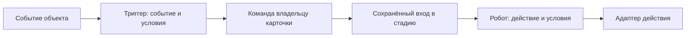

# План MVP: Lead, Deal и Funnel

Дата: 2026-10-18. Статус: проектирование, до реализации.

Документ описывает будущие backend, API и интерфейс Console. Наличие сценария,
таблицы или файла в плане не означает, что соответствующая возможность реализована.
Нормативные источники: [backend-архитектура](../architecture/backend.md),
[frontend-архитектура](../architecture/frontend.md).
Связанный контекст: [план Catalog](catalog.md).

Уточнение от 2026-10-18: Basket выделяется в самостоятельный агрегат CRM,
доступный через внутренние адаптеры. Модель, контракты и порядок внедрения
корзины описаны в разделе 4.3 этого же документа. Funnel, редактор стадий,
конфигурации триггеров/роботов и будущий runtime подробно раскрыты в разделах
4.5–4.6; автоматическое исполнение остаётся отдельным следующим этапом.
Подробная конвертация Lead — раздел 5: семь режимов, данные/связи/points,
независимый Basket, подготовка формы, транзакция и идемпотентность.
UI/UX CRM раскрыт в разделе 9: коллекции, карточки Lead/Deal, канбан,
корзина, форма конвертации, состояния ошибок и сохранения, mobile/keyboard.

## 1. Цель и границы MVP

В CRM появляются два самостоятельных объекта:

- **Lead** — неподтверждённый контакт, заявка или обращение. Содержит контактные
  данные, название компании, contact_points и предварительную корзину.
- **Deal** — сделка, заказ или намерение приобрести товары и услуги. Содержит
  участников, корзину, валюту и сумму. Не управляет выполнением заказа,
  производством, доставкой или оказанием услуги.

Отдельный модуль **Funnel** задаёт воронки и последовательности стадий для внешних
объектов. В MVP он обслуживает `crm.lead` и `crm.deal`, не импортируя их внутренние
доменные модели. Каждая воронка отображается отдельным канбаном.

Basket — третий новый Aggregate Root CRM: общий механизм хранения перечня
намерений для Lead, Deal и будущих документов. Собственного HTTP API у него нет.

В обязательный объём входят:

1. Создание и редактирование лида с ручными данными либо выбором существующего
   **контакта**. Это уточнение пользователя заменяет исходную формулировку
   «привязка существующего лида».
2. Товары и услуги из Catalog и произвольные позиции без записи в Catalog.
3. Дополнительные данные отдельных позиций корзины.
4. Семь режимов конвертации лида в новые Contact, Company и Deal.
5. Несколько контактов и компаний в сделке.
6. Корзина, цены строк и итог сделки в одной валюте заказа.
7. Заглушка выбора валют с USD, EUR и UAH.
8. Хотя бы одна доступная воронка лида и одна сделки для каждого tenant.
9. Создание нескольких воронок каждого типа, редактор стадий и перемещение
   карточек между стадиями канбана.
10. Модель и редактор настроек триггеров и роботов каждой стадии.

В MVP не включаются операционное исполнение заказа, платежи, складские резервы,
доставка, налоги, скидки, валютная переоценка и автоматическое объединение дублей.

Фраза «заложить» триггеры и роботов трактуется как требование подготовить
конфигурацию, контракты и редактор. Запуск автоматизаций вынесен в отдельный этап.
В разделе 4.6 предложены правила будущего исполнения; начальные типы событий,
действий и их адаптеры ещё требуют утверждения. В MVP is_enabled=false, интерфейс
явно показывает, что настройки сохранены, а исполнитель не подключён.

## 2. Исходное состояние проекта

На момент подготовки плана:

- CRM уже содержит самостоятельные Contact и Company, их API и связь many-to-many.
- Общий модуль contact_points предоставляет телефоны, email и привязки по
  `model_key + record_id`. CRM уже использует его через Application port и adapter.
- Catalog предоставляет самостоятельные товары; интерфейс различает товар
  и услугу через существующий признак `virtual`.
- В проекте уже существуют reference_data, CurrencyVO, настройки валют tenant
  и пользователя, а также модуль курсов. Новая сделка не должна зависеть от
  текущей валюты отображения пользователя.
- Console написана на Vue 3 и TypeScript. Существующие CRM-страницы располагаются
  в `frontends/apps/console/src/modules/crm/`.
- Общий HTTP UoW и выбор tenant-схемы уже реализованы.

Следует расширять эти контракты, не создавать параллельные реализации контактов,
компаний, каталога или контактных данных. Если существующий пример противоречит
архитектурным правилам, приоритет имеет нормативный документ.

## 3. Применимые архитектурные требования

Оба актуальных архитектурных документа прочитаны полностью. Перечень ниже
применяется к backend, API, хранению и соответствующей frontend-документации.

Обязательный перечень для последующей реализации:

- Бизнес-модель определяется до таблиц. Lead, Deal и Basket — отдельные Aggregate Roots
  CRM; Funnel — отдельный bounded context с одним Aggregate Root.
- Структура CRM: `модуль / слой / aggregate_root / ответственность`.
  У модуля Funnel с единственным корнем нет повторяющейся папки `funnel`
  внутри каждого слоя.
- Domain не импортирует Application, Infrastructure, Presentation, SQLAlchemy,
  FastAPI или Pydantic. Application не импортирует Infrastructure.
- Каждый агрегат и внутренняя Entity имеют явные фабрики `create` и `restore`.
  Изменения выполняются только доменными методами.
- `__post_init__` разрешён только в Value Objects. Инварианты агрегата нельзя
  переносить в VO или persistence mapper ради обхода этого правила.
- Между самостоятельными агрегатами хранятся ID, а не ссылки на Python-объекты.
  Для внешних бизнес-решений используются специализированные snapshots.
- Basket получает собственный Domain Repository. Его позиции и стадии Funnel —
  внутренние Entity своих агрегатов без самостоятельных Domain Repository.
- Domain Repository возвращает агрегат. Query Repository находится в Application
  и возвращает проекции конкретных сценариев без восстановления агрегата
  только ради списка или карточки.
- У каждого сценария собственные Command/Query, Handler и Result DTO.
  Совпадающие поля разных use cases не заменяются универсальным DTO.
  Для сценария без результата используется `-> None`, без пустого DTO.
- Обработчики координируют порты и domain-методы. Общую orchestration можно
  выделять в Application services; обработчики одного модуля не вызывают друг друга.
- Взаимодействие CRM, Funnel, Catalog и contact_points проходит через Application
  ports и Infrastructure adapters, использующие публичные Application-контракты.
- Один атомарный процесс использует одну сессию общего внешнего UoW.
  Repository не вызывает commit/rollback, Application не получает AsyncSession.
- UoW открывается в Depends и завершается до успешного HTTP-ответа.
  Tenant определяется доверенным контекстом; клиент не передаёт имя SQL-схемы.
- Каждый HTTP endpoint имеет собственный controller-файл. Request и Response
  находятся в разных файлах соответствующего сценария. Для GET без тела
  нет фиктивного Request, для 204 нет пустого Response.
- Router регистрирует маршруты, схемы, статусы и зависимости. Depends собирает
  адаптеры на общей сессии. Контроллер явно преобразует DTO в Response.
- Аутентификация импортируется из Identity Presentation напрямую. Мутации
  используют действующие authentication/CSRF dependencies.
- Все методы имеют аннотации аргументов и результата, включая `__init__ -> None`
  и `Handler.execute`. Классы и методы имеют русские docstrings.
- Импорты идут из файлов определений; новые `__init__.py` пустые.
- Domain не логирует. В логах отсутствуют ФИО, телефоны, email и полные payload.
  Завершение handler не объявляется успешным commit.
- Если следующий этап добавит интеграционные события, запись Outbox выполняется
  в общей транзакции с изменением агрегата, доставка — после commit.

Дополнительные требования frontend:

- API/DTO/mappers, чистые модели форм, queries, mutations и page state разделены.
- Page собирает сценарий, UI получает типизированные props/emits и не импортирует
  HTTP client, DTO, router, stores или query cache.
- Данные сервера принадлежат TanStack Vue Query; черновик отделён от query,
  refetch не стирает ввод. Межмодульные импорты — через публичный index.ts.
- Query keys учитывают tenant/owner/фильтры; поздние ответы старого контекста
  игнорируются. Decimal не теряет точность, конфликты и pending явно отображаются.
- Для изменения только документации проверяются ссылки, согласованность и diff;
  сборка и browser QA требуются при последующей реализации UI.

Успешные функциональные тесты не заменяют отдельную проверку этого перечня.

## 4. Модель предметной области

### 4.1. Lead

Самостоятельный Aggregate Root в `crm/domain/lead/`.

| Данные | Назначение |
| --- | --- |
| `id`, `title` | Идентичность и название заявки для списка и канбана |
| `first_name`, `last_name`, `middle_name` | Необязательные части ФИО неподтверждённого контакта |
| `company_name` | Название компании, указанное в заявке |
| `contact_id` | Необязательная ссылка на выбранный существующий Contact |
| `company_id` | Необязательная ссылка на существующую Company |
| `basket` в read-проекции | Собственный Basket владельца `crm.lead`; валюта, строки и сумма берутся через внутренний порт |
| `funnel_positions` | Стадии лида в назначенных ему воронках |
| `conversion_result` | ID созданных объектов, выбранный режим и время конвертации |
| Audit | Время и автор создания/изменения |

Телефоны и email хранятся в contact_points с target `crm.lead`, а не дублируются
в собственных строковых колонках CRM.

Правила:

- Лид может быть неполным: отсутствие имени или компании не запрещает принять
  обращение. Название карточки обязательно; UI может предложить начальное значение.
- При выборе существующего контакта его ФИО и contact_points копируются в лид.
  Ссылка на контакт сохраняется. Позднейшее редактирование лида не меняет Contact.
- Снимок лида не обновляется автоматически при последующем изменении контакта.
- При конвертации в Contact имя обязательно; при конвертации в Company обязательно
  название компании. Остальные режимы не требуют неиспользуемых данных.
- Конвертация не удаляет исходный лид и его корзину. Результаты доступны из карточки.
- Предлагаемое поведение MVP: после конвертации лид становится доступным для чтения,
  а дальнейшая работа ведётся с результатами. Повторная конвертация не создаёт дублей.

Предполагаемые domain-методы: `create`, `restore`, `revise_details`,
`ensure_commercial_data_editable`, `move_in_funnel`, `ensure_convertible`,
`complete_conversion`. Изменение позиций делегируется агрегату Basket через
Application-сценарий владельца.

### 4.2. Deal

Самостоятельный Aggregate Root в `crm/domain/deal/`.

| Данные | Назначение |
| --- | --- |
| `id`, `title` | Идентичность и название сделки |
| `contact_ids` | Набор связанных контактов |
| `company_ids` | Набор связанных компаний |
| `basket`, `currency`, `total` в read-проекции | Данные самостоятельного Basket владельца `crm.deal`; не второе состояние Domain Deal |
| `source_lead_id` | Источник при создании из лида; необязателен для прямого создания |
| `source_lead_snapshot` | Ограниченный immutable снимок исходных ФИО/компании/названия обращения; предлагается для сохранности данных режима только Deal |
| `contact_points` в read-проекции | Предлагаемые собственные bindings crm.deal; не дублирующие строковые поля Domain Deal |
| `funnel_positions` | Стадии сделки в её воронках |
| Audit | Время и автор создания/изменения |

Правила:

- В сделке допустимы несколько контактов и компаний, без повторения одной связи.
- Участники ссылаются только на объекты текущего tenant.
- Удаление участника из сделки удаляет связь, не сам Contact или Company.
- Корзина сделки независима от корзины исходного лида и текущих цен Catalog.
- Basket — единственный источник суммы и валюты заказа. Поле `total` нельзя
  независимо редактировать или дублировать как авторитетное состояние Deal.
- Воронка отражает коммерческий процесс; её стадии не создают складские,
  производственные или сервисные обязательства.
- Прямое создание сделки используется тем же интерфейсом, что и редактирование
  результата конвертации. Контакт или компания не обязательны для черновой сделки.

Предполагаемые domain-методы: `create`, `restore`, `revise_details`,
`ensure_commercial_data_editable`, `replace_participants`, `move_in_funnel`.
Расчёт и изменение строк выполняет Basket, а не Domain Deal.

### 4.3. Basket: внутренний агрегат перечня намерений

Уточнение пользователя имеет приоритет над первоначальной моделью встроенной
корзины. Basket теперь самостоятельный агрегат CRM. Ниже — его детализация;
отдельный документ или модуль для этого этапа не создаётся.

#### 4.3.1. Решение и назначение

**Basket** — самостоятельный Aggregate Root внутри CRM, отвечающий за перечень
товаров и услуг, которые рассматриваются в конкретном обращении или документе.
Написание в коде и контрактах — `Basket`; `backet` считается опечаткой.

Его используют Lead, Deal, а в дальнейшем счёт и другие объекты. В текущем MVP
реализуются только владельцы Lead и Deal; упоминание счёта не добавляет его создание
или бухгалтерские правила в объём работ.

Basket владеет позициями, их порядком, коммерческими снимками, дополнительными
данными, валютой и расчётом суммы. Он не управляет стадиями Lead/Deal, оплатой,
резервированием, исполнением услуг или содержимым Catalog.

Это отдельная граница согласованности внутри контекста CRM. Выделение нового
bounded context и самостоятельного модуля `basket` пока не требуется.

У Basket **нет собственного публичного HTTP API**, router или отдельной страницы.
Все пользовательские операции проходят через API объекта, которому он назначен.
Доменный агрегат при этом имеет методы создания и изменения: требование
«без публичных методов» трактуется как отсутствие внешних endpoints; доменное
поведение остаётся необходимой частью архитектуры.
Infrastructure adapters не заменяют domain-методы и не содержат бизнес-инварианты.

#### 4.3.2. Граница агрегата и связь с владельцем

```text
CRM
  Lead                 Deal                 Будущий счёт
     │                   │                       │
     └── владелец ────────┴───────────────────────┘
                         │
                         ▼
                    Basket
                      ├── BasketItem
                      ├── BasketItem
                      └── BasketItem
```

Каждый объект имеет **свою** корзину. Лид и сделка не разделяют изменяемый Basket,
даже если сделка создана из этого лида.

В MVP:

- Одна корзина на пару `(model_key, record_id)` внутри tenant.
- Владелец обязателен; бесхозная корзина не создаётся через прикладной контракт.
- При создании Lead/Deal в том же UoW создаётся его Basket, в том числе пустой.
- `BasketOwnerVO` содержит стабильный model_key и EntityIdVO записи владельца.
- Начальные ключи — `crm.lead` и `crm.deal`. Ключ будущего счёта регистрирует
  его модуль при подключении; Basket не импортирует Invoice Aggregate.
- Basket хранит владельца. В Lead/Deal не добавляется вторая дублирующая связь
  `basket_id`; этот ID можно возвращать в проекции карточки.
- Владелец и Basket не содержат друг друга как Python-объекты.
- Перепривязка существующей корзины другому владельцу в MVP отсутствует.

BasketItem — внутренняя Entity Basket. Его нельзя загружать или сохранять
через самостоятельный Domain Repository.

##### Аналогия с contact_points

Перенимаются адресация через model_key/record_id, owner-specific ports/adapters,
сборка на общей сессии и отсутствие прямого доступа потребителя к SQL расширения.

У contact_points значения могут переиспользоваться через разные bindings.
У Basket другие правила: даже совпадающие позиции принадлежат разным корзинам.
Глобального справочника BasketItem и дедупликации по Catalog ID нет. Отдельная
таблица basket bindings при одной корзине на владельца также не нужна.

#### 4.3.3. Данные Basket и BasketItem

##### Basket

| Поле | Смысл |
| --- | --- |
| `id` | BasketIdVO, собственная идентичность агрегата |
| `owner` | BasketOwnerVO с model_key и record_id |
| `currency` | Единая валюта цен и итогов корзины |
| `items` | Упорядоченные внутренние BasketItem |
| `total` | Сумма строк, вычисляемая агрегатом |
| `state` | `editable` или `frozen`; защита коммерческого снимка |
| `source_basket_id` | Необязательная ссылка на источник при копировании |
| `revision` | Версия корзины для обнаружения устаревшего редактирования |
| Audit | Время и автор создания/изменения |

##### BasketItem

| Поле | Смысл |
| --- | --- |
| `id` | BasketItemIdVO; уникальная строка внутри корзины |
| `position` | Порядок отображения |
| `kind` | Товар или услуга |
| `catalog_item_id` | Необязательная ссылка на CatalogItem |
| `name`, `sku` | Снимки названия и артикула на момент добавления |
| `quantity`, `unit` | Количество и единица измерения |
| `unit_price` | Цена за единицу в валюте Basket |
| `line_total` | Рассчитанная стоимость строки |
| `custom_fields` | Дополнительные данные конкретного намерения |

Один CatalogItem допускается в нескольких строках одной корзины: параметры,
комментарии, количество и договорная цена могут различаться. Совпадение Catalog ID
не означает автоматического объединения строк. Дублирование item ID запрещено.

Ручная позиция имеет `catalog_item_id = null`, но сохраняет тип, название и остальные
данные. Она не создаёт запись Catalog автоматически. Изменение полей позиции
не меняет CatalogItem. Удаление или архивирование товара не уничтожает ранее
сохранённый коммерческий снимок.

При добавлении каталожной позиции тип/название/артикул берутся из разрешённой
Application-проекции Catalog на выбранной locale; изменения снимка оператором
передаются явно. Locale нужна для получения исходного текста, но не делает
корзину динамическим представлением текущего перевода Catalog.

Произвольные поля первой версии — строки «ключ — значение». Они принадлежат
позиции Basket, а не атрибутам Catalog. Типизированный конструктор полей отложен.

#### 4.3.4. Инварианты и ответственность

Basket проверяет:

1. Принадлежность всех переданных item ID этой корзине и отсутствие повторов.
2. Непрерывный порядок строк; перестановка сохраняет item ID.
3. Положительное конечное количество и неотрицательную конечную цену.
4. Одну валюту всех строк; точные Decimal и согласованную точность.
5. Сумму каждой строки и общий итог; клиент не задаёт вычисляемые суммы.
6. Уникальность ключей дополнительных полей и согласованные ограничения размера.
7. Запрет изменения frozen-корзины, включая очистку и смену валюты.
8. Запрет смены владельца; копирование создаёт новый Basket.

Owner Aggregate проверяет право изменения коммерческой части в своём состоянии.
Например, конвертированный Lead может запрещать изменение корзины. Такие правила
не кодируются в Basket через `if owner.model_key == 'crm.lead'`.

Application проверяет внешние ссылки через ports, получает время/ID, координирует
repositories. Persistence mapper только преобразует сохранённое представление.
Уникальность корзины владельца дополнительно защищена ограничением БД.

Публичные внутри Domain методы: `create`, `restore`, `replace_items`,
`freeze`, `calculate_total`, фабрика создания копии по проверенному снимку.
Добавление/изменение/удаление отдельных строк в UI в MVP сохраняется как замена
полного набора, а не требует отдельных HTTP методов или item repositories.

В `replace_items` существующие строки передаются с ID, новые — без ID во входном
Application-контракте и получают серверные ID. Пропущенная строка удаляется.
Передача чужого ID отклоняется; очистка — явный пустой список.

Весь кандидат проверяется до принятия состояния: неверная последняя строка
не оставляет первые строки частично изменёнными.

##### Деньги и источник истины

Basket — единственный источник валюты, цен и расчёта итогов. Lead/Deal возвращают
их через свои read-проекции; отдельного независимо редактируемого `Deal.total`
или второго вычисления по таблицам Lead/Deal нет.

В MVP сохраняются правила общего плана: USD/EUR/UAH, Decimal, округление строки
до двух знаков `ROUND_HALF_UP`, итог как сумма округлённых строк. Цена задаётся
явно; цена 0 — именно нулевая цена. Поддержку «цена ещё неизвестна» нужно вводить
отдельным состоянием, а не маскировать нулём; в текущий срез она не добавляется.

В API деньги передаются десятичными строками. Валюта пользователя не меняет
корзину. Обновление непустой корзины с новой валютой передаёт полный пересмотренный
набор цен одним действием; автоматической конвертации валют нет.

Если позже счёт потребует обязательную непустую корзину, реквизиты или налоговые
правила, это проверяет сценарий счёта по immutable коммерческому snapshot.
Доменный Basket не приобретает правила бухгалтерского документа.

#### 4.3.5. Внутренние порты, адаптеры и сценарии

Путь записи:

```text
HTTP Lead/Deal
  → Application-сценарий владельца
  → OwnerBasketPort
  → OwnerBasketAdapter
  → BasketApplicationService
  → BasketRepository.get_for_update
  → Basket domain methods
  → BasketRepository.save
```

Путь чтения карточки использует owner-specific read port, Basket Query Repository
и проекцию. Агрегат не восстанавливается для отображения. При batch-чтении канбана
суммы нескольких корзин получаются одним пакетным запросом, без N+1.

- Application владельца зависит от порта, а не от конкретного адаптера.
- Адаптер связывается с фиксированным model_key во внешней сборке. Клиент API
  Lead не может передать `model_key=crm.deal` или произвольный Basket ID.
- Порт предоставляет только необходимые сценарии: create, get, replace, freeze,
  copy и remove для явного жизненного цикла владельца.
- Adapter преобразует owner-specific входы/результаты и вызывает Basket Application
  service; он не считает суммы, не меняет ORM и не проверяет domain-инварианты.
- Чтобы не строить цепочку handler → handler внутри CRM, общая orchestration Basket
  размещается в Application service. Внутренние Basket handlers делегируют ему;
  адаптер владельца использует тот же service, не вызывает Basket handler из
  Lead/Deal handler.
- Внешний потребитель из другого модуля объявляет собственный порт, реализует
  адаптер к Application-контрактам Basket и собирает его на общем UoW.
- Basket не вызывает ContactPointsAdapter и не использует его Repository:
  аналогия относится к способу интеграции, а не к совместному хранению.

##### Сценарии Basket

Все команды имеют tenant/actor context; внутреннее использование не отменяет
проверку принадлежности и существования владельца в вызывающем сценарии.

| Use case | Вход | Конкретный результат |
| --- | --- | --- |
| `CreateBasket` | Проверенный owner, currency, начальные позиции | `CreateBasketResultDTO`: basket_id, revision, currency, total |
| `GetOwnerBasket` | Проверенный owner | `GetOwnerBasketResultDTO`: детали корзины и её собственные item projections |
| `GetOwnersBasketSummaries` | Набор owner одного tenant | `GetOwnersBasketSummariesResultDTO`: owner, basket_id, revision, currency, total |
| `ReplaceBasketItems` | Owner, expected_revision, полный список строк; при смене валюты — новая currency | `ReplaceBasketItemsResultDTO`: basket_id, новая revision, currency, total и соответствие новых строк |
| `CopyBasket` | Source owner, target owner, expected source revision | `CopyBasketResultDTO`: новый basket_id, revision, currency, total |
| `FreezeBasket` | Owner, expected_revision | `FreezeBasketResultDTO`: basket_id, revision, state |
| `RemoveOwnerBasket` | Проверенный удаляемый owner | `-> None`; пустой DTO не нужен |

Create не является upsert: вторая корзина владельца даёт конфликт. Для удаления
владельца RemoveOwnerBasket допускает уже отсутствующую корзину и выполняется
в той же транзакции; самостоятельного пользовательского удаления Basket нет.
Frozen-корзина не удаляется командой редактирования. Уничтожение истории регулирует
жизненный цикл владельца; физическое удаление финансовых документов сюда не входит.

GetOwnerBasket не создаёт отсутствующую корзину побочным эффектом. В MVP корзина
создаётся вместе с новым владельцем, поэтому её отсутствие у существующей Lead/Deal
считается нарушением целостности, а не пустым массивом по умолчанию.

Replace возвращает item ID новых строк с корреляцией по уникальному `client_line_key`
запроса; он нужен для сопоставления ответа с черновиком и не заменяет серверный ID.
При запросе без фактических изменений revision/audit не увеличиваются.

Copy не переносит item ID, owner, frozen-state или revision источника. Цель получает
новые ID, revision=1 и editable-состояние, прежнюю валюту и точные значения строк.
`source_basket_id` — происхождение, а не живая синхронизация.

##### Результаты и транспорт

Это внутренние Application Command/Query и DTO, а не HTTP endpoints Basket.
Для каждого сценария фиксируются свои `command.py`/`query.py`, `handler.py` и
`dto.py` при результате. Результат `None` не получает `dto.py`.

Бизнес-операции владельца включают корзину в собственный контракт:
CreateLead/CreateDeal создают Basket; UpdateLead/UpdateDeal заменяют явно
переданную корзину; GetLead/GetDeal возвращают проекцию; ConvertLead копирует её.
Неизвестный owner type, чужой item ID или устаревшая revision отклоняются.

HTTP DTO владельца не подменяются общим BasketDTO. Вложенные поля явно собираются
в Response соответствующего сценария. Для expected_revision conflict владелец
возвращает 409; ошибку содержимого строк переводит в полевые ошибки его формы.

В запросах CreateLead/CreateDeal корзина задаётся блоком `basket` с currency и items.
В PATCH отсутствие блока сохраняет корзину; переданный блок содержит
expected_revision и полный набор items. Пустой items очищает корзину, `basket=null`
отклоняется. Корзина отсутствующей валюты не сохраняется; при создании пустой
корзины предлагается валюта tenant, если она входит в MVP-allowlist, иначе UI
требует явного выбора. Скрытого назначения USD или UAH нет.

Ответ UpdateLead/UpdateDeal при изменении корзины содержит подтверждённую revision,
currency, total и соответствие client_line_key → item ID. Каждый метод имеет
собственную вложенную транспортную схему. После создания карточка может загрузить
полный GetLead/GetDeal для продолжения редактирования.

Копирование загружает исходный агрегат под блокировкой для domain-решения,
формирует immutable коммерческий snapshot и создаёт новую корзину через фабрику.
Query DTO не передаётся в Domain как Entity или подмена snapshot.

#### 4.3.6. Транзакции, жизненный цикл и конкурентность

Каждая мутация сначала блокирует Owner Aggregate, проверяет допустимость действия,
затем блокирует Basket и сверяет expected_revision. Порядок «владелец → корзина»
одинаков для всех путей записи. Внутренние Basket service/adapter не открывают UoW.

При работе с несколькими существующими владельцами применяется общий стабильный
порядок их блокировок; порядок корзин следует порядку владельцев. В конвертации
источник существующий, целевые объекты создаются в текущей транзакции.

Замена полного набора требует expected_revision, поскольку без неё блокировка
лишь сериализует устаревшие запросы и не предотвращает потерю чужого редактирования.
Версия Basket независима от изменения стадии или названия владельца.
Read-only GET использует согласованную проекцию без изменяющих блокировок.
Заголовок, revision, позиции и сумма одной read-проекции читаются одним SQL
statement либо в согласованном snapshot, чтобы ответ не смешивал разные версии.

При создании из Lead:

1. ConvertLead блокирует и проверяет Lead и исходную Basket.
2. Создаёт выбранные Contact/Company/Deal и связи.
3. Для Deal выполняет CopyBasket в **новую** корзину целевого владельца.
   Обычный путь CreateDeal с автоматической пустой корзиной не вызывается повторно.
4. Сохраняет результат конвертации Lead. При принятом read-only режиме Lead
   замораживает его исходную корзину в той же транзакции.
5. Один внешний UoW фиксирует все изменения, включая обе корзины и contact_points.

При конвертации без Deal копия не создаётся. Сбой любого шага откатывает корзины
и остальные результаты. Повтор по ключу идемпотентности ConvertLead возвращает
уже созданные объекты, не запускает повторное CopyBasket.

Завершение Deal → счёт в будущем использует такое же независимое копирование.
Изменения исходной Deal не должны переписывать выставленный счёт. Момент
заморозки корзины счёта определяет его собственный сценарий.

#### 4.3.7. Хранение и файлы

Две tenant-таблицы:

- `crm_baskets`: ID, owner_model_key, owner_record_id, currency, state, total,
  source_basket_id, revision, audit.
- `crm_basket_items`: ID, basket_id, position, catalog reference, снимки,
  quantity/unit, unit_price/line_total, custom_fields.

`UNIQUE(owner_model_key, owner_record_id)` защищает одну корзину владельца;
`UNIQUE(basket_id, position)` — порядок. При перестановке SQL-адаптер должен
учитывать промежуточные коллизии индексов. BasketItem FK ведёт на Basket.
Деньги — numeric, параметры — ограниченный JSON/string-набор.

Полиморфный owner не обеспечивается обычным FK на несколько таблиц. Поэтому
проверку и блокировку существования владельца выполняет доверенный сценарий
владельца в той же транзакции. Синтаксически корректного model_key недостаточно.
Внутренний контракт не предоставляет обходного пути создания произвольного owner.
Все пути удаления владельца должны вызывать очистку корзины или согласованное
сохранение истории; удаления только строки владельца через Repository недостаточно.

Ссылка Catalog не должна каскадно удалять позиции. `source_basket_id` сохраняет
происхождение, но не блокирует согласованную очистку источника: политика FK
при удалении источника допускает SET NULL, если хранение ссылки не обязательно.
Ни одна SQL-модель Basket не выходит во внутренние контракты потребителей.

```text
src/modules/crm/
  domain/basket/
    aggregate.py
    entity/item.py
    value_object/identifier.py
    value_object/item_identifier.py
    value_object/owner.py
    value_object/quantity.py
    value_object/item_snapshot.py
    value_object/custom_fields.py
    error.py
    repository.py
  application/basket/
    command/<scenario>/command.py, handler.py, dto.py при результате
    query/<scenario>/query.py, handler.py, dto.py
    service/basket.py
    port/query_repository.py
    port/catalog_selection.py
    port/currency_catalog.py
  application/lead/port/basket.py
  application/deal/port/basket.py
  infrastructure/basket/
    persistence/mapper.py
    persistence/repository.py
    persistence/query_mapper.py
    persistence/query_repository.py
    adapter/catalog_selection.py
    adapter/currency_catalog.py
  infrastructure/lead/adapter/basket.py
  infrastructure/deal/adapter/basket.py
  infrastructure/persistence/models/basket.py
  infrastructure/persistence/models/basket_item.py
  presentation/depends/basket.py
```

Создаются только реально нужные определения. Денежные VO переиспользуются из
Shared, если соответствуют правилам; собственный CurrencyVO с другим смыслом
не дублируется. Reference_data проверяется через Application-контракты,
MVP-allowlist USD/EUR/UAH задаётся заменяемым адаптером политики доступных валют.
Порты времени/ID — существующие Shared-контракты.

`presentation/depends/basket.py` — только внешняя сборка зависимостей общего UoW.
У Basket нет `presentation/basket/router.py`, controllers, Request или Response.
Все новые методы полностью типизированы, документированы; фабрики явные,
`__post_init__` только в VO; package `__init__.py` пустые.

#### 4.3.8. Frontend без отдельного API Basket

Редактор корзины находится в CRM и принимает типизированные draft props/emits.
Он не знает owner model_key, Axios, DTO, router, stores и query cache.
При необходимости другой модуль использует его через публичный `crm/index.ts`,
без глубокого импорта внутренних composables CRM.

- API, request/response DTO и mappers остаются в соответствующих Lead/Deal сценариях.
- Frontend BasketDraft/BasketItemDraft — чистые модели формы, не HTTP DTO.
- Черновик и ошибки живут у формы/оркестратора; mutation сохраняет snapshot запроса.
- Page собирает queries, mutations и UI. UI передаёт действие наверх через emits.
- Queries и mutations используют общий HTTP provider; отдельного basket client нет.
- Refetch не стирает черновик. Подтверждённый ответ сопоставляет строки по
  client_line_key и очищает только отправленные изменения, сохраняя новый ввод.
- После записи обновляются detail и затронутые list/kanban summaries владельца.
- Query keys включают tenant и ID владельца; revision хранится с серверной проекцией,
  а не в отдельном глобальном store Basket.
- Конфликт revision показывает возможность загрузить актуальную корзину и сравнить
  изменения; молчаливое перезаписывание или автоповтор полного набора запрещены.
- Decimal остаётся строковым/точным значением; итог backend авторитетен.
- При смене tenant/session отменяются запросы и очищается связанный черновик.

Предполагаемые UI: BasketEditor, BasketItems, BasketItemForm и BasketTotals
внутри `crm/ui/basket/`. Не создаются отдельные BasketPage, route или меню.

#### 4.3.9. Проверки и порядок внедрения

1. Зафиксировать Basket Aggregate и owner contract; убрать позиции и расчёт
   из Domain Lead/Deal и их отдельных item repositories в общем плане.
2. Описать внутренние Command/Query, конкретные DTO, ports/adapters и общий UoW.
3. Спроектировать таблицы и миграцию. Если к началу реализации появились данные
   старой модели, предусмотреть перенос без потери ID владельцев и денежных снимков.
4. Подключить Create/Update/Get/List Lead/Deal и batch-суммы канбана.
5. Подключить CopyBasket к семи режимам конвертации.
6. Подключить редактор формы и обработку conflicts без отдельного Basket API.

Критерии приёмки реализации:

- Basket действительно самостоятельный Aggregate Root, позиции принадлежат ему.
- Нет публичных Basket endpoints и способов обойти проверку состояния владельца.
- Нет прямых обращений потребителя к SQL Basket или Catalog.
- Две корзины владельца, чужие item ID и устаревшая revision отклоняются.
- Один CatalogItem может иметь несколько независимых строк с разными параметрами.
- Суммы и округление корректны, изменение Catalog не меняет снимки.
- Копирование создаёт новые basket/item ID; редактирование копии не меняет источник.
- Frozen-корзина не меняется; будущие правила счёта не просачиваются в Basket.
- Create/Convert/Remove владельца и его Basket используют одну транзакцию,
  проверены rollback, повторы, гонки и два tenant.
- Чтение канбана использует batch-проекции; нет скрытой записи через GET.
- По diff проверены архитектурные границы, create/restore, типизация, DTO,
  отсутствие handler chains, поведение Repository/mapper и общая сессия.
- Frontend проверен на сохранность ввода, item ID correlation, revision conflict,
  точные деньги и смену tenant; выполнены применимые lint/typecheck/build и UI QA.

Для текущего изменения только документации проверяются ссылки, согласованность
с общим планом и diff. Исполнение сценариев, миграции и UI-тесты не заявляются
выполненными до реализации.

### 4.4. Деньги и валюты

Для выбора валют реализуется заменяемая статическая заглушка с тремя значениями:

| Код | Название | Денежная точность |
| --- | --- | --- |
| USD | Доллар США | 2 знака |
| EUR | Евро | 2 знака |
| UAH | Украинская гривна | 2 знака |

Один и тот же Application port используется списком валют в UI и проверкой
записи заказа. Проверка только на frontend недостаточна.

Предлагаемая граница заглушки — доступные валюты CRM. Существующий глобальный
reference_data и настройки других модулей автоматически не сокращаются:
в проекте они уже обслуживают более широкий справочник. Его sync-проверка
ожидает минимум 150 валют, поэтому передача в неё трёх записей без отдельного
решения была бы ошибкой. Если требуется именно глобальное сокращение,
это отдельное уточнение объёма перед реализацией.

Правила расчёта:

- Числа передаются в API десятичными строками, вычисляются через Decimal,
  хранятся в точных SQL numeric-полях. Float не используется для сохранения денег.
- Количество строго положительно, цена неотрицательна, NaN/Infinity отклоняются.
- `line_total = round(quantity × unit_price, 2)`;
  `deal_total = sum(line_total)` с согласованным округлением `ROUND_HALF_UP`.
- Нулевая сумма и пустая корзина допустимы для незаполненного намерения покупки.
- Если заказ оформлен в USD, цены строк и итог сохраняются в USD.
- Валюта отображения пользователя и курсы не меняют сохранённые суммы заказа.
- Цена Catalog не считается автоматически выраженной в валюте заказа. При
  несовпадении или отсутствии подтверждённой валюты оператор вводит цену явно.
- Смена валюты непустой корзины требует явного пересмотра цен и сохранения
  нового набора строк одной операцией; простая замена подписи валюты недопустима.
- Конвертация лида в сделку сохраняет валюту и точные цены его корзины.

### 4.5. Funnel: определение процесса и стадии

#### 4.5.1. Ответственность и границы

Funnel — отдельный модуль с одним Aggregate Root Funnel в MVP. Он описывает
процесс для одного типа внешних объектов: название, стадии, их порядок,
настройки триггеров и роботов. Lead/Deal не становятся внутренними Entity Funnel.

| Ответственность | Владелец |
| --- | --- |
| Определение воронки, стадии, конфигурации правил | Funnel |
| Допустимость изменения конкретной карточки | Domain Lead/Deal |
| Назначенные воронки и текущая стадия в каждой | Lead/Deal |
| Корзина, валюта, коммерческий итог | Basket |
| Доступ пользователя и доверенный контекст | Identity и сценарий потребителя |
| Запуск действий, попытки и результаты | Будущий исполнитель автоматизаций, вне MVP |

Funnel не читает SQL CRM, не меняет поля Lead/Deal, не рассчитывает Basket и не
объявляет заказ выполненным. Общие правила процесса проверяет Funnel; доменные
ограничения объекта проверяются его владельцем через собственный сценарий.
Например, попадание в колонку «Выиграна» само по себе не создаёт платёж или счёт.

Редактор Funnel имеет публичный HTTP API для управления определением процесса.
Назначение карточки и перемещение — публичные операции Lead/Deal, использующие
внутренний Application-контракт Funnel. Ограничение Basket на отсутствие
собственного HTTP API на редактор Funnel не переносится.

#### 4.5.2. Модель агрегата

| Поле Funnel | Смысл |
| --- | --- |
| `id` | FunnelIdVO, самостоятельная идентичность |
| `model_key` | Тип обслуживаемого объекта: в MVP `crm.lead` или `crm.deal` |
| `name` | Название для выбора воронки и редактора |
| `is_default` | Начальная воронка этого типа для tenant |
| `stages` | Полное упорядоченное определение Stage |
| `revision` | Версия сохранённого определения для конкурентного редактирования |
| Audit | Время и автор создания/изменения |

Stage — внутренняя Entity Funnel:

| Поле Stage | Смысл |
| --- | --- |
| `id` | StageIdVO; сохраняется при переименовании и перестановке |
| `name` | Название колонки канбана |
| `position` | Индекс отображения от 0 |
| `color` | Необязательный токен из ограниченной палитры, без свободного CSS |
| `triggers` | Упорядоченные TriggerConfiguration данной стадии |
| `robots` | Упорядоченные RobotConfiguration данной стадии |

TriggerConfiguration и RobotConfiguration — разные внутренние Entity со
стабильными ID. Их параметры, условия и ссылки описываются immutable VO.
Одинаковые технические поля не требуют универсальной Entity «любая автоматизация».
Stage и конфигурации не имеют самостоятельных Domain Repository.

Модель обращается к другим агрегатам через ID и согласованные snapshots.
Funnel не содержит Contact, Deal, Basket или исполняемые объекты провайдеров.

#### 4.5.3. Инварианты определения

- Один Funnel обслуживает один model_key. Тип нельзя изменить после создания.
- Имена воронки и стадий непустые, нормализуются и ограничиваются согласованной
  длиной. Совпадение названий не объединяет их идентичности; UI предупреждает
  о трудноразличимых названиях стадий, но ссылки используют только ID.
- Есть хотя бы одна Stage. Индексы стадий образуют последовательность от 0
  без пропусков и повторов; индексы правил проверяются отдельно в своих списках.
- Stage ID уникальны в агрегате. Чужая стадия не может быть вставлена как своя.
- ID триггеров/роботов уникальны и принадлежат соответствующему списку Stage.
  Нельзя передать ID робота как триггер или незаметно перенести правило на другую
  стадию. Копирование правила на другую стадию создаёт новый ID.
- Ограничены размеры определения, число стадий/правил, глубина условий и объём
  параметров. Конкретные пределы фиксируются перед реализацией и совпадают в API/UI.
- Переименование, изменение цвета и перестановка не меняют stage/rule ID.
- В MVP сохранённые стадии не удаляются и не архивируются. Непереданный сохранённый
  Stage ID при полной замене определения даёт 422, а не удаляет колонку.
- Несохранённую новую стадию можно удалить из черновика. Правила можно удалять
  из конфигурации; в MVP у них ещё нет запущенных исполнений.
- `is_default` не задаётся произвольным PUT редактора. Его устанавливает bootstrap;
  переключение default воронки потребует отдельного согласованного сценария.

Фабрики `create/restore` проверяют собственные инварианты агрегата и Entity.
Методы Funnel: `replace_process`, `ensure_model_supported`, `select_stage`.
Внутренние методы Stage обновляют её имя/порядок/правила под управлением Funnel.
Application не присваивает состояние напрямую; mapper не исправляет плохую
конфигурацию и не переносит к себе проверки принадлежности ID.

#### 4.5.4. Последовательность и переходы

Индекс Stage задаёт порядок колонок, а не обязательный маршрут. В MVP оператор
может перемещать карточку в любую стадию уже назначенной воронки, если владелец
карточки разрешает изменение. Граф допустимых переходов, обязательные поля
отдельной стадии и ветвления пока не вводятся.

Названия «Квалифицирован», «Выиграна», «Проиграна» не являются системными enum.
Из имени нельзя выводить успех, отказ, право редактирования или конвертацию.
Конвертация Lead — отдельный сценарий, а не неявное действие смены колонки.

При назначении без Stage ID выбирается первая стадия текущего определения.
При явно указанном Stage ID проверяется его принадлежность выбранному Funnel.
Перестановка стадий влияет на начальную стадию **будущих** назначений, но не
перемещает уже существующие карточки. Редактор показывает это предупреждение.

#### 4.5.5. Назначение и текущая позиция карточки

У одного типа объекта доступно много воронок. Рабочее предложение плана — одна
карточка может участвовать в нескольких одновременно; это допущение остаётся
на подтверждение в разделе 12. В каждой воронке позиция независима.

При создании без явного списка выбирается default-воронка типа объекта.
При явном выборе назначаются только выбранные процессы; default не добавляется
скрыто. Новая позиция начинается с position_revision=1.

Позиция внутри Lead/Deal содержит:

- Funnel ID и Stage ID.
- `position_revision`, увеличиваемую только при реальном изменении этой позиции.
- Время и автора последнего назначения/перемещения.

Это внутреннее состояние владельца, не отдельный Aggregate Root Funnel и не
папка объектов CRM внутри Funnel. Уникальность пары `(record_id, funnel_id)`
защищена в таблице назначений владельца. Tenant определяется его схемой.

AssignLeadFunnel/AssignDealFunnel проверяют тип объекта и назначают первую стадию.
Повтор назначения уже присутствующей воронки возвращает существующую позицию,
не сбрасывая карточку в начало. Assign не используется для перемещения.

MoveLead/MoveDeal принимают Funnel ID, Stage ID и `expected_position_revision`.
Проверяется наличие назначения. Запрос не создаёт членство скрытым побочным
эффектом. Устаревшая revision даёт 409; повтор текущего значения с актуальной
revision — no-op без нового audit и будущего события входа.

Перемещение затрагивает только одну позицию. Не меняются остальные воронки,
Basket revision, строки корзины или связанные Contact/Company.
Ручной порядок карточек внутри колонки в MVP не сохраняется: используется
оговорённая стабильная сортировка по времени изменения позиции и ID.

#### 4.5.6. Внутренняя интеграция и транзакция перемещения

```text
HTTP MoveLead / MoveDeal
  → Handler владельца: загрузить и заблокировать Lead/Deal
  → Domain владельца: проверить допустимость изменения
  → FunnelPort → adapter → ResolveFunnelStage
  → Funnel Repository: согласованное определение процесса
  → Domain Funnel: проверить model_key и Stage ID
  → DTO с проверенными ID и revision определения
  → Domain Lead/Deal: изменить свою позицию
  → Repository владельца → commit общего внешнего UoW
```

ResolveFunnelStage — внутренний Query для domain-решения, поэтому восстановление
Funnel здесь обосновано. Карточки редактора и списки читаются Query Repository
через проекции, без восстановления агрегата.

Все адаптеры получают общую сессию текущего UoW, не открывают вложенные транзакции
и не выполняют commit. У записи определения одна изменяющая блокировка Funnel;
у перемещения — блокировка владельца и совместимая читающая блокировка Funnel.
Редактор не блокирует Lead/Deal, поэтому обратного пути «Funnel → карточка» нет.
Порядок для нескольких процессов/карточек должен быть одинаково определён.

Изменение определения не выполняет массовую запись карточек. Сохранённые ID стадий
не исчезают, поэтому переименование/перестановка безопасны для назначений.
Сбой проверки процесса или commit откатывает позицию и не считается успехом API.

#### 4.5.7. Default-воронки и дальнейший жизненный цикл

Tenant-миграция создаёт default Lead Funnel и default Deal Funnel с начальными
стадиями из раздела 8.2. Их revision начинается с 1; триггеры и роботы пустые.
Чтение не выполняет bootstrap. Пользовательские воронки создаются без default-флага.

Удаление воронок, архивирование и перенос карточек из удаляемой Stage отложены.
Для их будущего добавления понадобится отдельный Application port использования
воронки, согласованная защита от гонок и явная политика сохранения истории.
Нельзя реализовать удаление как CASCADE, уничтожающий назначения CRM.

### 4.6. Редактор процесса, триггеры и роботы

#### 4.6.1. Граница MVP и следующего этапа

В этой версии проектируются и впоследствии реализуются определение процесса,
редактор, валидация, сохранение и повторное чтение конфигураций. Исполнитель
автоматизаций не входит в MVP. Все разделы ниже о запуске, очередях и попытках
являются **планом следующего этапа**, а не обещанием работающих действий MVP.

| Возможность | MVP конфигурации | Следующий этап исполнения |
| --- | --- | --- |
| Редактирование стадий, триггеров и роботов | Да | Сохраняется |
| Проверка поддерживаемого типа и схемы параметров | Да | Дополняется доступностью адаптера/подключения |
| Preview порядка стадий и настроек без побочных эффектов | Да, локально в редакторе | Возможна отдельная симуляция событий |
| Автоматическая реакция на событие | Нет | После подключения конкретного источника |
| Выполнение действия робота | Нет | Через согласованный action adapter |
| Планировщик, задержки и retries | Нет | После определения runtime-сценариев |
| Журнал выполнения и ручной retry | Нет | Отдельные use cases и UI |
| Серверный draft, публикация версий, откат процесса | Нет | При появлении самостоятельной потребности |

В MVP один текущий сохранённый процесс с revision; черновик живёт в редакторе.
Сохранение сразу меняет определение для канбана. Оно не перемещает карточки,
не запускает правила и не воспроизводит прошлые события.

#### 4.6.2. Смысл триггера и робота

**Триггер** реагирует на событие и условия. Предлагаемая первая семантика для
будущего runtime: триггер, настроенный на стадии S, запрашивает перевод подходящей
карточки в S. Он не выполняет произвольный набор внешних действий.

**Робот** выполняет конкретное действие. Предлагаемая первая точка активации —
подтверждённый вход карточки в стадию, на которой он настроен. Условия робота
определяют, требуется ли действие при этом входе.

Пример будущего поведения: «получено сообщение → триггер запросил переход
в “В работе” → после сохранения перехода робот создал задачу». Названия событий,
интеграция сообщений и модуль задач здесь иллюстративны; их исполнителей ещё нет.



Диаграмма описывает будущий runtime. В MVP сохраняются только определения T и R.
Первичное назначение воронки в будущем считается отдельным входом; переход
в уже текущую стадию и изменение определения не создают повторного входа.
Повторный реальный выход и возврат в стадию создаёт новый вход с новым ID.
Реакции на выход из стадии, произвольные расписания и цепочки роботов отложены.

Триггер не обязателен для ручного перехода. Робот не определяет принадлежность
карточки стадии и не меняет определение Funnel.

#### 4.6.3. Модель TriggerConfiguration

| Поле | Смысл |
| --- | --- |
| `id` | TriggerIdVO; идентичность настройки |
| `name`, `position` | Название и приоритет среди триггеров стадии |
| `type_code`, `config_version` | Поддерживаемый тип реакции и версия его конфигурации |
| `parameters` | Типизированные параметры выбранного типа |
| `conditions` | Ограниченный набор условий на событие и доступный snapshot карточки |
| `is_enabled` | Намерение включения; в MVP false и недоступно для активации |

Целевая Stage определяется вложенностью, поэтому не дублируется изменяемым
`target_stage_id` внутри parameters. Идентификаторы события и карточки не являются
постоянными параметрами: они приходят в контексте конкретного исполнения.

Если понадобятся ограничения исходной стадии, они задаются структурированным
условием с проверенными ID того же Funnel. Они не превращаются в SQL-условия,
произвольные выражения или скрытую интерпретацию индекса Stage.

Будущий триггер относится только к адресованной карточке текущего tenant и её
назначенным воронкам. Самостоятельное создание карточки или назначение новой
воронки по внешнему событию потребует отдельного явно разрешённого сценария.

#### 4.6.4. Модель RobotConfiguration

| Поле | Смысл |
| --- | --- |
| `id` | RobotIdVO; идентичность настройки |
| `name`, `position` | Название и порядок действий стадии |
| `type_code`, `config_version` | Тип действия и версия его конфигурации |
| `parameters` | Типизированные параметры действия |
| `conditions` | Условия выполнения для конкретного входа в стадию |
| `is_enabled` | В MVP false; сохранённая настройка не считается запущенной |

Вход в стадию — фиксированная точка активации первой будущей версии runtime,
а не произвольный строковый cron в parameters. Первые роботы предполагаются
немедленными и последовательными в порядке position. Отложенные действия,
параллельные ветки, ссылки на результат предыдущего робота и остановка цепочки
по сложным выражениям проектируются отдельно.

Один и тот же тип робота может быть добавлен несколько раз с разными параметрами.
При копировании настройки в UI создаётся новая идентичность, а не ссылка на
общий изменяемый RobotConfiguration.

#### 4.6.5. Каталог типов и проверка конфигураций

Frontend не придумывает type_code и поля произвольным JSON-редактором.
Backend предоставляет read-only каталог типов конфигурации, отдельно для
триггеров и роботов, с фильтром по model_key.

Метаданные типа содержат kind, стабильный code, config_version, название,
описание, поддерживаемые model_key, схему parameters, доступные условия и
`execution_available`. Схема ограничена описанием формы: типы полей, обязательность,
enum и разрешённые ссылки. Она не содержит исполняемые скрипты, Vue-компоненты,
SQL, выражения eval или произвольные URL для автоматического вызова.

В MVP используется небольшой статический реестр конфигураций через Application
port и adapter. Динамическая установка типов и редактор самого реестра не нужны.
Точный начальный набор согласовывается до реализации; без него нельзя объявлять
работающим редактор параметров. Для каждого выбранного типа должны быть
конкретные поля и валидные/невалидные примеры, даже когда execution_available=false.

Предлагаемые кандидаты для обсуждения: триггер изменения выбранного поля объекта
и робот создания задачи. Это **не утверждённые готовые интеграции**: источник
событий, модель задач, разрешённые поля и action contract требуют решения.
Можно принять другие типы, не меняя общий контракт сохранения.

Проверка разделена по слоям:

- Application получает описание разрешённого типа и проверяет внешние ссылки
  через ports. Неизвестные type_code/config_version у новой или изменяемой
  конфигурации дают полевую ошибку 422.
- Domain проверяет инварианты конкретной конфигурации, принадлежность ID,
  условия и весь кандидат Funnel по проверенному immutable descriptor/snapshot.
  Domain не импортирует JSON Schema/Pydantic и не обращается к реестру через I/O.
- HTTP проверяет транспортную форму. Frontend использует те же метаданные для
  формы, но не заменяет серверную проверку.

Недоступность исполнения не делает валидную конфигурацию ошибочной. Однако
включение правил в MVP отклоняется; после появления worker старые настройки
не должны активироваться автоматически. Нужен явный последующий этап включения.

Версия параметров отличается от revision Funnel. Изменение metadata-реестра
не переинтерпретирует сохранённые параметры автоматически. Старые версии должны
оставаться читаемыми; неподдерживаемая версия показывается как требующая миграции,
а её изменение/активация запрещены до явного преобразования. Прочие сохранённые
правила не удаляются из ответа и не обнуляются при сохранении другой стадии.

Неизменённая выключенная настройка неподдерживаемой версии допускается в полном
PUT как сохранённое непрозрачное значение с тем же ID и содержимым. Проверка
использует исходное состояние агрегата, а не доверяет отметке клиента «не изменено».
Restore сохраняет такой снимок, проверяя общие инварианты; он не требует загрузки
актуального реестра через I/O из Domain. Миграция параметров остаётся явным действием.

#### 4.6.6. Условия и ссылки в параметрах

Для первого редактора предлагается один набор условий, соединённых AND.
Произвольные вложенные AND/OR, вычисляемые выражения и пользовательские скрипты
не входят в MVP. Пустой список означает отсутствие дополнительного ограничения.

Условие содержит field_code, operator и типизированное value. Реестр задаёт
разрешённые поля и операторы для model_key и конкретного типа настройки.
Например, сравнение enum допустимо только с его значением, а денежное сравнение
требует валюты. Отсутствующее значение отличается от 0, false и пустой строки;
проверка наличия задаётся отдельным оператором. Неизвестное поле отклоняется.

В параметры сохраняются внутренние ID разрешённых сущностей, а не отображаемые
имена или произвольные внешние credentials. Модуль, которому принадлежит ссылка,
подтверждает её через Application-контракт. В будущем action adapter повторно
проверяет доступность подключения перед исполнением; конфигурация не даёт
бессрочное право обойти актуальные ограничения владельца или tenant.

Секреты, токены и пароли не хранятся в parameters и не возвращаются редактору.
Ссылки на интеграции не запускают сетевую проверку или действие при простом GET
либо локальном preview. Неизвестные поля parameters не молча отбрасываются.

#### 4.6.7. Сценарий редактора

Редактор — последовательность стадий, а не графовый BPMN canvas. Основной экран:
название и тип воронки; лента стадий; панель выбранной стадии; отдельные вкладки
«Триггеры» и «Роботы»; кнопка сохранения и статус черновика.

1. Создать воронку: выбрать Lead/Deal, задать название и хотя бы одну Stage.
2. Добавить, переименовать, перекрасить или переставить стадии. ID существующих
   стадий сохраняются; новые имеют локальный client_key до ответа сервера.
3. Выбрать стадию и добавить триггер либо робот из каталога допустимых типов.
4. Заполнить форму параметров и условий; увидеть ошибки у конкретных полей.
5. Переставить, скопировать или удалить настройку. Копия получает новый client_key
   и не отправляет старый ID как идентичность нового правила.
6. Просмотреть последовательность и конфигурации без выполнения действий.
7. Нажать «Сохранить»: отправляется полный кандидат определения и expected_revision.
8. После успеха получить новую revision и соответствие client_key → серверные ID
   новых стадий/правил; обновить канбан и список воронок.

Существующая стадия не имеет кнопки удаления в MVP; новая несохранённая имеет.
Для первого этапа глобальная кнопка «Включить автоматизацию» отсутствует.
Показывается «Настройки сохранены. Исполнение не подключено», а не зелёный статус
«Работает». is_enabled не становится true в скрытом transport mapper.

Настройки не сохраняются отдельными запросами при каждом вводе. Одна кнопка
сохраняет всё определение атомарно. Черновик можно отменить с явным отказом от
несохранённого ввода. Смена выбранной стадии не уничтожает её черновик.

В локальном preview нет API исполнения, вызовов провайдеров или обещания результата
реального события. Отдельный серверный сценарий симуляции в этот срез не добавляется.

#### 4.6.8. Сохранение, ID и конфликты

CreateFunnel создаёт серверные ID всех новых Stage/Trigger/Robot и revision=1.
UpdateFunnel принимает expected_revision, название и полное упорядоченное дерево.
model_key и is_default не входят в изменяемые поля. Новые вложенные элементы
имеют client_key без server ID; сохранённые — свой server ID.

После проверки всего кандидата Domain применяет замену одним методом.
Несовпадение revision даёт 409 без частичного изменения стадий или правил.
При no-op не увеличиваются revision/audit. Ключи корреляции новых элементов
уникальны во всём запросе, не подменяют идентичность и не сохраняются как Domain ID.

UpdateFunnelResultDTO возвращает Funnel ID, revision и отдельные карты ID
созданных стадий/триггеров/роботов. CreateFunnelResultDTO возвращает аналогичный
результат своего сценария. HTTP Responses у этих методов самостоятельные.
Ошибки 422 адресуются по client_key/существующему ID и пути поля, чтобы смена
порядка не прикрепила ошибку к другой строке.

Повторное получение ответа после неопределённого сетевого исхода не решается
автоматическим повтором Create. Для CreateFunnel предлагается idempotency key:
одинаковый ключ и payload возвращают прежний результат, другой payload даёт 409.
Повтор PUT со старой revision не создаёт новые правила: клиент сначала читает
сохранённый процесс и сверяет результат, сохраняя свой черновик.

Подтверждение сохранения очищает только отправленный snapshot. Если пользователь
продолжил ввод во время запроса, новый ввод остаётся dirty; соответствие server ID
применяется к уцелевшим локальным элементам. Опоздавший ответ старого tenant или
другой воронки не применяется к открытому редактору.

Ни изменение имени, ни изменение правил не переписывают позиции карточек.
Уже текущая Stage не считается повторно посещённой при увеличении revision Funnel.

#### 4.6.9. Application-сценарии и API Funnel

| Use case | Вход | Конкретный результат |
| --- | --- | --- |
| `CreateFunnel` | actor/tenant, model_key, name, полное дерево новых стадий/правил, idempotency key | `CreateFunnelResultDTO`: id, revision, карты новых ID |
| `UpdateFunnel` | actor/tenant, Funnel ID, expected_revision, name и полное дерево | `UpdateFunnelResultDTO`: id, revision, карты новых ID |
| `GetFunnel` | Funnel ID и доверенный контекст доступа | `GetFunnelResultDTO`: определение, revision, доступные права/возможности редактора |
| `ListFunnels` | model_key, search, ограниченная pagination | `ListFunnelsResultDTO`: элементы, default-флаг, revision, краткие стадии и total |
| `ListAutomationTypes` | model_key, optional kind trigger/robot | `ListAutomationTypesResultDTO`: версии, схемы и возможности типов |
| `ResolveFunnelStage` | model_key, optional Funnel ID/Stage ID | `ResolveFunnelStageResultDTO`: проверенные Funnel ID/Stage ID и revision определения |

Сценарии перемещения остаются у Lead/Deal. Входы и результаты дополняются
expected_position_revision/подтверждённой position_revision. Resolve не получает
сырой HTTP Request или SQL session через Application-контракт.

В плане сохраняются GET/POST `/funnels` и GET/PUT `/funnels/{funnel_id}`;
добавляется GET `/funnels/automation-types` с Query-параметрами. Статический маршрут
регистрируется перед `/{funnel_id}`, чтобы имя справочника не разбиралось как UUID.
Схемы справочника принадлежат этому сценарию; PUT не становится универсальным
CRUD для отдельных таблиц Stage/Robot/Trigger.

В MVP нет `/run`, `/retry`, `/publish`, публичного `/resolve-stage` или общего
endpoint, позволяющего Funnel менять карточку по произвольному model_key/record_id.

Права чтения и управления определением проверяются на backend через действующую
авторизацию Identity. Capability в ответе управляет доступностью UI, но не заменяет
проверку команды. Право перемещать карточку не равно праву изменять процесс tenant.
Мутации используют CSRF; недоступный tenant не раскрывается через ID, ошибки ссылок
и каталог типов. Конкретное сопоставление ролей/permissions фиксируется до реализации.

#### 4.6.10. Backend-структура и хранение

У модуля один корень, поэтому в каждом слое нет дополнительной папки funnel:

```text
src/modules/funnel/
  domain/
    aggregate.py
    stage.py
    trigger_configuration.py
    robot_configuration.py
    value_object/{funnel_id,stage_id,trigger_id,robot_id,condition,rule_parameters}.py
    error.py
    repository.py
  application/
    command/create_funnel/{command,handler,dto}.py
    command/update_funnel/{command,handler,dto}.py
    query/get_funnel/{query,handler,dto}.py
    query/list_funnels/{query,handler,dto}.py
    query/list_automation_types/{query,handler,dto}.py
    query/resolve_funnel_stage/{query,handler,dto}.py
    port/query_repository.py
    port/automation_type_catalog.py
    port/configuration_references.py
  infrastructure/
    persistence/{repository,mapper,query_repository,query_mapper}.py
    persistence/models/{funnel,stage,trigger_configuration,robot_configuration}.py
    adapter/automation_type_catalog.py
    adapter/configuration_references.py
  presentation/
    depends.py
    router.py
    http/controller/<http_scenario>.py
    http/request/<http_scenario>.py
    http/response/<http_scenario>.py
```

Фигурные скобки обозначают отдельные файлы, не буквальные имена каталогов.
Request отсутствует у GET без тела. Импорты из файлов определений, init пустые,
все методы типизированы и имеют docstrings; __post_init__ только в VO.

Funnel Domain Repository хранит целое определение, не предоставляет list/search.
Funnel Query Repository читает Get/List DTO без восстановления агрегата.
AutomationTypeCatalogPort отдаёт read-only metadata; ConfigurationReferencesPort
проверяет внешние ссылки через Application-контракты их владельцев. Ни один порт
не раскрывает SQLAlchemy или конкретные HTTP SDK.

Одна tenant-транзакция сохраняет строки funnels, funnel_stages,
funnel_stage_triggers и funnel_stage_robots. У stages/rules стабильные UUID,
FK на родителя, position; у rules отдельные type_code/config_version/is_enabled,
ограниченные parameters/conditions. У Funnel — revision/audit и частичная
уникальность default по model_key. Constraints порядка учитывают промежуточные
коллизии при SQL-перестановке строк.

Удаление конфигурации правила при полной замене не должно каскадно затрагивать
историю будущего runtime. Для нового этапа история получает собственные snapshots
и независимый жизненный цикл. Таблицы выполнения и очередей не создаются в MVP.

#### 4.6.11. Frontend-структура и состояние

Отдельный frontend-модуль `modules/funnel/` владеет API, типами, queries,
mutations, page state, редактором и маршрутами. CRM использует его небольшой
публичный index.ts для выбора/отображения определения. Funnel UI не импортирует
внутренние API/composables CRM и не создаёт циклическую зависимость.

```text
frontends/apps/console/src/modules/funnel/
  api/funnel.api.ts
  api/funnel.dto.ts
  api/funnel.mapper.ts
  model/funnel.types.ts
  model/funnel.query-keys.ts
  model/use-funnels-query.ts
  model/use-funnel-query.ts
  model/use-automation-types-query.ts
  model/use-create-funnel.ts
  model/use-update-funnel.ts
  model/use-funnels-page-state.ts
  model/use-funnel-editor-draft.ts
  pages/FunnelsPage.vue
  pages/FunnelEditorPage.vue
  ui/results/FunnelsBody.vue
  ui/results/FunnelsList.vue
  ui/forms/FunnelForm.vue
  ui/forms/StagesEditor.vue
  ui/forms/StageForm.vue
  ui/forms/TriggersEditor.vue
  ui/forms/RobotsEditor.vue
  ui/forms/AutomationRuleForm.vue
  routes.ts
  index.ts
```

Это распределение ответственности, а не требование создавать пустые компоненты.
Общий RuleForm допустим как форма полей; он не подменяет разные trigger/robot
модели и не импортирует собственный HTTP client.

| Состояние | Владелец |
| --- | --- |
| Списки, детали, каталог типов и их pending/error | Query composables Funnel |
| Поиск, pagination, model_key списка | Page-state composable и URL |
| Выбранная стадия/вкладка редактора | Локальный page state; deep link только со стабильным server ID |
| Несохранённое дерево, local keys и полевые ошибки | Draft composable редактора |
| Сохранение и invalidation | Отдельные Create/Update mutations |
| Отображение и доступные действия | UI через типизированные props/emits |

Queries передают AbortSignal в общий API provider, mutations не управляют
диалогами. Query keys учитывают tenant, Funnel ID, фильтры и registry version,
если версия реестра влияет на ответ. Refetch не перезаписывает черновик.

После сохранения обновляются детали/списки Funnel; CRM через публичный контракт
получает актуальные названия и порядок колонок. Funnel mutation не импортирует
внутренние query keys CRM. Позиции/карточки остаются серверными данными CRM.

При конфликте 409 форма остаётся открытой, показывается возможность загрузить
актуальную версию и сверить различия. Молчаливое force-save недоступно. При 422
ошибки показываются на соответствующих стадиях/правилах; ошибка скрытой вкладки
имеет индикатор. Повторный submit заблокирован на время запроса.

Нужны loading/empty/error/retry, доступные подписи и фокус, keyboard-перестановка
стадий и правил, мобильный режим с отдельной панелью настроек выбранной Stage.
Уход с несохранённым вводом требует явного решения сохранить/отказаться.
Смена tenant/session отменяет запросы, очищает draft и исключает поздние ответы.
Сохранённый процесс не копируется в Pinia как второй серверный кеш.

#### 4.6.12. Будущий runtime: события и граница исполнения

Следующий этап использует существующие Shared Outbox/Inbox и jobs-контракты,
но не добавляет исполняющее поведение в Domain Funnel или HTTP-сохранение.
Потребуются отдельные агрегаты состояния исполнения и прикладные сценарии;
точное размещение runtime и группировка слоёв определяются до начала этого этапа.
Funnel/Stage не содержат mutable список всех попыток карточек.

Событие источника содержит event_id, tenant, model_key/record_id, event_code,
occurred_at, schema version и correlation/causation. Из внешнего payload нельзя
принимать доверенный tenant или произвольного actor: adapter выводит их из
проверенного подключения и передаёт минимальные согласованные данные.

Триггер запрашивает изменение через порт владельца карточки. Владелец проверяет
текущее состояние, права автоматизации и позицию, затем сохраняет переход и
сообщение о входе в Stage в одной транзакции Outbox. Funnel не пишет CRM SQL.
Publisher доставляет сообщение после commit; worker запускает подходящих роботов.
Если владельцу запрещён переход, автоматизация не обходит ограничение.

При первичном назначении воронки нужен отдельный факт входа, отличный от реального
перехода и от повторного назначения. При конвертации источника и создании Deal
эти события относятся к разным карточкам, даже при общем correlation ID.

В нескольких воронках обрабатывается только адресованная позиция. Реакция сразу
в нескольких воронках требует явных настроек каждой и не подразумевается по
совпадению названий стадий.

#### 4.6.13. Будущий runtime: порядок, повторы и изменения процесса

Предлагаемые правила первой работающей версии:

- На один event и Funnel выбирается не более одного триггера перехода. Кандидаты
  проверяются в стабильном порядке Stage.position → Trigger.position → ID;
  первый подходящий определяет реакцию, остальные помечаются skipped.
  Это предложение о приоритете подтверждается до включения runtime.
- Для одного входа роботы рассматриваются последовательно по position. Условие
  оценивается по согласованному snapshot входа и payload события; зависимости
  от результатов предыдущих действий не возникают скрыто.
- Каждый вход получает stage_entry_id и номер перехода позиции. Повторная доставка
  того же сообщения не считается новым входом. Возврат в Stage после выхода — новый вход.
- Ключ исполнения включает tenant, карточку, Funnel, stage_entry_id/event_id,
  Rule ID и версию захваченной конфигурации. Повтор не создаёт новое действие
  только из-за позднего изменения revision Funnel.
- При принятии события фиксируется неизменяемый execution plan: версии параметров,
  порядок и необходимые значения. Его создание дедуплицируется по исходному событию
  и адресованной позиции, а не только по текущей revision Funnel. Retry использует
  этот план, а не текущую
  отредактированную конфигурацию. Отдельная политика задаёт отмену старых заданий.
- Если карточка ушла из Stage до начала робота, ещё не начатое действие предлагается
  отменять как stale. Начатое внешнее действие не считается автоматически обратимым.
  Смена состояния и начало исполнения требуют согласованной проверки/сериализации,
  а не двух несвязанных GET, между которыми можно обойти это правило.
- Ошибка робота по умолчанию приостанавливает оставшуюся последовательность
  данного входа, не откатывая уже подтверждённые внешние действия. Пропуск/продолжение
  допускаются только как явная будущая политика.
- Таймаут с неизвестным исходом провайдера не вызывает слепой повтор. Нужны
  idempotency key провайдера или сверка результата; иначе требуется внимание оператора.
- Гарантия доставки — с повторами и идемпотентной обработкой, без обещания exactly-once
  для произвольного внешнего действия. Inbox защищает обработку события, а не
  заменяет защиту конкретного действия от дублей.
- Просроченные/переставленные события проверяются по номеру перехода или контракту
  источника; время occurred_at само по себе не считается надёжной версией объекта.
- Защита от циклов включает correlation/causation и ограничение глубины реакции.
  Триггер не должен бесконечно реагировать на собственные изменения. Команды
  автоматизации используют те же проверки и no-op правила, что ручные команды.

В будущей истории отдельно хранятся выполнение, шаг, попытка и итог с безопасным
кодом причины. Предлагаемые статусы: queued, running, succeeded, skipped, failed,
cancelled, requires_attention. Это не статусы Stage или Deal.

Повтор из журнала получает отдельный авторизованный use case и проверяет
идемпотентность действия; нажатие «Повторить» не означает создание нового входа
в Stage и не запускает заново все успешно завершённые шаги.

#### 4.6.14. Приёмка Funnel и редактора

MVP конфигурации считается готовым после проверки:

1. Создания/чтения нескольких процессов Lead и Deal и наличия двух default-воронок.
2. Стабильности Stage ID при переименовании/перестановке и отсутствия массового
   перемещения карточек при сохранении определения.
3. Отказа для чужих Stage/Rule ID, повторов ID/client_key, удаления сохранённой Stage,
   новых/изменённых неподдерживаемых types/versions и неверных parameters/conditions.
   Неизменённые выключенные legacy-настройки сохраняются без потери содержимого.
4. Полного rollback неверного дерева и сохранности прежней конфигурации при 422/409.
5. No-op сохранений, concurrent Update по expected_revision и повторов Create.
6. Независимости позиции карточки в разных воронках и конфликта stale position_revision.
7. Сохранения и повторного чтения обоих видов правил без их активации и запуска.
8. Отсутствия внешних действий, jobs и сообщений запуска при Save/Get/preview.
9. Целостности прочитанного дерева и registry metadata, batch-чтения там, где оно нужно,
   tenant isolation, общей сессии назначения/перемещения и завершения UoW до ответа.
10. UI ошибок внутри вкладок, client_key/ID mapping, нового ввода во время Save,
    refetch, смены Stage, ухода со страницы и смены tenant/session.
11. Keyboard/mobile сценариев и корректного обновления колонок CRM после Save.
12. Разделения Query/Mutation/Page/UI, отсутствия циклических deep imports между
    CRM и Funnel, конкретных DTO/HTTP-схем и архитектурного аудита всего diff.

Для будущего runtime отдельно требуются тесты повторов событий, конкуренции,
стабильного приоритета триггеров, повторного входа в Stage, изменения конфигурации
между попытками, отмены stale действий, ограничений циклов и неопределённого
результата внешнего провайдера. Эти проверки не объявляются выполненными в MVP.

Порядок внедрения: Domain и read-контракты → хранение/default → CRUD определения
и каталог типов → интеграция позиций Lead/Deal → редактор → конфликты и QA.
Исполнитель подключается отдельным срезом только после утверждения конкретных
типов, источников событий, действий и правил их активации.

## 5. Конвертация Lead в Contact, Company и Deal

### 5.1. Назначение и границы

Конвертация — один бизнес-сценарий CRM: из зафиксированных данных неподтверждённого
обращения создаётся выбранная комбинация самостоятельных объектов. Это не смена
типа строки Lead, не перенос единственной корзины другому владельцу и не удаление
источника.

Сценарий получает один явный `mode`, создаёт строго предусмотренные им типы,
копирует данные и сохраняет результат в Lead. Не выбранные типы не создаются
скрыто ради заполнения обязательных полей или связей.

Рабочие решения этого раздела:

- Создаются **новые** Contact/Company/Deal. Переиспользование существующего объекта
  как результата вместо нового — отдельная будущая семантика, не скрытое поведение.
- Существующие ссылки лида могут стать участниками новой Deal; содержимое этих
  Contact/Company не перезаписывается данными обращения.
- После успеха Lead и его исходный Basket сохраняются для чтения. Предлагается
  однократная конвертация с заморозкой исходного Basket во всех семи режимах.
- При наличии Deal создаётся её независимый Basket. У Contact/Company корзины
  автоматически не возникают: в текущем срезе они не подключены как Basket owners.
- Отмена успешной конвертации, merge дублей, повторное преобразование в другом
  режиме, разделение одного Lead на несколько Deal и выдача счёта не входят в MVP.

Уточнение по копированию информации: предлагается новая Deal сохраняет immutable
снимок исходных ФИО/названия компании и получает собственные contact_points bindings
с target `crm.deal`. Так режим `deal` не теряет контактные сведения и не зависит
от постоянной доступности исходного Lead. Это конкретизация открытого вопроса
о точках Deal, требующая подтверждения в разделе 12; прямое создание Deal
не обязано иметь source snapshot или contact_points.

### 5.2. Матрица семи режимов

Обозначения: C+ — новый Contact, K+ — новая Company, D+ — новая Deal.
C0/K0 — существующие Contact/Company, прямо выбранные в Lead.
Ksel — подтверждённые дополнительные компании из связей C0.

| Режим | Создать Contact | Создать Company | Создать Deal | Обязательные данные создаваемых объектов | Новый Basket |
| --- | --- | --- | --- | --- | --- |
| `contact` | C+ | — | — | Имя Contact | Нет |
| `company` | — | K+ | — | Название Company | Нет |
| `contact_company` | C+ | K+ | — | Имя Contact и название Company | Нет |
| `contact_deal` | C+ | — | D+ | Имя Contact; название Deal и валюта исходного Basket | Только у D+ |
| `company_deal` | — | K+ | D+ | Название Company; название Deal и валюта исходного Basket | Только у D+ |
| `contact_company_deal` | C+ | K+ | D+ | Имя Contact, название Company, название Deal и валюта Basket | Только у D+ |
| `deal` | — | — | D+ | Название Deal и валюта исходного Basket | Только у D+ |

Имя/название берутся из Lead либо из явно заполненного черновика результата.
Отсутствие ФИО не блокирует `company` или `deal`; отсутствие компании не блокирует
`contact` или `contact_deal`. Пустая исходная корзина допустима и копируется пустой.
Наличие C0 не отменяет создание C+, если выбран режим с Contact.

Во всех режимах обязательны доступ к Lead, право выбранного действия, актуальность
данных формы и неконвертированное состояние источника. Отсутствующий Basket —
нарушение целостности даже в режиме без Deal; он не создаётся молча при конвертации.

#### 5.2.1. Только Contact — `contact`

Создаётся C+ с эффективным ФИО и выбранными для него контактными точками.
Если в Lead указана компания текстом, Company из этого текста не создаётся.
Существующая K0 может быть явно связана с C+ по подтверждённому плану связей.

Новая Deal и её Basket отсутствуют. Исходная корзина остаётся у Lead и замораживается
вместе с его read-only состоянием. Результат: contact_id заполнен, company_id/deal_id
равны null. Нельзя считать C0 результатом этого режима вместо C+.

#### 5.2.2. Только Company — `company`

Создаётся K+ с названием и выбранными для неё contact_points. Отсутствующее имя
контакта не мешает этому режиму. При наличии C0 можно явно подтвердить связь
C0 → K+, не создавая новый Contact и не меняя ФИО существующего.

Deal/Basket не создаются. Результат содержит только company_id. Корзина и обращения
исходного Lead сохраняются, контакты не создаются по текстовому ФИО автоматически.

#### 5.2.3. Contact + Company — `contact_company`

Создаются C+ и K+, копируются их данные и points, создаётся связь C+ → K+.
Дополнительные связи с C0/K0 допустимы только по явно подтверждённым парам,
а не как декартово произведение всех известных контактов и компаний.

Deal/Basket отсутствуют. Результат содержит contact_id/company_id, deal_id=null.
Ошибка создания компании или связи откатывает и новый Contact, и его bindings.

#### 5.2.4. Contact + Deal — `contact_deal`

Создаются C+ и D+, Company не создаётся даже при непустом company_name.
Контакты Deal: C+ и C0, если C0 существует; компании: K0 и Ksel. Все наборы
уникальны по ID. При отсутствии компаний сделка остаётся без Company links.

Название компании текстом сохраняется в снимке источника Deal. Корзина копируется
в новый Basket D+. Связь C+ с существующей компанией создаётся только по отдельному
подтверждённому плану. Результат: contact_id/deal_id заполнены, company_id=null.

#### 5.2.5. Company + Deal — `company_deal`

Создаются K+ и D+, новый Contact не создаётся. Контакты Deal: C0 при наличии;
компании: K+, K0 и Ksel. Отсутствующий Contact не заменяется фиктивной записью.
ФИО обращения остаётся в source snapshot Deal, points копируются отдельно.

При наличии C0 связь C0 → K+ создаётся только после явного подтверждения.
У D+ собственная копия Basket. Результат содержит company_id/deal_id,
contact_id=null, даже когда C0 включён в участников Deal.

#### 5.2.6. Contact + Company + Deal — `contact_company_deal`

Создаются все три объекта. Между C+ и K+ создаётся связь. В Deal входят C+/C0,
K+/K0/Ksel с устранением повторяющихся ID, собственные contact_points bindings
и независимая копия Basket. Существующие Contact/Company сохраняют свои данные.

Это максимальная комбинация, но не отдельная реализация бизнес-правил: применяется
тот же план создания/копирования/связей. Ошибка любого элемента откатывает всё.
Все три ID результата заполнены.

#### 5.2.7. Только Deal — `deal`

Создаётся D+ со ссылками C0, K0 и Ksel, если они есть. Не создаются Contact/Company
для одного лишь отображения имени, телефона или компании. При отсутствии ссылок
Deal может не иметь участников, сохраняя снимок контактных данных обращения.

Basket копируется полностью. Результат: только deal_id; contact_id/company_id=null
означают отсутствие **созданных результатов**, а не отсутствие участников сделки.

### 5.3. Матрица копирования полей и происхождение

| Источник | Contact C+ | Company K+ | Deal D+ | Что остаётся у Lead |
| --- | --- | --- | --- | --- |
| first_name/last_name/middle_name | Эффективное ФИО результата | Не копируется в юридическое название | Source snapshot; актуальные участники читаются отдельно | Исходные сохранённые поля |
| company_name | Только через отдельную связь, не строковое поле Contact | Эффективное legal_name | Source snapshot | Исходное название |
| title | Не подменяет имя | Не подменяет legal_name | Начальное title с возможностью явной правки | Исходное title |
| phones/emails | Выбранные новые bindings | Выбранные новые bindings | Выбранные новые bindings crm.deal | Все прежние bindings |
| contact_id/company_id | Не перезаписываются как собственные ID новых объектов | Аналогично | Участники по плану | Прежние ссылки |
| Корзина/валюта/сумма | Не копируются | Не копируются | Новый Basket по CopyBasket | Исходный Basket |
| Позиции Funnel | Не копируются | Не копируются | Новые назначения воронок Deal | Прежние назначения Lead |
| created_at/created_by | Новые now/actor | Новые now/actor | Новые now/actor | Прежний audit плюс факт конвертации |

В форме разрешены точечные переопределения полей **нового** объекта: ФИО Contact,
legal_name Company и title Deal. Они не сохраняются обратно в Lead. Неизвестные
поля и блоки объектов, не выбранных mode, отклоняются, а не игнорируются.

Отсутствующее поле override использует исходное значение. Явный null очищает
только допустимое nullable-поле, например middle_name; first_name/Company legal_name
после всех подстановок обязаны пройти свои Domain VO. Пустая строка не означает
автоматический fallback к Lead. Preview показывает итоговые значения, не только diff.

Source snapshot Deal содержит source_lead_id, title/части ФИО/company_name исходного
обращения, время снимка и версию его формата. Он передаётся Domain как отдельный
immutable LeadOriginSnapshotVO. В нём нет текущего Domain Lead, ORM, Basket total
или дублирующих телефонов/email: points остаются в contact_points.
Deal проверяет совпадение source_lead_id со ссылкой snapshot, если присутствуют оба.

Снимок хранится независимо от изменения/будущего удаления источника. Это сведения
об обращении на момент конвертации; новое ФИО C+ после override отображается через
участника, не выдаётся за исходные данные Lead. Не добавляется произвольный JSON
всех полей CRM под видом универсального snapshot.

Новые объекты получают actor текущей операции и единый согласованный now.
Копирование не переносит автора/время создания Lead в audit новых объектов.
Изменение существующей связи не переписывает содержимое Contact/Company.

### 5.4. Contact points: значения, bindings и выбор адресатов

Копируется информация contact_points, а не их принадлежность:

- Источник читается по target `crm.lead` и Lead ID через существующий порт.
- Для каждого выбранного результата создаётся новый binding с новым binding ID.
- Сам ContactPoint с нормализованным телефоном/email может быть переиспользован
  штатным механизмом модуля. Повторяющееся значение не требует новой глобальной точки.
- Старые binding ID нельзя передавать как bindings новой записи при sync.
  Они используются только как подтверждённые ссылки на элементы источника.
- Копируются тип, значение, country_code, допустимая label и порядок внутри типа.
  Нормализация и проверка labels остаются в contact_points, без прямого SQL из CRM.
- Lead bindings не удаляются и не переназначаются. Points существующих C0/K0
  не дополняются и не перезаписываются этой операцией.

В форме есть отдельные наборы source binding ID для C+, K+ и D+. Один исходный
телефон разрешено включить в несколько новых результатов; внутри одного назначения
повторы недопустимы. Доступны явный пустой набор и «Выбрать все». Точки вне данного
Lead или другого tenant отклоняются, даже если пользователь знает их UUID.

Предлагаемое начальное заполнение — все точки во все выбранные новые результаты,
с обязательным показом адресатов перед подтверждением. Это сохраняет исходное
предложение плана, но требует решения по личным/корпоративным точкам в разделе 12.
Возможная альтернатива — не заполнять Company автоматически и требовать явного выбора.

Конвертация не принимает произвольные новые phones/emails в обход Lead: оператор
сначала сохраняет исправление исходного обращения и заново получает контекст.
Недействительная/удалённая label не отбрасывается тихо: показывается ошибка
подготовки и требуется исправить источник/выбор. Никакой частичный sync не коммитится.

Пустые точки допустимы для всех режимов. При варианте с собственными points Deal
можно позже менять их через отдельный явный сценарий Deal; это не меняет Lead,
Contact или Company. Такой сценарий должен использовать тот же ContactPointsPort,
свои Command/DTO и отдельные HTTP controller/request/response, без generic owner API.

### 5.5. Участники Deal и связи Contact–Company

Связь «Deal содержит Contact/Company» и связь «Contact относится к Company»
не заменяют друг друга. Наличие контакта и компании среди участников сделки
не подтверждает автоматически отношения между ними.

#### 5.5.1. Набор участников новой Deal

Для режимов с Deal применяется следующий план:

- contact_ids = созданный C+ (если есть) + прямая ссылка C0 (если есть).
- company_ids = созданная K+ (если есть) + прямая ссылка K0 + выбранные Ksel.
- Ksel берутся из доступных компаний существующего C0, предлагаются в форме,
  подтверждаются явно. Все компании контакта не переносятся скрыто.
- Повторяющиеся ID в итоговом наборе объединяются; совпадающие имена разных UUID
  остаются разными участниками. Новый объект и существующий дубль не объединяются.
- В режиме без Deal параметры её участников отсутствуют; связанные C0/K0 в Lead
  не делают эти существующие объекты результатами конвертации.

Добавление произвольных сторонних участников возможно обычным редактированием
Deal после создания. MVP-конвертация не выполняет поиск и массовое включение
несвязанных контактов только из-за совпадения телефона или названия.

Если C0 присутствует, а выбран режим с C+, форма предупреждает: будет создан
новый контакт, и оба ID попадут в Deal. Для работы только с C0 следует выбрать
режим без создания нового Contact. Совпадение телефона — повод для предупреждения,
а не разрешение silently заменить C+ существующим объектом.

#### 5.5.2. Отношения Contact–Company

Автоматически создаётся только C+ → K+, когда оба объекта предусмотрены mode.
Дополнительно форма может явно подтвердить пары C+ → существующая компания
или C0 → K+. Хотя бы один конец новой пары должен быть результатом этой конвертации.

Разрешённая существующая компания — K0 либо подтверждённая Ksel при режиме с Deal.
В режиме без Deal доступны только прямые ссылки источника; конвертация не превращается
в отдельный произвольный поиск компаний. Существующие данные остаются неизменными.

Команда передаёт типизированный план ссылок: new_contact/source_contact и
new_company/разрешённый существующий company ID. Новые обозначения разрешаются
в сгенерированные ID после создания. Пара, ссылающаяся на не выбранный режимом
новый объект, отклоняется. Повтор пары идемпотентен внутри плана.

Конвертация не создаёт произвольные связи «существующий контакт → существующая
компания», не удаляет старые связи C0/K0 и не строит все возможные комбинации
участников Deal. Такие изменения принадлежат самостоятельным CRM-сценариям.

Все пары, создаваемые или подтверждённые в подготовке, показываются пользователю.
При наличии Deal их стороны включены в её участников по тем же правилам;
нельзя скрыто создать связь с компанией, не показанной в итоговом плане сделки.
Изменение relationship требует соответствующего права, не только чтения Company.

### 5.6. Basket: точная независимая копия

Конвертация использует внутренний Basket port из раздела 4.3. Нельзя читать
или записывать crm_baskets/crm_basket_items напрямую из ConvertLeadHandler.

| Данные источника Basket | Basket новой Deal |
| --- | --- |
| basket_id | Новый ID |
| owner crm.lead/Lead ID | Новый owner crm.deal/Deal ID |
| currency | Тот же код USD/EUR/UAH |
| Каждая позиция | Новая BasketItem с новым item ID |
| position, kind, catalog_item_id | Сохраняются |
| name, sku, quantity, unit, unit_price | Сохраняются точно |
| custom_fields | Независимая копия значений |
| line_total/total | Рассчитываются Basket теми же Decimal-правилами; должны совпасть |
| revision/state | revision=1, editable |
| source_basket_id | ID исходного Basket |
| audit | Новые actor/now |

Количество строк, включая несколько строк одного CatalogItem, сохраняется.
Нельзя объединять их по товару, очищать произвольные поля или подтягивать текущую
цену Catalog. Не выполняются пересчёт валюты, повторное ценообразование и изменение
исходных item ID. Цена 0, дробное количество и пустая корзина сохраняют свой смысл.

Ранее допустимая позиция с удалённым/архивированным товаром остаётся коммерческим
снимком и копируется по политике Basket: отсутствие текущей записи Catalog не
заставляет пересчитать цену или молча удалить строку. При несовместимости нового
обязательного инварианта Basket операция прекращается без частичной конвертации.

Команда получает expected_basket_revision. В форме Basket только для просмотра:
изменить цены/строки нужно обычным сохранением Lead до подготовки конвертации.
В conversion payload нет новой currency, total или подменённого массива items.

Создание Deal не вызывает обычный CreateDealHandler, который успел бы создать
пустую корзину. Общая Application orchestration создаёт её агрегат и ровно один
Basket через CopyBasket для нового owner. Уникальность owner дополнительно
защищает от случайного двойного создания.

CopyBasket проверяет актуальность источника, строит immutable snapshot и вызывает
фабрику целевого Basket; Query DTO не подменяет Domain Entity. Изменение D+ после
конвертации не влияет на Lead, его цены или дополнительные поля.

Во всех режимах при принятом read-only жизненном цикле исходный Basket замораживается.
Без Deal копии нет; позиции не выбрасываются и не прикрепляются к Contact/Company.
Freeze меняет состояние и при необходимости revision, но не коммерческие значения.
Результат хранит revision **исходного скопированного содержимого** отдельно от
последующей revision замороженного источника, если они различаются.

### 5.7. Funnel, состояние Lead и история результата

Новая Deal получает только воронки типа crm.deal. Если список не указан, выбирается
default Deal Funnel и его первая Stage; при явном выборе — только подтверждённые
Deal воронки и допустимые стадии по ResolveFunnelStage. Lead Funnel/Stage ID
не переносятся как назначения Deal, даже при одинаковых названиях колонок.
Форма передаёт конкретные Funnel/Stage ID из подтверждённого плана, включая
предложенную default Stage. Поэтому перестановка колонок между открытием формы
и Submit не подменяет подтверждённое назначение новой сделки.

Назначения исходного Lead сохраняются на своих стадиях. Конвертация не переносит
его автоматически в «Квалифицирован», «Выиграна» или другую колонку по имени.
Признак converted и сохранённый результат — самостоятельное состояние Lead.
В канбане конвертированные карточки можно читать через соответствующий фильтр;
их связи и позиции не исчезают ради обновления счётчика колонки.

После успеха Lead запрещает обычное редактирование данных, points, Basket и
перемещение по воронкам согласно принятому предложению read-only. Успешные
результаты остаются самостоятельными и редактируются своими сценариями.
Временно сохраняемое состояние converting не требуется: одна транзакция переводит
открытый Lead в converted, при ошибке он остаётся исходным.

Предлагаемые данные conversion_result в Lead:

- conversion_id, mode, converted_at, converted_by.
- Только созданные contact_id/company_id/deal_id, с null для не созданных типов.
- ID исходного Basket и revision содержимого; ID нового Basket при создании Deal.
- Версия записи результата и внутренние метаданные source token/идемпотентности.

Source token, request fingerprint и служебные сведения ключа не включаются
в публичный GetLead conversion_result. Публичная проекция содержит бизнес-результат
и созданные ID; read-контекст имеет собственный token только для подготовки формы.

Created IDs не подменяются C0/K0. Результат не переписывается при переименовании
или будущем удалении целевого объекта: UI сообщает, что результат недоступен,
а не предлагает повторно создать его из Lead. Сам факт конвертации не равен
доказательству постоянного существования каждого результата.

В MVP смена состояния не запускает автоматизации Funnel. Будущий факт LeadConverted
или входа D+ в Stage потребует Application mapping и записи Outbox в том же UoW,
без запуска worker/provider до commit. Новые события не добавляются неявно
для одного лишь сохранения настроек роботов.

### 5.8. Подготовка формы и актуальность источника

Предлагается отдельный read-сценарий GetLeadConversionContext. Он возвращает:

- Снимок данных Lead, выбранных C0/K0 и состояния конвертации.
- Исходные points и Basket с revision, валютой, строками и суммой.
- Возможные режимы с требованиями к полям и доступностью по правам.
- Предложения для ФИО/названия компании/title Deal.
- Доступные компании C0 и предложения по участникам/связям, без молчаливого выбора Ksel.
- Доступные назначения Deal Funnel и предупреждения о возможных дублях.
- expected_source_token — непрозрачный отпечаток подтверждаемого состояния.

Read-сценарий не создаёт Contact, Company, Basket, bindings или idempotency record,
не резервирует UUID и не блокирует Lead на всё время редактирования формы.
Для уже конвертированного источника он возвращает сохранённый результат и
недоступность новых режимов, а не предлагает повторное создание объектов.
Context DTO различает open/converted: token новой операции выдаётся только
для open; сохранённые служебные метаданные предыдущего ключа не раскрываются.
Подготовка использует проекции и ports; внешний read-UoW должен обеспечить
согласованный snapshot ответа, не отдельные транзакции каждого adapter.

Предлагается токен содержимого вместо введения универсальной revision всех Lead:
он включает релевантные поля источника, C0/K0, состояние, нормализованные points
с binding/label/position и Basket revision. Корректировка только неиспользуемой
названной колонки Funnel не делает сами коммерческие данные устаревшими.
Точный состав канонизации задаётся Application-контрактом, не mapper БД или UI.
Для C0/K0 участвуют идентификаторы ссылок; их актуальное ФИО/название не подменяет
снимки Lead. Доступность и выбранные relationships проверяются отдельно.
Токен привязан к tenant/Lead и версии формата, не является авторизацией и не
содержит открытых персональных данных.

При ConvertLead источник повторно читается под блокировкой и токен сверяется.
Если данные изменились после подготовки, возвращается 409 без новых объектов;
форма сохраняет черновик, предлагает обновить исходные данные и проверить план.
Отдельно подтверждается expected_basket_revision и существование/доступность
участников, points и выбранных отношений C0 → Ksel на момент записи.

Данные существующего C0 не подставляются заново поверх сохранённого ФИО Lead.
Изменение C0 после создания Lead не переписывает снимок обращения. Исчезнувшая
подтверждённая связь C0 → Ksel даёт конфликт, а не неожиданно меняет участников.

Совпадение имени/телефона с доступным Contact или названия с Company даёт
информационное предупреждение, не автоматическое объединение и не глобальный
запрет создания. Поиск дублей не раскрывает данные других tenant или недоступных
записей. Исчерпывающий dedup/merge-engine не входит в этот срез.

### 5.9. Транзакция и порядок действий

Полный путь HTTP-сценария ниже. ConvertLeadHandler координирует шаги записи
в уже открытом внешнем UoW, не получает HTTP Request и не проверяет CSRF сам:

1. Presentation проверяет аутентификацию/tenant/CSRF; Depends открывает общий UoW.
   Application получает доверенный контекст и проверяет права выбранного действия.
2. Загрузить и заблокировать Lead. После проверки текущих прав проверить replay
   уже зафиксированного результата по ключу идемпотентности.
3. Для новой операции проверить неконвертированное состояние и допустимость mode.
4. Через ports получить согласованные source points/Basket, заблокировать Basket,
   сверить source token/expected_basket_revision и подготовить immutable snapshots.
5. Проверить эффективные кандидаты Contact/Company/Deal, допустимость связей,
   labels, прав и выбранных Deal Funnel. Существующие стороны подтверждённых связей
   защищаются блокировками от удаления/несогласованной смены во время операции.
6. Создать выбранные агрегаты через domain-фабрики, сгенерировав новые ID.
7. Сохранить Contact/Company, создать только утверждённые пары Contact–Company.
8. Создать Deal с участниками/source snapshot и её назначения воронок, если режим требует.
9. Для Deal выполнить ровно один CopyBasket; создать выбранные contact_points bindings
   всех новых результатов через adapters общей сессии.
10. Заморозить исходный Basket при принятой политике и вызвать Lead.complete_conversion.
11. Сохранить conversion_result, метаданные повтора и состояние Lead в той же транзакции.
12. Внешний UoW выполняет commit до успешного ответа. Любое исключение или ошибка
    commit откатывает всё; DTO до commit не доказывает сохранение результатов.

Нельзя вызывать CreateContactHandler/CreateCompanyHandler/CreateDealHandler
из ConvertLeadHandler. Общие операции создания и проверки, нужные нескольким
сценариям, выделяются в небольшие Application services. Они не открывают UoW;
правила остаются в Domain, а не переезжают в adapters.

Основной порядок блокировок — Owner перед его Basket. При участии нескольких
существующих CRM owners применяется общий стабильный порядок; Funnel definition
и справочные ссылки блокируются совместимо с их штатными сценариями. Порядок
нужно согласовать с уже имеющимися путями link/unlink/delete, а не выбирать
независимо для каждого handler. Тестируются deadlocks и конкурентные мутации.

Все адаптеры работают с одной tenant-сессией. Внутри транзакции нет HTTP/email,
фоновой задачи с request-scoped session или самостоятельного commit points/Basket.
Отсутствие внешнего action adapter не оставляет «частично успешную» конвертацию.

### 5.10. Повторы, гонки и восстановление после сетевой ошибки

Предлагаемая семантика: Idempotency-Key обязателен для ConvertLead. Ключ ограничен
по формату/размеру, scoped к tenant, Lead, инициатору и операции. Server хранит
отпечаток канонического запроса и зафиксированный результат в общей транзакции.
Отпечаток учитывает mode, presence/null overrides, выбор points/связей/Funnel
и expected source/Basket tokens; не зависит от локального порядка полей JSON.
Неупорядоченные наборы нормализуются как наборы ID, порядок строк/назначений
сохраняется там, где он имеет смысл. Decimal канонизируется без float.

| Ситуация | Поведение |
| --- | --- |
| Первый валидный запрос | Создать выбранные результаты и сохранить результат после commit |
| Тот же ключ и тот же запрос после успеха | Вернуть исходные conversion/result ID без создания объектов/новых bindings |
| Тот же ключ, другой payload | 409, даже если новый mode кажется допустимым |
| Другой ключ после успешной конвертации | 409 LeadAlreadyConverted, без второго набора результатов |
| Два одновременных одинаковых запроса | Блокировка Lead сериализует их; второй возвращает зафиксированный replay |
| Два запроса с разными ключами/режимами | Только первый успешный commit; второй получает конфликт |
| Ошибка до commit | Полный rollback; тот же запрос допускает повтор при сохранённой актуальности источника |
| Неизвестен исход из-за обрыва сети | Повторить тот же payload с тем же ключом либо прочитать GetLead; не генерировать новый ключ |

Replay проверяется **до** отказа по converted/source token: после успешного Freeze
исходный Basket может уже иметь новую revision, но это не причина отклонить
безопасный повтор завершённой операции. Проверка прав/tenant выполняется снова;
ключ не позволяет обойти отозванный доступ или получить чужой результат.

Ключ сохраняется вместе с commit, не «сгорает» из-за rollback. Если источник после
ошибки изменился и пользователь пересобрал payload, используется новый ключ.
Подмена payload под прежним ключом успешной операции запрещена.

Не нужен публичный промежуточный job, polling статуса фоновой конвертации или
состояние «половина объектов создана»: MVP выполняет локальную атомарную операцию.
В логах — source/result ID, mode и безопасный код ошибки, без ФИО, points,
полных payload или сырого ключа идемпотентности.

### 5.11. Application и HTTP-контракты

| Use case | Вход | Конкретный результат |
| --- | --- | --- |
| `GetLeadConversionContext` | Lead ID и доверенный контекст доступа | `GetLeadConversionContextResultDTO`: снимок, source token, требования/варианты/предупреждения, исходный Basket revision |
| `ConvertLead` | Lead ID, mode, expected_source_token, expected_basket_revision, draft выбранных новых объектов, план points/связей/назначений Deal, idempotency key | `ConvertLeadResultDTO`: conversion_id, mode, созданные ID, Basket IDs/revisions, converted_at/by, признак replay |

Предлагаемые маршруты с префиксом `/api/console`:

- `GET /crm/leads/{lead_id}/conversion-context` — подготовка, 200, без тела запроса.
- `POST /crm/leads/{lead_id}/convert` — конвертация, 200 для первой операции и replay.
- `GET /crm/leads/{lead_id}` — сохранённый результат и ссылки после reload.

actor/tenant берутся из Identity context, ключ — из заголовка Idempotency-Key.
Нельзя передать created IDs, conversion time, произвольный target model_key,
Basket ID другого владельца, итог суммы или права через payload.

Блок contact разрешён только для mode с C+, company — с K+, deal — с D+.
При отсутствии override используются предложения из сохранённого источника.
Deal block содержит title, funnel assignments и подтверждённые Ksel; он не
подменяет валюту/строки копируемой корзины. Поле связи с источником задаёт сервер.

План копирования contact_points перечисляет source binding IDs отдельно для
каждого создаваемого типа. Неявное серверное правило «если поле отсутствует,
скопировать всё» не используется: форма передаёт явный план, включая пустые наборы.
Режим без типа не принимает его набор points. Пары связей задаются явно;
автоматическую пару C+ → K+ сервер добавляет независимо от списка дополнительных
пар, а форма всегда показывает её в итоговом плане. Отсутствие дополнительного
списка не отключает обязательную связь новых Contact/Company.

ConvertLeadResultDTO contact_id/company_id — только ID новых C+/K+.
Deal participants возвращаются в GetDeal либо отдельном подтверждённом summary
результата, не смешиваются с этими nullable-полями. Basket ID новой Deal отсутствует
в режимах без Deal. Отдельный внутренний CopyBasketResultDTO не отдаётся HTTP
вместо ConvertLeadResponse.

При 403 нет права действия; при 404 Lead/доступная ссылка не найдены; при 422
некорректны mode, поля, выбор points или структура плана; при 409 источник устарел,
Lead уже конвертирован или нарушена идемпотентность. Для отсутствующей связанной
записи не раскрывается её существование в чужом tenant. Неожиданная ошибка
остаётся технической и откатывает UoW.

Полевые ошибки адресуются к contact.first_name, company.legal_name,
deal.funnel_assignments, выбранным source binding ID или паре связи. Ошибка
создания Company не маскируется как ошибка всего Contact. Успешный ответ
не возвращается до commit; при неизвестном результате UI предлагает безопасное
восстановление, не обещает, что операция точно не состоялась.

### 5.12. Domain, ports, файлы и хранение

LeadConversionMode — enum семи комбинаций. Lead проверяет своё состояние и
выполняет complete_conversion ровно один раз. Чистая LeadConversionPolicy
строит/проверяет план комбинации и обязательные данные по эффективным кандидатам;
она не использует repositories и не вызывает внешние модули. Её вход —
специализированный immutable Domain snapshot, результат — LeadConversionPlanVO
с эффективными кандидатами и типизированными ссылками. Application DTO не
становится доменной моделью только из-за передачи его в Policy.

Contact/Company проверяют собственные имена фабриками/VO. Deal проверяет участников
и source snapshot; Basket проверяет копию/суммы; Funnel — тип/стадии; contact_points
— значения/labels/bindings. Координация этих решений принадлежит Application.
Не создаётся отдельный Conversion Aggregate только ради нескольких таблиц.

Потребуются существующие repositories Contact/Company/Lead/Deal, company-link
ports, read-порт контекста, Basket port, ContactPointsPort для каждого target,
FunnelPort, clock/UUID и действующая авторизация. Для points Deal добавляется
owner-specific adapter с ключом crm.deal, а не новый общий HTTP endpoint.

```text
src/modules/crm/
  domain/lead/value_object/conversion_mode.py
  domain/lead/value_object/conversion_result.py
  domain/lead/value_object/conversion_input_snapshot.py
  domain/lead/value_object/conversion_plan.py
  domain/lead/service/conversion_policy.py
  domain/deal/value_object/lead_origin_snapshot.py
  application/lead/query/get_lead_conversion_context/{query,handler,dto}.py
  application/lead/command/convert_lead/{command,handler,dto}.py
  application/lead/port/conversion_query_repository.py
  application/lead/service/conversion_preparation.py
  application/lead/service/conversion_execution.py
  infrastructure/lead/persistence/conversion_query_repository.py
  infrastructure/lead/persistence/conversion_query_mapper.py
  presentation/lead/http/controller/get_conversion_context.py
  presentation/lead/http/response/get_conversion_context.py
  presentation/lead/http/controller/convert_lead.py
  presentation/lead/http/request/convert_lead.py
  presentation/lead/http/response/convert_lead.py
  presentation/lead/depends.py
  presentation/depends/contact_points.py
```

Создаются только необходимые классы; общий service не нужен, если orchestration
остаётся понятной в handler и не переиспользуется. Для GET нет фиктивного Request.
У каждого сценария собственный DTO; в Domain не передаются Query DTO/AsyncSession,
нет __post_init__ вне VO, фабрики явные, новые init пустые и импорты прямые.

Lead хранит conversion_result и метаданные безопасного повтора; Deal —
source_lead_id и ограниченный source snapshot. Таблицы Basket/points/relationships
используются их владельцами. SQL-схема обеспечивает уникальность результата
конвертации для Lead и пар links. Отдельные поля/индексы fingerprint/idempotency
проектируются с учётом хранения персональных данных; JSON результата не превращается
в склад полных HTTP запросов.

Чтение результата не восстанавливает все агрегаты только ради карточки Lead.
Конвертация использует Domain Repository для изменения, query preparation —
проекции и конкретные read-порты. Оба пути используют согласованный tenant context.

### 5.13. Форма конвертации и frontend-состояние

1. Открыть форму из Lead и загрузить conversion context; несохранённые изменения
   карточки сначала сохраняются либо явно отбрасываются пользователем.
2. Выбрать один из семи режимов. Показать только выбранные новые объекты и
   конкретные недостающие поля; сообщение о возможном дубле не подменяет mode.
3. Проверить ФИО/название, участников Deal и явные пары Contact–Company.
4. Выбрать source points отдельно для Contact/Company/Deal; увидеть, куда копируется
   личный телефон, и какие существующие записи останутся неизменными.
5. Просмотреть Basket с пометкой «Будет создана независимая копия» и валютой,
   суммой, строками и custom_fields. Без Deal показать «Корзина останется у Lead».
6. Для Deal выбрать допустимые воронки/стадии; не показывать список Funnel Lead
   как назначения будущей сделки.
7. Показать итоговую сводку: какие объекты создаются, участники, пары связей,
   points, Basket, read-only состояние источника. Затем явное «Конвертировать».
8. На время Submit блокировать повтор и изменение подтверждаемого плана.
9. После успеха показать ссылки на созданные объекты; не пытаться открыть null ID.
   Обновить карточку Lead/списки и доступные Contact/Company/Deal коллекции.

Не сохранять черновики не выбранных mode в payload. При переключении режима
локальный ввод можно сохранить для возврата, но API получает только итоговый выбор.
Нельзя тихо сбросить выбранные points или дополнительные связи при обычном refetch.

Query context, чистые ConversionDraft/Preview модели, API DTO/mappers, mutation
и UI разделены по frontend-правилам. Query key включает tenant и Lead ID;
сохранение исходных полей/points/Basket инвалидирует контекст подготовки, но
refetch не стирает уже подтверждаемый черновик формы. Форма получает props/emits и не вызывает HTTP.
Page собирает use-lead-conversion-context-query, use-convert-lead и dialog state.
Idempotency key принадлежит отправленному снимку плана, не пересоздаётся таймером
или каждым нажатием после неопределённого сетевого исхода.

При 422 сохраняются поля формы и показываются адресные ошибки. При 409 source
change/revision — обновление контекста и повторная проверка; при already converted
— показ сохранённого результата. При неизвестном исходе — тот же запрос/ключ
либо reload Lead, а не новый режим с новым ключом.

После успеха недоступен повторный Submit; перезагрузка восстанавливает результат
через GetLead. При смене tenant/session запросы отменяются, поздние ответы не
применяются; нельзя перепослать конвертацию старого Lead в новом контексте.
Поддерживаются keyboard/mobile, loading/error/retry, понятный фокус ошибок
и состояние pending без потери подтверждённого плана.

### 5.14. Проверки, примеры и критерии приёмки

Для каждого из семи mode тестируются:

- Точный набор новых объектов и nullable created IDs.
- Пустые/полные данные, обязательность только выбранных типов, корректные overrides.
- Копирование points, отсутствие переноса старых binding ID и сохранность источника.
- Формирование участников/пар links без декартова произведения и перезаписи C0/K0.
- Копия Basket только при Deal, верные суммы/валюта, новые ID и независимость данных.
- Conversion result, read-only Lead и исходные назначения Funnel.

Показательные сценарии:

| Исходные данные | Режим | Ожидаемое поведение |
| --- | --- | --- |
| ФИО нет, компания есть | company | Создать Company, не требовать имени |
| ФИО есть, компании нет | contact_deal | Создать Contact/Deal, компании не изобретать |
| Есть только обращение, телефон и корзина | deal | Создать Deal со своими points/source snapshot/Basket, без Contact/Company |
| Есть C0 с тремя компаниями, выбрана одна Ksel | deal | Включить C0 и только подтверждённые/прямые компании, без новых relationships |
| Есть C0, выбран contact_deal | contact_deal | Предупредить и создать C+, не заменить им/его C0 скрыто |
| Несколько строк одного товара с разными параметрами | contact_company_deal | Сохранить все строки отдельно, не объединять по Catalog ID |
| После подготовки изменилась цена или source phone | любой | 409 без частичных результатов, сохранить черновик формы |
| Ответ потерян после commit | любой | Replay тем же ключом возвращает те же result ID, без дублей |

Обязательные технические проверки:

- Fault injection после Contact/Company insert, link, points sync, CopyBasket,
  Freeze и сохранения conversion_result; при любом сбое полный rollback.
- Ошибка commit, два конкурентных Convert, UpdateLead/points/Basket/Move в момент
  Convert и удаление подтверждённого участника/связи.
- Replay после Freeze, другой payload/ключ, отозванные права, два tenant,
  отсутствие утечки персональных данных в response/errors/logs.
- Decimal round-trip, дробные количества, нулевая цена, пустая корзина,
  архивированный CatalogItem и изменение Catalog после создания Lead.
- Сохранность полей/points/links/Basket исходных объектов и корректные actor/now.
- Контрактные HTTP тесты context/convert/GetLead, CSRF, 403/404/409/422,
  отдельные Request/Response и преобразование DTO без ORM.
- Архитектурный diff audit: Domain-инварианты, ports/adapters, общий UoW,
  отсутствие handler chains, прямого SQL чужих агрегатов и пустых DTO.
- Frontend lint/typecheck/build и браузерный проход всех режимов, полевых ошибок,
  неизвестного сетевого исхода, повторной загрузки, keyboard/mobile и смены tenant.

Этапы: контракты эффективных кандидатов/результата → context read и source token →
domain policy и orchestration → копирование points/links/Basket → идемпотентность
и гонки → форма/сводка → архитектурная и функциональная приёмка.

Утверждения этого раздела — спецификация будущей реализации. Для текущего изменения
только Markdown проверяются ссылки, согласованность и diff; исполнение конвертации,
миграции и браузерные тесты не объявляются выполненными.

## 6. Application-сценарии и результаты

Во всех изменяющих сценариях actor и tenant берутся из доверенного контекста.
Списки имеют ограниченную пагинацию; фильтры воронки и стадии согласованы.

| Use case | Вход | Конкретный результат / возвращаемый тип |
| --- | --- | --- |
| `CreateLead` | Данные заявки, optional contact/company, points, корзина, валюта, выбранные воронки | `CreateLeadResultDTO` с ID |
| `UpdateLead` | Lead ID и явно переданные изменённые поля/наборы | `UpdateLeadResultDTO` с ID и подтверждённой версией/суммами/новыми ID строк при изменении Basket |
| `GetLead` | Lead ID | `GetLeadResultDTO` с деталями, points, корзиной и результатом конвертации |
| `ListLeads` | Поиск, funnel/stage, состояние конвертации, pagination | `ListLeadsResultDTO` со своими строками и total |
| `AssignLeadFunnel` | Lead ID, Funnel ID | `AssignLeadFunnelResultDTO` с начальной или уже существующей позицией и position_revision |
| `MoveLead` | Lead ID, назначенная Funnel ID, Stage ID, expected_position_revision | `MoveLeadResultDTO` с сохранённой позицией и position_revision |
| `GetLeadConversionContext` | Lead ID и контекст доступа | `GetLeadConversionContextResultDTO`: source token, требования/предложения, points, Basket revision и сводка ссылок |
| `ConvertLead` | Lead ID, mode, source token/Basket revision, drafts выбранных результатов, план points/связей/Funnel, idempotency key | `ConvertLeadResultDTO`: conversion_id, mode, nullable created IDs, Basket references/revisions, converted_at/by и replay |
| `CreateDeal` | Название, участники, корзина, валюта, выбранные воронки | `CreateDealResultDTO` с ID |
| `UpdateDeal` | Deal ID и явно переданные изменённые поля/наборы | `UpdateDealResultDTO` с ID и подтверждённой версией/суммами/новыми ID строк при изменении Basket |
| `GetDeal` | Deal ID | `GetDealResultDTO` с участниками, Basket, суммой, источником, source snapshot и предлагаемыми собственными points |
| `ListDeals` | Поиск, funnel/stage, pagination | `ListDealsResultDTO` со своими строками и total |
| `AssignDealFunnel` | Deal ID, Funnel ID | `AssignDealFunnelResultDTO` с начальной или уже существующей позицией и position_revision |
| `MoveDeal` | Deal ID, назначенная Funnel ID, Stage ID, expected_position_revision | `MoveDealResultDTO` с сохранённой позицией и position_revision |
| `ListOrderCurrencies` | Пустой Query | `ListOrderCurrenciesResultDTO` с тремя доступными валютами |
| `CreateFunnel` | Тип объекта, название, стадии/правила, idempotency key | `CreateFunnelResultDTO` с ID, revision и картами новых Stage/Trigger/Robot ID |
| `UpdateFunnel` | Funnel ID, expected_revision, название, полное дерево стадий/правил | `UpdateFunnelResultDTO` с ID, revision и картами новых вложенных ID |
| `GetFunnel` | Funnel ID и контекст доступа | `GetFunnelResultDTO` с определением, revision и возможностями редактора |
| `ListFunnels` | Optional model_key/search, pagination | `ListFunnelsResultDTO` со своими элементами, краткими стадиями и total |
| `ListAutomationTypes` | model_key, optional kind | `ListAutomationTypesResultDTO` с разрешёнными типами/версиями и схемами форм |
| `ResolveFunnelStage` | model_key, optional Funnel ID/Stage ID | `ResolveFunnelStageResultDTO` с проверенной парой ID и revision определения; внутренний контракт |

Для UpdateLead/UpdateDeal применяется PATCH: отсутствие поля сохраняет значение,
`null` очищает только nullable-поле, переданный набор заменяется целиком.
Нельзя отправить только новый `total`. Переданный блок корзины с expected_revision
заменяется через внутренний Basket port в том же UoW; инварианты проверяет Basket.
Смена стадии или других данных владельца без изменения корзины не меняет её revision.
Неизвестные поля, пустой PATCH и нарушение итоговых инвариантов отклоняются.

Команды создания воронки передают новые стадии/правила с client_key без server ID;
сервер создаёт их идентификаторы и возвращает карты корреляции. При обновлении
существующие элементы передаются со своими ID, новые — с client_key без ID.
Клиент не может подменить принадлежность стадии/правила другому процессу.
В MVP настройки сохраняются выключенными; отдельный этап runtime описан в 4.6.

Сценарии удаления, отвязки от воронки и самостоятельного исполнения автоматизаций
не объявляются реализуемыми неявно. При их добавлении до проектирования файлов
нужно определить семантику, отдельный use case и результат. Если операция ничего
не возвращает, её Handler.execute имеет `-> None`, а HTTP — 204 без DTO.

### 6.1. Необходимые порты и адаптеры

| Контракт | Владелец | Назначение и реализация |
| --- | --- | --- |
| Lead/Deal Domain Repository | CRM Domain соответствующего корня | add, load-for-update, save полного агрегата |
| Lead/Deal Query Repository | CRM Application соответствующего корня | Карточки и списки конкретных сценариев через SQL projections |
| Funnel Domain Repository | Funnel Domain | Полное определение процесса для изменения и доменной проверки назначения |
| Funnel Query Repository | Funnel Application | Проекции редактора и страницы списка, без восстановления агрегата |
| `AutomationTypeCatalogPort` | Funnel Application | Read-only типы/версии/схемы параметров; статический adapter MVP |
| `ConfigurationReferencesPort` | Funnel Application | Проверка внешних ссылок настроек через Application-контракты владельцев |
| `FunnelPort` | CRM Application | Проверка типа, воронки и стадии; adapter вызывает публичный Application-контракт Funnel |
| Basket Domain/Query Repositories | CRM Domain/Application Basket | Полный агрегат для записи и отдельные read-проекции |
| Lead/Deal Basket ports | CRM Application соответствующего владельца | create/get/replace/copy/freeze/remove через внутренние adapters к Basket Application service |
| `CatalogSelectionPort` | CRM Application Basket | Проверка выбранных Catalog ID через публичные Application-контракты Catalog |
| `ContactPointsPort` | CRM Application | Targets crm.lead/contact/company и предлагаемый crm.deal; чтение источника и создание новых bindings |
| Conversion Query Repository | CRM Application Lead | GetLeadConversionContext: проекции и согласованный read snapshot без восстановления всех агрегатов |
| Conversion Application services | CRM Application Lead | Эффективные кандидаты, source fingerprint и orchestration через существующие порты; без вызова соседних handlers |
| Contact/Company repositories и link ports | CRM, существующие контракты | Создание результатов и связей в общем UoW |
| `OrderCurrencyCatalogPort` | CRM Application | Список и проверка трёх валют; статический adapter, заменяемый позднее |
| Clock/UUID ports | Shared, существующие контракты | Время и генерация идентификаторов без скрытых зависимостей |

Чтение default-воронки для назначения может восстанавливать Funnel: здесь нужен
проверяемый Domain выбор стадии. Обычные списки и редактор читают Query DTO.
Ни один adapter не открывает независимый UoW внутри конвертации.

### 6.2. Расположение обязательных файлов

Для публичных сценариев Lead/Deal:

```text
src/modules/crm/
  domain/lead|deal/
    aggregate.py
    error.py
    repository.py
    value_object/...
  application/lead|deal/
    command/<scenario>/command.py
    command/<scenario>/handler.py
    command/<scenario>/dto.py
    query/<scenario>/query.py
    query/<scenario>/handler.py
    query/<scenario>/dto.py
    port/...
  infrastructure/lead|deal/
    persistence/repository.py
    persistence/mapper.py
    persistence/query_repository.py
    persistence/query_mapper.py
    adapter/...
  infrastructure/persistence/models/<model>.py
  presentation/lead|deal/
    depends.py
    router.py
    http/controller/<scenario>.py
    http/request/<scenario>.py
    http/response/<scenario>.py
```

Это шаблон структуры, а не буквальные каталоги с символом `|`.
Basket имеет отдельные `domain/basket/`, `application/basket/` и
`infrastructure/basket/` по дереву раздела 4.3. Позиции находятся только внутри
Basket. Его внешняя сборка — `presentation/depends/basket.py`; собственного
router/http-контрактов нет. Общие вложенные значения не подменяют отдельные DTO
верхнего уровня use cases.

Подробные backend/frontend-деревья Funnel приведены в разделах 4.6.10–4.6.11.
Используются `domain/aggregate.py`, `domain/stage.py` и отдельные внутренние
TriggerConfiguration/RobotConfiguration; `application/command|query/<scenario>/`,
ports, persistence/adapters и `presentation/http/`. Router/Depends — в
`funnel/presentation/`. Frontend-модуль `modules/funnel/` имеет небольшой публичный
index.ts для CRM; нет глубоких циклических импортов и универсального Funnel DTO.

Request-файлы создаются только для методов с телом. Имена HTTP-файлов отражают
конкретный endpoint: например `patch_lead.py`, даже если он вызывает UpdateLead.
Регистрация routers и моделей выполняется во внешней сборке проекта.

## 7. Предлагаемые HTTP-контракты

Префикс Console API: `/api/console`. Все endpoints tenant-scoped и требуют
действующей аутентификации; изменения также требуют CSRF.

| Метод и путь | Сценарий |
| --- | --- |
| `GET /crm/leads` | ListLeads |
| `POST /crm/leads` | CreateLead, 201 |
| `GET /crm/leads/{lead_id}` | GetLead |
| `PATCH /crm/leads/{lead_id}` | UpdateLead |
| `POST /crm/leads/{lead_id}/funnels` | AssignLeadFunnel |
| `PUT /crm/leads/{lead_id}/funnels/{funnel_id}/stage` | MoveLead |
| `GET /crm/leads/{lead_id}/conversion-context` | GetLeadConversionContext, read-only, 200 |
| `POST /crm/leads/{lead_id}/convert` | ConvertLead, обязательный Idempotency-Key, 200 для успеха и replay |
| `GET /crm/deals` | ListDeals |
| `POST /crm/deals` | CreateDeal, 201 |
| `GET /crm/deals/{deal_id}` | GetDeal |
| `PATCH /crm/deals/{deal_id}` | UpdateDeal |
| `POST /crm/deals/{deal_id}/funnels` | AssignDealFunnel |
| `PUT /crm/deals/{deal_id}/funnels/{funnel_id}/stage` | MoveDeal |
| `GET /crm/order-currencies` | ListOrderCurrencies |
| `GET /funnels?model_key=crm.lead` | ListFunnels с search/pagination; аналогично crm.deal |
| `GET /funnels/automation-types?model_key=crm.lead` | ListAutomationTypes, optional kind; статический маршрут перед `/{funnel_id}` |
| `POST /funnels` | CreateFunnel с idempotency key, 201 |
| `GET /funnels/{funnel_id}` | GetFunnel |
| `PUT /funnels/{funnel_id}` | UpdateFunnel, полное определение с expected_revision |

У Basket нет маршрутов `/baskets`, универсальных endpoints по model_key
или отдельной страницы. Корзины читаются и сохраняются только через контракты
владельца с проверкой его состояния и прав. Внутренний Basket ID из ответа
не даёт право обращаться к корзине напрямую.

ResolveFunnelStage — внутренний Application-контракт, отдельный публичный HTTP
endpoint для него не нужен. Настройки триггеров/роботов сохраняются как часть
определения процесса, без отдельных искусственных CRUD API каждой таблицы.

Ожидаемые ошибки: 404 — отсутствующая карточка/воронка в текущем tenant;
422 — некорректные данные, валюта, стадия или режим; 409 — конфликт конвертации
или конкурентного редактирования. Ошибки чужого tenant не раскрывают наличие
чужой записи. Неожиданные технические ошибки доходят до границы UoW и откатываются.

У каждого метода отдельная Response schema, даже если сегодня у нескольких
операций результат состоит только из ID. Контроллеры не возвращают ORM или
Application DTO непосредственно как транспортную схему.

## 8. Хранение, default-данные и конкурентность

### 8.1. Логическая схема

Физическая схема уточняется после фиксации Domain, ориентир:

| Таблица | Владелец |
| --- | --- |
| `crm_leads` | Lead, conversion_result и внутренние метаданные source/request fingerprint для безопасного повтора |
| `crm_lead_funnel_positions` | Назначения Lead воронкам |
| `crm_deals` | Deal, участники, source_lead_id и ограниченный source snapshot; коммерческие значения в отдельном Basket |
| `crm_baskets` | Basket, owner, валюта, итог, состояние, revision и audit |
| `crm_basket_items` | Внутренние позиции Basket для всех поддержанных видов владельцев |
| `crm_deal_contacts` | Связи Deal с Contact |
| `crm_deal_companies` | Связи Deal с Company |
| `crm_deal_funnel_positions` | Назначения Deal воронкам |
| `funnels` | Funnel, model_key, default, revision и audit |
| `funnel_stages` | Внутренние Stage со стабильными ID/position и цветом |
| `funnel_stage_triggers`, `funnel_stage_robots` | Разные внутренние конфигурации: ID, type_code/config_version, параметры/условия, position, is_enabled=false в MVP |

Имена сверяются с действующей схемой перед реализацией. Таблицы находятся
в tenant-схемах. Модели Lead/Deal не читают SQL-модели соседних модулей напрямую.
JSON допустим для произвольных атрибутов и параметров автоматизации; идентичность,
порядок, денежные поля и используемые связи остаются явно контролируемыми.

Нужны FK связей CRM, уникальность пар участников и назначений воронок, индексы
для канбана и стабильной пагинации. Межмодульные FK рассматриваются отдельно:
их наличие не даёт CRM права читать/менять таблицы Funnel или Catalog в обход ports.
При удалении CatalogItem коммерческий снимок позиции должен оставаться читаемым.

Сумма хранится в Basket как рассчитанное состояние и обновляется в его транзакции
с позициями. В таблице Deal нет второго независимого итога или валюты.
Query side карточки/канбана получает готовые коммерческие проекции через
внутренний read-контракт Basket, включая batch-чтение. Domain Basket при
восстановлении проверяет свои инварианты; mapper не исправляет данные.

### 8.2. Воронки по умолчанию

Новая tenant-миграция создаёт структуру и по одной default-воронке:

- «Лиды»: «Новый» → «В работе» → «Квалифицирован».
- «Сделки»: «Новая» → «Обсуждение» → «Согласование» → «Выиграна» / «Проиграна».

Это предлагаемые стартовые названия. Индекс задаёт порядок отображения колонок,
а не обязательное прохождение всех стадий: проигранная сделка не обязана сначала
попасть в «Выиграна». Исход конвертации Lead также не выводится из названия стадии.
Успех/отказ как отдельная семантика стадии могут быть спроектированы позднее.

Начальные процессы имеют revision=1 и пустые списки правил. Default-данные
должны появляться и у существующих tenant после upgrade, и у новых
через штатный процесс tenant-миграций. Публичный GET не создаёт их побочным эффектом.
Уникальное ограничение допускает не более одной default-воронки на model_key;
миграция и отсутствие удаления в MVP обеспечивают наличие хотя бы одной.

Не переписывать исторические миграции. Номер и down_revision новой миграции
выбираются по актуальному head при реализации, без предположения о свободном номере.

### 8.3. Согласованность

- Для изменения корзины сначала блокируется владелец и проверяется его состояние,
  затем Basket. Полная замена строк требует expected_revision Basket и возвращает
  409 при устаревании. Изменение стадии не увеличивает revision корзины.
- При назначении/перемещении проверка Stage выполняется на согласованном
  определении Funnel. Редактор процесса и назначения должны использовать
  совместимый порядок блокировок, исключающий потерянные ссылки и deadlocks.
- Полная замена Funnel требует expected_revision; устаревшая версия даёт 409
  без частичной записи, no-op не увеличивает revision/audit. Карточки имеют
  отдельную position_revision на каждую воронку; Move проверяет её независимо
  от revision определения и Basket.
- Внутренний индекс Stage не используется как идентификатор назначения карточки.
- При дальнейшем добавлении удаления стадий потребуется проверка использования
  через Application port и та же защита от гонки между удалением и назначением.

## 9. UI/UX CRM в Console

### 9.1. Цель, границы и применимые правила

Интерфейс помогает принять обращение, уточнить контакт и намерения, вести Deal
по коммерческим стадиям и осознанно конвертировать Lead. Основные названия в UI:
«Лиды», «Сделки», «Контакты», «Компании», «Товары и услуги», «Воронки».
Техническое имя Basket остаётся в документации/контрактах; оно не обязательно
должно быть названием секции для оператора.

Этот раздел детализирует взаимодействие, а не меняет бизнес-правила разделов
4–5. Одновременное участие карточки в нескольких воронках, read-only Lead после
конвертации и политика копирования points остаются предложениями раздела 12.
UI не должен незаметно выбирать один из неподтверждённых вариантов.

Объём: коллекции Lead/Deal, канбан и компактный список, создание, полные карточки,
редактор корзины и форма конвертации. Не добавляются операционное исполнение,
задачи, переписка, платежи, дашборд продаж, массовые изменения или неописанное
удаление Lead/Deal. В интерфейсе нет работающих кнопок для отсутствующих сценариев.

Применимый frontend-checklist:

- CRM владеет своими API/DTO/mappers, чистыми моделями, queries/mutations,
  page state, страницами и UI. Funnel используется через публичный index.ts.
- Page координирует запросы, действия и навигацию; UI получает props/emits.
  Обычные формы/карточки не импортируют Axios, HTTP DTO, query keys, router или stores.
- API-функции используют общий HTTP provider, возвращают mapped frontend-модели;
  `null`, отсутствие поля, пустой набор и 0 не смешиваются.
- Серверное состояние — TanStack Vue Query; черновик — отдельное состояние формы.
  Refetch, pending и возврат ответа не уничтожают новый ввод.
- Page state синхронизирует поиск, фильтры, вид и пагинацию списка с URL;
  прогресс догрузки отдельных колонок хранится в состоянии выбранной доски.
  Черновики, source token и содержимое формы в URL не помещаются.
- Чтение получает AbortSignal, кеши учитывают tenant/owner и параметры запроса.
  Смена tenant/session очищает привязанные черновики и исключает поздние ответы.
- Используются существующие semantic tokens, layouts и UI primitives Console;
  доступность, мобильная компоновка и точность Decimal обязательны.
- Существующие CRM-компоненты — кандидаты на переиспользование только при
  соответствии этим границам. Встроенные в обычный UI HTTP-вызовы не становятся
  допустимыми из-за наличия такого примера в текущем коде.

Предлагаемые UI-решения ниже фиксируются для последующей реализации, а не
объявляют уже существующие экраны готовыми.

### 9.2. Навигация, маршруты и возврат к работе

В группе CRM доступны «Лиды», «Сделки» и существующие «Контакты»/«Компании».
Каждый раздел коллекции имеет собственный адрес и состояние фильтров.
Предлагаемые пути новых страниц:

| Путь Console | Назначение |
| --- | --- |
| `/crm/leads` | Канбан/список Lead |
| `/crm/leads/:id` | Полная карточка Lead |
| `/crm/deals` | Канбан/список Deal |
| `/crm/deals/:id` | Полная карточка Deal |

Это frontend-маршруты, не дополнительные HTTP endpoints backend.
Создание открывается диалогом из соответствующей коллекции. После подтверждённого
создания — переход на полную карточку, где можно заполнить корзину и остальные данные.
Форма конвертации открывается из карточки Lead; массовая конвертация из канбана
не вводится.

Фильтры коллекции: выбранная воронка, при необходимости стадия, поиск, состояние
конвертации для Lead и pagination списка. Переключатель «Канбан / Список» меняет
представление с сохранением подходящих фильтров. Неподдерживаемые API фильтры
не имитируются по одному загруженному фрагменту коллекции.

Если в URL нет Funnel ID, загружается список воронок данного типа, выбирается
существующая default, после чего её ID отражается в URL. Если ID в URL неверен,
чужого типа или недоступен, показывается ошибка выбора с действием «Выбрать
другую воронку», без тихого открытия другого процесса.

При входе из канбана карточка запоминает контекст возврата: тип, воронку, фильтры
и по возможности положение прокрутки. «Назад к лидам/сделкам» возвращает к нему.
Прямое открытие карточки без такого контекста остаётся полноценным сценарием.
Смена выбранной воронки коллекции не назначает её открытой карточке автоматически.

Контакты/компании открываются существующими безопасными внутренними ссылками
или preview, если он доступен. Lead/Deal не обязаны сразу поддерживать вложенный
стек preview: основным местом редактирования остаётся полная страница.
При переходе к связанному объекту сначала разрешается судьба несохранённого ввода.

### 9.3. Коллекция и канбан

#### 9.3.1. Компоновка

Порядок блоков экрана:

1. Заголовок «Лиды»/«Сделки» и основная кнопка «Новый лид»/«Новая сделка».
2. Выбор воронки, «Настроить воронку» при наличии права и переключатель вида.
3. Поиск и фильтры с видимым состоянием «Сбросить фильтры».
4. Содержимое: загрузка, пустой результат, ошибка либо список/канбан.
5. Догрузка данных в рамках выбранного представления.

Канбан показывает Stage слева направо по position. Заголовок колонки содержит
название, необязательный цветовой маркер и подтверждённое сервером количество
карточек в этой стадии с текущими фильтрами. Цвет дополняет текст, а не заменяет его.

Карточка в колонке — краткое представление, не уменьшенная форма редактирования.
Название открывает полную страницу. Меню даёт «Открыть» и «Переместить», если
это разрешено. Случайный клик по карточке не отправляет PATCH и не запускает drag.
Для перетаскивания используется различимая область захвата.

Предварительная текстовая схема, без привязки к окончательным размерам:

```text
Лиды                                      [Новый лид]
[Воронка: Входящие]  [Канбан | Список]  [Настроить]
[Поиск] [Стадия] [Состояние]           [Сбросить]

Новый · 12             В работе · 8        Квалифицирован · 3
┌ Обращение о монтаже ┐ ┌ Запрос компании ┐ ┌ Повторная заявка ┐
│ ФИО / компания     │ │ ФИО / компания  │ │ ФИО / компания   │
│ 1 200,00 USD       │ │ 8 000,00 UAH   │ │ 240,00 EUR       │
└ [Открыть] [⋯] ─────┘ └─────────────────┘ └──────────────────┘
[Загрузить ещё]        [Загрузить ещё]
```

#### 9.3.2. Содержимое карточки канбана

| Данные | Lead | Deal |
| --- | --- | --- |
| Главный текст | Название обращения | Название сделки |
| Вторичный текст | Сохранённое ФИО и/или название компании, если заполнены | Краткая сводка участников, не список всех связей |
| Деньги | Итог Basket с кодом валюты | Итог Basket с кодом валюты заказа |
| Состояние | «Конвертирован» и ссылка на результат, если такие карточки включены фильтром | Признак происхождения из Lead, если он полезен в данном представлении |
| Действия | Открыть; переместить для редактируемого Lead | Открыть; переместить при наличии права |

Пустое ФИО не превращается в «Без имени» вместо названия обращения; необязательные
строки просто опускаются либо имеют спокойную подпись «Контакт не указан».
Для множества участников Deal показывается несколько названий и «ещё N»,
без растягивания карточки на высоту полного списка.

Пустой Basket с корректной валютой имеет итог 0,00, а не неизвестную сумму.
Незагруженные деньги показываются как недоступные/загружаемые данные, не как 0.
Везде рядом с суммой присутствует код USD/EUR/UAH: символ `$` сам по себе неоднозначен.

В MVP заголовки колонок и доски не суммируют деньги разных валют. Денежные итоги
по всей воронке или валютным группам потребуют отдельной согласованной серверной
проекции; сумма только видимых карточек не называется общей суммой продаж.

#### 9.3.3. Загрузка, поиск и полнота данных

Каждая колонка использует server-side фильтр Funnel/Stage и свою ограниченную
пагинацию. Загрузка первых N объектов общего списка не считается полным канбаном.
«Показано N из M» относится к конкретной колонке и текущим фильтрам.

Пустой столбец и ещё не загруженный столбец различаются. Пока total неизвестен,
не показывается фиктивный 0. Для большого числа стадий загружаются видимые/нужные
колонки, предусмотрена горизонтальная навигация. У каждой догрузки свои pending,
ошибка и «Повторить»; сбой одной колонки не скрывает успешно прочитанные остальные.
После полного reload допустима загрузка с начала страниц колонок; восстановление
всех их курсоров из URL не обещается. Возврат из карточки может сохранять прогресс
и scroll в пределах жизни соответствующего page state.

Поиск передаётся backend согласно его контракту; применяется согласованная
задержка ввода с отменой предыдущего запроса. Результаты старого поиска не
подменяют новые. Фильтры сбрасывают соответствующую пагинацию.

Стадия «Все» показывает доступные колонки, выбор одной стадии ограничивает
представление. «Переместить» всё равно может предложить другие допустимые стадии,
даже когда они скрыты фильтром. После успешного перемещения карточка может
исчезнуть из отфильтрованного результата; UI объясняет это и даёт ссылку на запись.

Для Lead предлагается начальный фильтр «Неконвертированные» с доступным выбором
«Все / Конвертированные». Это UI-default для обсуждения, не удаление данных
и не смена сохранённых назначений. Значение сохраняется в URL.

#### 9.3.4. Перемещение и подтверждение сервера

Основной путь: захватить карточку → выбрать колонку этой воронки → отпустить →
показать pending → подтвердить серверную стадию. Передаётся известная
expected_position_revision этой пары «карточка — воронка».

Равнозначный путь без drag-and-drop: меню «Переместить» → выбор стадии →
«Переместить». Он обязателен для клавиатуры, touch и случаев, когда целевая
колонка сейчас вне экрана. Смена Stage не назначает новую воронку скрыто.

Допускается optimistic-перенос с обязательным восстановлением состояния:

- На время запроса у карточки есть индикатор «Перемещаем», повторное перемещение
  этой карточки блокируется. Другие карточки не становятся глобально disabled.
- При подтверждённом отказе откатывается именно эта операция, а не весь старый
  snapshot колонок, который мог бы затереть чужие обновления.
- При 409 читается актуальная позиция и показывается «Карточка уже изменена.
  Обновили её положение». Новый Move не отправляется автоматически со свежей revision.
- При таймауте/обрыве связи нельзя объявить, что перенос точно не состоялся.
  Сначала сверяется состояние карточки, затем показывается подтверждённая стадия
  и доступное действие. Техническая ошибка с неизвестным исходом обрабатывается так же.
- Успех обновляет source/target колонки и кеш карточки. Перезагрузка подтверждает
  стадию; новая сортировка берётся из серверного результата/обновлённой проекции.

Тексты и счётчики не объявляются окончательно сохранёнными до ответа.
После перемещения обновляются затронутые страницы колонок с дедупликацией по ID;
нельзя склеивать устаревшие страницы и получать одну карточку в двух стадиях.
Прокрутка по возможности сохраняется, а загрузка не заменяет всю доску пустым экраном.

Перенос в уже текущую стадию — no-op. Свободный ручной порядок карточек внутри
колонки не сохраняется: MVP использует определённую стабильную сортировку.
UI не предлагает переставить карточки как способ назначения приоритета.

Если за время запроса сменились фильтры или открытая воронка, ответ обновляет
только соответствующий кеш, но не переставляет элементы другого экрана.
При смене tenant/session поздний ответ игнорируется и не восстанавливает уже
очищенный кеш старого контекста. Read-only Lead не имеет доступного drag/Move.

#### 9.3.5. Компактный список и состояние коллекции

Список использует те же бизнес-фильтры. Колонки: название; сводка контакта/компании; пара «воронка — стадия»; сумма и валюта; состояние Lead/источник Deal;
действия. Пагинация принадлежит Footer/page state, а не строкам списка.
Переход между видом и канбаном не вызывает повторного создания или изменения данных.

Основные состояния:

| Состояние | Отображение и действие |
| --- | --- |
| Первый запрос | Skeleton структуры доски/списка, без выдуманных карточек |
| Фоновый refetch | Сохранить известные данные, показать небольшой индикатор актуализации |
| Нет объектов | Пояснение и доступная кнопка создания |
| Фильтры ничего не нашли | «Ничего не найдено», «Сбросить фильтры»; не утверждать, что CRM пуста |
| Нет доступной воронки | Отдельная ошибка подготовки/доступа; GET не создаёт Funnel |
| Ошибка чтения | Понятное сообщение и «Повторить», предыдущие данные не стираются без необходимости |
| Недоступна конкретная запись | 403/404 представляются согласно API, без поиска чужого tenant |

### 9.4. Создание и карточка Lead

#### 9.4.1. Создание

«Новый лид» открывает форму с названием обращения, способом заполнения контакта,
необязательными ФИО/компанией, points, валютой и предложенной воронкой.
При создании из конкретного канбана эта воронка предвыбрана явно; пользователь
видит, куда попадёт карточка. Отдельная кнопка колонки может предложить её Stage
только если CreateLead API явно поддерживает такое назначение; иначе используется
начальная Stage воронки, без последующего скрытого Move.

Два способа контактных данных:

- «Ввести вручную»: части ФИО, компания, телефоны и email; пустое имя допустимо
  для Lead, но неподходящие значения не объявляются корректными лишь из-за optional.
- «Выбрать контакт»: поиск среди доступных Contact, показ выбранного объекта
  и того, какие ФИО/points будут скопированы в новое обращение.

Если ручной ввод уже есть, выбор контакта требует явного решения заменить его
копируемыми данными. Не происходит молчаливого уничтожения заполненных полей.
Возврат к ручному режиму до создания может восстановить его локальный черновик.
Позднее редактирование уже созданного Lead не меняет исходный Contact.

Название компании текстом и связь с существующей Company различимы. Текст не
создаёт Company. Если доступен выбор K0, он явно подписан как существующая запись.
Текущее название выбранной компании не переписывает историю обращения скрыто.

Валюта выбирается из USD/EUR/UAH. Можно предложить поддерживаемую валюту tenant;
если такой нет, требуется явный выбор. Скрытой установки USD/UAH не существует.
Создаётся пустой Basket в выбранной валюте; позиции добавляются на полной карточке.
Одна короткая форма не обязана дублировать весь редактор корзины.

Кнопка «Создать и открыть» выполняет один CreateLead и ждёт подтверждения.
Повторное нажатие заблокировано. Если исход POST неизвестен, нет автоматического
повтора, способного создать второй Lead: предлагается проверить список/состояние.
Новый механизм идемпотентности CreateLead этим UI-разделом не вводится.

После успеха открывается `/crm/leads/:id`, читается GetLead, заполняется редактор.
Если текущие фильтры не показывают созданную запись, создание всё равно считается
успешным; доступна ссылка на новую карточку, фильтры коллекции не подменяются скрыто.

#### 9.4.2. Компоновка полной карточки

Шапка: возврат к коллекции; название Lead; статус редактирования/конвертации;
контекст «воронка — стадия»; действия «Редактировать», «Конвертировать» либо
ссылки результата. Время/автор изменения доступны как вторичная информация.

Основная область делится на логические блоки:

| Блок | Содержимое |
| --- | --- |
| Обращение | Название и сохранённые части ФИО/company_name |
| Связанные записи | C0/K0 с понятными ссылками; их текущие данные не выдаются за снимок Lead |
| Телефоны и email | Редактор contact_points с типом, label, country_code и порядком |
| Товары и услуги | Общий редактор Basket с валютой и итогом |
| Воронки | Все назначенные Funnel/Stage; отдельное действие назначения |
| Конвертация | Состояние и сохранённые ссылки на созданные результаты |

На desktop основная форма и Basket занимают широкую область, сводка и воронки
могут находиться в боковой колонке. На мобильном блоки идут последовательно.
Названия разделов и доступ к ошибкам сохраняются, даже если часть блоков свернута.
Не вводятся пустые вкладки «История», «Задачи», «Переписка» без соответствующих API.

Чтение и редактирование различаются. «Редактировать» создаёт черновик; общая
панель «Сохранить изменения / Отменить» относится к явно изменяемым полям и наборам.
Первое предложение MVP — явное сохранение, без autosave каждого поля.

#### 9.4.3. Контактные сведения и связанные объекты

Lead показывает собственные сохранённые ФИО/points. Ссылка C0 может показывать
актуальный displayName выбранного Contact, но это другой источник данных.
Отличие подписывается, а не разрешается автоматической перезаписью снимка.

Изменение/снятие связи с C0 после создания само по себе не очищает ФИО и points.
Повторное копирование данных другого Contact в существующий Lead не добавляется
как скрытый эффект обычной смены ссылки; для такого действия нужно отдельно
подтвердить контракт и показать заменяемые значения.

В points редакторе можно добавлять, менять, удалять и переставлять допустимые
строки. Binding ID относится к этому Lead; ID чужого контакта не подставляется
как собственный binding. Ошибка телефона/email показывается у строки, без
потери остальных значений. Пустой массив означает явную очистку, не «не изменять».

Связанные Contact/Company не создаются на каждое введённое имя. Их создание
из обращения выполняется через явную форму конвертации с выбранным mode.

#### 9.4.4. Сохранение, воронки и завершённый Lead

Submit отправляет только изменённые scalar-поля и полные явно изменённые наборы.
Отсутствующий блок сохраняет серверные значения; UI не сериализует все optional
поля как null. Basket передаётся с собственной ожидаемой версией.

Переход Stage и назначение другой воронки — отдельные явные действия. Если
в карточке есть несохранённые изменения, сначала предлагается сохранить/отменить
их, затем выполнять действие по сохранённому состоянию. Та же последовательность
обязательна перед открытием context конвертации.

После конвертации по предложенной политике Lead становится read-only:

- Поля, points, исходный Basket и прежние назначения доступны для чтения.
- «Конвертировать», «Сохранить» и drag/Move недоступны.
- Видны mode, дата, инициатор и ссылки только на действительно созданные объекты.
- Nullable ID не превращаются в пустые кнопки, C0/K0 не подписываются как созданные.
- Недоступный/удалённый результат обозначается явно, без повторного создания.

Если Lead конвертировал другой пользователь во время редактирования, поздний
Submit обрабатывается по ответу сервера: сохраняется локальный ввод для просмотра,
но он не отправляется автоматически в новый объект. UI предлагает открыть
актуальный Lead/результат, не делает скрытого merge.

### 9.5. Карточка Deal

#### 9.5.1. Создание и структура

«Новая сделка» запрашивает title, валюту, необязательных участников и назначение
Deal Funnel. После одного подтверждённого CreateDeal открывается полная карточка.
Допускаются пустой набор участников и пустой Basket; UI не заставляет сначала
создать фиктивный Contact/Company ради черновой сделки.

В шапке: возврат к сделкам, название, подтверждённая сумма/валюта, текущий контекст
«воронка — стадия», доступные действия. Основные блоки:

- Коммерческие данные и название.
- Участники: отдельно Contact и Company.
- Товары и услуги, валюта, рассчитанный итог.
- Воронки и положения карточки в каждой.
- Источник: ссылка на Lead и immutable source snapshot, если он есть.
- Предлагаемые собственные points Deal, если утверждён вариант раздела 5.

Операционное выполнение, платежи, доставка и налоговые статусы не выводятся
как функции Deal. Название Stage «Выиграна» не меняет интерфейс в оплаченный заказ.

#### 9.5.2. Участники и источник

Каждый набор участников поддерживает выбор нескольких существующих записей,
удаление связи и открытие записи. «Убрать из сделки» не означает «Удалить контакт».
Повтор выбора одного ID не создаёт дубль. Совпадающие названия разных записей
различаются доступными вторичными данными, а не объединяются визуально в одну.

Одновременное присутствие Contact и Company в Deal не создаёт автоматически
relationship между ними. UI показывает это как два набора участников.
Произвольное создание новых relationship из карточки Deal не добавляется
без соответствующего существующего сценария.

Source snapshot подписан «Данные обращения на момент конвертации». Он не заменяет
актуальные сведения участников и не синхронизируется при их правке.
У сделки прямого создания отсутствие Lead — нормальное состояние, не ошибка.
При недоступности исходного Lead snapshot остаётся читаемым согласно контракту.

Собственные скопированные points Deal не редактируются через форму участника
и не меняют Contact/Company. Пока отдельный сценарий редактирования points Deal
не включён в API, этот блок только читается; UI не обещает их самостоятельную
запись обычным PATCH Deal. Для прямо созданной сделки блок необязателен.

#### 9.5.3. Деньги и воронки

Валюта заказа видна рядом с ценами и итогом. Предварительный расчёт формы
отличается от подтверждённой сервером суммы. Стоимость не меняется из-за валюты
профиля пользователя или обновления Catalog.

При смене валюты непустого Basket показывается: «Пересмотрите цены позиций
в новой валюте». Применяется один новый набор цен; отображение не обещает
автоматического пересчёта по курсу. Итог readonly и не редактируется как поле формы.

Если Deal участвует в нескольких воронках, блок содержит пары Funnel/Stage.
Селектор контекста карточки выбирает, какую пару показывать в шапке; он не создаёт
новую «главную» воронку и не изменяет backend membership. Действие «Добавить воронку»
явно назначает ещё одну, не удаляя прежние.

Самостоятельные «Удалить сделку», «Отвязать воронку» или «Создать счёт» не появляются
в меню до проектирования их use cases. Наличие Basket, пригодного будущему счёту,
не является готовностью соответствующего бизнес-сценария.

### 9.6. Общий редактор «Товары и услуги»

Редактор Basket переиспользуется внутри Lead/Deal, не имеет своего маршрута
и HTTP client. В форме есть валюта, список строк, «Добавить из каталога»,
«Добавить вручную» и предварительный итог.

Для каждой строки доступны название, тип «Товар / Услуга», количество, единица,
цена за единицу и рассчитанная стоимость. SKU и ссылка Catalog — вторичная
информация. Дополнительные пары «Название — Значение» открываются в подробностях
строки, не растягивая все позиции в большие формы одновременно.

Поведение:

- Из Catalog берутся согласованные снимки. При неизвестной/другой валюте исходной
  цены пользователь вводит стоимость в валюте заказа; UI не подставляет 0 как
  якобы известную цену и не делает неописанную конвертацию.
- В ручной строке ссылка на Catalog отсутствует; ввод не создаёт CatalogItem.
- Один товар может быть несколькими строками с разными параметрами/ценами.
  «Добавить ещё» не означает «увеличить количество уже имеющейся строки» автоматически.
- Удаление действует на строку Basket, не Catalog. При наличии существенного
  ввода используется понятное подтверждение удаления либо доступное локальное
  восстановление до Save; оно не имитирует отмену уже сохранённой серверной операции.
- Нулевая цена допустима как введённое значение; пустое поле цены остаётся
  незаполненным и требует ввода. Количество положительное, дробность сохраняется.
- Денежный ввод поддерживает понятный локальный формат и преобразуется в точную
  десятичную строку, без промежуточной потери точности в floating point.
- У новых строк есть client_line_key; серверные item ID прикрепляются после ответа.
  Перестановка не меняет идентичность строки и не переносит её ошибку на соседнюю.
- Форматированные суммы не используются как исходное значение для PATCH.

Пустая корзина показывает пояснение и действия добавления, а также корректную
нулевую сумму в выбранной валюте. Недоступный Catalog не делает ручную строку
недоступной и не стирает уже сохранённые снимки. Если API явно сообщает, что
ссылка на товар больше не доступна, показывается соответствующая пометка.
Нельзя обещать такую проверку по одному лишь отсутствию товара в текущем поиске.

В read-only Lead и форме конвертации редактор становится просмотром без мутаций.
В карточке Deal после копирования изменения затрагивают только её Basket.
Обычный UI-компонент не вычисляет правила права/заморозки из названий стадий.

### 9.7. Форма конвертации

#### 9.7.1. Вход и компоновка

Бизнес-спецификация — раздел 5, особенно 5.8–5.13. Здесь определяется её
пользовательское представление. Context загружается после сохранения/отмены
несохранённых изменений Lead; старый context не выдаётся за текущий.

На desktop предлагается широкий диалог/панель: слева редактируемый план,
справа краткая сводка результатов. На мобильном — полноэкранная форма с теми же
логическими разделами и закреплёнными основными действиями.
Окончательные размеры выбираются по существующей оболочке Console.

Это один подтверждаемый план и один POST, а не семь форм с разными правилами.
Логические разделы можно сворачивать, но скрытая ошибка получает видимый индикатор.
Порядок: режим → данные новых объектов → участники/связи → points → Basket и
назначения Deal → итоговое подтверждение. Ненужные режиму секции не показываются.

#### 9.7.2. Выбор режима

Семь radio-вариантов подписаны бизнес-названиями:

| mode | Подпись |
| --- | --- |
| contact | Контакт |
| company | Компания |
| contact_company | Контакт и компания |
| contact_deal | Контакт и сделка |
| company_deal | Компания и сделка |
| contact_company_deal | Контакт, компания и сделка |
| deal | Только сделка |

Режим выбирается явно. UI не ставит автоматически максимальную комбинацию,
которая могла бы незаметно создать лишние объекты. Рядом с выбранным вариантом
поясняется, что будут созданы **новые** записи.

Режимы, недоступные по правам/состоянию Lead, disabled с объяснением. Недостающая
ФИО/компания сама по себе не должна делать mode недоступным, если нужные поля
можно заполнить прямо в черновике нового результата.

Смена mode может сохранить прежние значения локально для возврата к выбору,
но Submit отправляет только блоки выбранных объектов. Скрытые поля не уходят
в payload и не создают обязательность не выбранного типа.

#### 9.7.3. Данные, участники и пары связей

Формы новых Contact/Company/Deal предзаполняются предложениями context. Разрешённые
правки относятся к результату, а не к исходному Lead. Это видно по заголовку
«Новый контакт», «Новая компания», «Новая сделка» и пояснению о сохранности источника.

Создаваемые C+/K+ и существующие C0/K0 визуально различаются. Существующая запись
имеет ссылку и пометку «Уже существует», а не поля для её перезаписи.
Если C0 и C+ одновременно окажутся в Deal, предупреждение показывает оба объекта.
Предупреждение о дубле не заменяет выбранный mode существующим Contact автоматически.

Участники Deal выводятся отдельным блоком. Прямые C0/K0 и выбранные новые результаты
следуют плану раздела 5; дополнительные компании Ksel выбираются явно.
Список участников не притворяется списком пар Contact–Company.

Отношения между Contact и Company показаны отдельно:

- Обязательная пара C+ → K+ подписана «Создастся автоматически».
- Дополнительные допустимые пары с существующей стороной подтверждаются явно.
- Нельзя поставить галочку на несуществующем результате другого mode.
- Все создаваемые пары отражены в финальной сводке; нет скрытого создания всех
  комбинаций участников и изменения существующих отношений.

#### 9.7.4. Копирование points и Basket

Каждая source point показывает тип, значение и label. Для каждого создаваемого
типа отдельно выбираются адресаты. На desktop допустима матрица с колонками
«Контакт / Компания / Сделка», на мобильном — компактные группы получателей
у каждой точки. Колонки не выбранных типов отсутствуют.

Начальное заполнение соответствует утверждённой политике раздела 5, а не
зашитому правилу компонента. «Выбрать все» и пустой выбор явны; пользователь
видит, попадёт ли личный телефон в Company. Выбранные связи C0/K0 не получают
новые точки скрыто — форма говорит о новых объектах, не об обновлении старых.

Новые телефон/email в conversion form не вводятся. Для исправления есть действие
вернуться к Lead, сохранить источник и заново проверить context. Разрешённые
черновики полей новых объектов можно сохранить в памяти этой страницы,
но source selections после обновления требуют сверки, а не слепого переноса.

Basket в форме — readonly-снимок: валюта, строки, количество, цена, custom_fields
и сумма. При режиме с Deal видна пометка «В сделке будет независимая копия»;
без Deal — «Товары и услуги останутся у лида. Новая корзина не создаётся».
Редактирование цен, удаление строк и смена валюты из этой формы не выполняются.

Воронки Deal выбираются только среди crm.deal с конкретными Stage ID. Funnel Lead
не копируется по совпадению названий. Предложенная default Stage видна в плане.
Если Deal не выбран, блок назначений отсутствует.

#### 9.7.5. Сводка, Submit и успешный результат

Перед Submit видны:

1. Точный перечень новых Contact/Company/Deal.
2. Итоговые поля каждого результата, включая явные overrides.
3. Участники Deal и отдельные создаваемые пары Contact–Company.
4. Количество/значения points и их адресаты.
5. Судьба Basket и назначения Deal Funnel.
6. Предупреждения о дублях и предложенное read-only состояние исходного Lead.

Кнопка называется «Конвертировать» с кратким указанием выбранного результата;
не «Сохранить контакт», если операция создаёт ещё Company/Deal. Перед отправкой
нет второго технического диалога, скрывающего уже проверенный план.

Один Submit фиксирует payload/source tokens и idempotency key. Во время запроса
план не редактируется, повторная отправка блокируется. Закрытие окна не считается
отменой серверной операции; если оно допускается, это явно объясняется, а Page
сохраняет состояние отправленного запроса до разрешения исхода. Возобновить
его как новую конвертацию с новым ключом нельзя.

После успеха показывается результат с отдельными ссылками на реально созданные
объекты. Основное действие — открыть Deal, если она создана; иначе новый Contact
или Company. В режиме Contact+Company видны обе ссылки. Null ID не превращается
в кнопку, существующий участник не называется новым результатом.

Lead обновляется в read-only состоянии, списки/счётчики актуализируются. Если
коллекция показывает только неконвертированные обращения, исчезновение Lead
из этого фильтра объясняется, а результат остаётся доступным по его карточке.
Автоматическая навигация не должна закрыть сводку до того, как её можно прочитать.

#### 9.7.6. Ошибки, устаревший context и неизвестный исход

| Ситуация | UX |
| --- | --- |
| Не загрузился первоначальный context | Показать ошибку и «Повторить»; режимы/план не строятся по неполным данным |
| 422 | Сохранить ввод, раскрыть ошибочную секцию, перейти фокусом к полю/точке/паре |
| 409: источник изменён | Показать различия, загрузить context заново и потребовать повторной проверки плана |
| 409: уже конвертирован | Показать сохранённый результат Lead, не предлагать новый mode для повторного создания |
| Ошибка прав | Объяснить недоступность действия, не продолжать отправку из кеша |
| Потеря ответа/неизвестный исход | Проверить GetLead или повторить тот же подтверждённый запрос с тем же ключом |

Если повторное чтение context завершилось ошибкой, существующий draft не
уничтожается; он помечается как требующий проверки, Submit не отправляет заведомо
устаревшее подтверждение. После обновления пользовательские overrides не стираются.
Изменившиеся
исходные поля/points/ссылки показываются отдельно. Нельзя молча выбросить удалённую
Ksel и отправить урезанный план, сохранив видимость прежнего подтверждения.

Source token, Basket revision и idempotency key — детали модели/API. В UI вместо
них используются понятные сообщения «Данные лида изменились» и «Проверяем результат».
Новый ключ для нового плана появляется после явного разрешения предыдущего исхода,
а не на каждом click/retry. После reload сначала читается сохранённый Lead;
если отправленный payload утрачен, он не реконструируется приблизительно для replay.

### 9.8. Общая модель редактирования, ошибок и навигации

Предлагаемые состояния формы карточки:

| Состояние | Видимый статус | Доступные действия |
| --- | --- | --- |
| Чтение | Подтверждённые данные | Редактировать/другие разрешённые действия |
| Черновик без изменений | Нет изменений | Отменить; Save не выполняет пустой PATCH |
| Dirty | Есть несохранённые изменения | Сохранить / Отменить |
| Pending | Сохраняем изменения | Нет повторного Submit; новое редактирование обрабатывается как отдельный ввод |
| Успех | Изменения сохранены | Вернуться к чтению либо продолжить оставшийся dirty-ввод |
| Ошибка | Не удалось сохранить | Исправить / Повторить по семантике ошибки / Отменить |
| Read-only | Конвертирован / Нет права изменения | Чтение и доступные ссылки |

Успех Save относится к конкретному отправленному snapshot, не к любому тексту,
введённому до прихода ответа. Если ввод продолжался, подтверждение не очищает
новые изменения и не объявляет всю форму сохранённой. Conversion plan на время
Submit блокируется строже, как описано выше.

Сохранение карточки выполняется одним owner PATCH изменённых блоков в рамках
его контракта; не собирается из независимых прямых запросов в Basket/points.
Одно неверное поле не объявляет остальные части той же операции сохранёнными.
Ошибка отображается рядом с полем и в сводке, если поле сейчас в другой секции.

Конфликты защищаются теми версиями, которые реально заданы API: Basket revision,
position_revision и source token при Convert. Универсальная revision всей карточки
этим разделом не вводится. PATCH только dirty-полей уменьшает риск затирания,
но UI не обещает обнаружение всех конкурентных правок одного scalar-поля,
если backend явно не предоставляет такой механизм.

При реальном refetch:

- Если draft отсутствует, обновляется отображение.
- При dirty draft сохраняется введённое и показывается, что серверные данные
  обновились, когда различия значимы для редактируемых блоков.
- По 409 нельзя автоматически отправить прежний набор Basket со свежей версией.
  Пользователь сверяет актуальные строки и свой ввод.
- По 401/смене session используется штатный auth flow, данные другого контекста
  не применяются и не отправляются повторно.

Попытка уйти со страницы с вводом предлагает «Сохранить», «Отбросить изменения»
и «Остаться». Save+переход выполняется только после успеха; ошибка сохраняет
страницу. Переход внутри секций одной карточки не теряет draft. Перезагрузка
браузера предупреждает об утрате несохранённого ввода в пределах возможностей
браузера; восстановление draft после reload не обещается без отдельной функции.

Черновики с персональными данными не сохраняются автоматически в общий localStorage
или глобальный Pinia. Для MVP достаточно памяти владельца формы. Pending или неизвестный
результат отправленной мутации не считается только локальным черновиком:
отбрасывание нового ввода не отменяет уже отправленную операцию. При закрытии/
навигации это объясняется; исход затем сверяется по серверному состоянию владельца,
а сохранение/создание не повторяются автоматически.

### 9.9. Мобильная версия и доступность

На узком экране полная карточка — одна колонка; сводка, участники и Basket
доступны через последовательные секции. Закреплённая панель действий не перекрывает
последние поля, ошибки или системную клавиатуру. Длинные названия и суммы не
уходят под меню и не обрезаются без доступного полного значения.

Канбан допускает горизонтальный просмотр стадий с явной навигацией; доступен
переключатель в список. Ни одно действие не требует исключительно drag-and-drop.
Таблица Basket преобразуется в читаемые блоки строк, дополнительные поля не
вынуждают прокручивать всю страницу в двух направлениях.

Форма конвертации на мобильном сохраняет последовательность и сводку результата;
можно увидеть все создаваемые объекты до Submit. Матрица points превращается
в группы получателей, не в нечитаемые узкие checkbox-колонки.

Обязательны labels, понятные ошибки, видимый focus, доступность меню с клавиатуры,
корректный focus trap/возврат фокуса диалога и сообщения о сохранении через aria-live.
Escape вне pending закрывает форму по правилам dirty; во время отправки не обещает
отмену операции. Цвет Stage или красная рамка поля не являются единственным
способом передачи смысла. Touch-цели и порядок Tab проверяются на реальных размерах.

### 9.10. UI редактора Funnel в контексте CRM

Подробный процесс и структура — разделы 4.6.7–4.6.11. Из коллекции CRM открывается
редактор выбранной Funnel только при наличии права управления определением.
Оператору для канбана нужны имя и краткие Stage, а не обязательный доступ ко всем
параметрам роботов/триггеров.

Редактор сохраняет линейную ленту стадий, панель выбранной Stage и раздельные
настройки правил. После Save названия/порядок колонок CRM обновляются через
публичный контракт frontend-модуля Funnel. Позиции карточек не переписываются.

Статус «Исполнение не подключено» остаётся видимым. Переход из CRM в редактор
не включает is_enabled и не запускает действия. Глубокий импорт чужих query keys
или двусторонняя зависимость Funnel UI от внутренностей CRM не вводятся.

### 9.11. Frontend-файлы, контракты и владельцы состояния

Все новые бизнес-сценарии находятся в существующем модуле CRM. Lead/Deal имеют
отдельные модели и DTO; общий UI не превращает их в универсальную CRUD-сущность.
Пример распределения, без обязательства создавать пустые файлы заранее:

```text
frontends/apps/console/src/modules/crm/
  api/{lead,deal,lead-conversion}.api.ts
  api/{lead,deal,lead-conversion}.dto.ts
  api/{lead,deal,lead-conversion}.mapper.ts
  model/{lead,deal,lead-conversion,basket}.types.ts
  model/crm.query-keys.ts
  model/use-leads-query.ts
  model/use-lead-query.ts
  model/use-deals-query.ts
  model/use-deal-query.ts
  model/use-create-lead.ts
  model/use-update-lead.ts
  model/use-create-deal.ts
  model/use-update-deal.ts
  model/use-move-lead.ts
  model/use-move-deal.ts
  model/use-assign-lead-funnel.ts
  model/use-assign-deal-funnel.ts
  model/use-lead-conversion-context-query.ts
  model/use-convert-lead.ts
  model/use-crm-sales-page-state.ts
  model/use-lead-editor-draft.ts
  model/use-deal-editor-draft.ts
  model/use-lead-conversion-draft.ts
  pages/{LeadsPage,DealsPage,LeadDetailPage,DealDetailPage}.vue
  ui/common/{SalesHeader,SalesToolbar,SalesBody,SalesFooter}.vue
  ui/leads/{LeadsKanban,LeadsList,LeadKanbanCard,LeadForm,CreateLeadDialog}.vue
  ui/deals/{DealsKanban,DealsList,DealKanbanCard,DealForm,CreateDealDialog}.vue
  ui/basket/{BasketEditor,BasketItems,BasketItemForm,BasketTotals}.vue
  ui/conversion/{LeadConversionDialog,LeadConversionForm,LeadConversionSummary}.vue
  routes.ts
  index.ts
```

Скобки означают отдельные файлы. Общие компоненты могут появляться по реальному
повторению; формы Lead/Deal и conversion DTO остаются конкретными сценариями.
Переиспользование существующего компонента требует отделить API/query/state от обычного UI,
если это ещё не сделано в его текущей реализации.

| Состояние | Владелец |
| --- | --- |
| Коллекции/карточки, loading/error, версии и актуальность | Query composables CRM |
| Funnel definitions/краткие Stage | Публичный frontend-контракт Funnel |
| Поиск, вид, фильтры, list pagination и URL | CRM page-state composable |
| Прогресс догрузки/scroll колонок | Состояние текущей доски, не серверный кеш внутри UI-карточек |
| Несохранённые поля карточки/Basket | Draft composable владельца формы |
| Подтверждаемый conversion plan и pending request snapshot/key | Conversion draft/mutation под управлением Page |
| Открытые диалоги и выбранная строка | Page или ближайший UI-владелец |
| Tenant/session | Существующие app stores |

Mutation composables выполняют API и invalidation/точное обновление своих keys;
не открывают диалоги и не вызывают router. Page после результата решает, что
открыть и куда перейти. Forms отображают ошибки пригодной frontend-модели,
не разбирают Axios response самостоятельно.

Query keys включают tenant, kind, ID, Funnel/Stage, фильтры и pagination, если
эти параметры влияют на запрос. queryFn получает те же значения и AbortSignal.
UI-only вид не создаёт второй серверный кеш одних данных без причины.
После мутации обновляются только затронутые detail/list/column/context keys;
не сбрасываются все формы и серверные данные приложения.

### 9.12. Потребности read-моделей и проверка границ API

Раздел не добавляет новые backend endpoints или скрытые bulk-операции.
Используются сценарии разделов 6–7; перед реализацией проверяется полнота
конкретных DTO для указанного отображения:

| Экран | Необходимые данные |
| --- | --- |
| Коллекция/канбан | ID/title, разрешённая краткая сводка, Basket total/currency, состояние, Stage ID/Funnel ID и position_revision |
| Колонка | Страница по Stage/фильтрам, total и параметры дальнейшей загрузки |
| Карточка Lead | Поля, собственные points/Basket, связанные ID и display summaries, назначения, conversion_result и возможности действия |
| Карточка Deal | Участники, Basket, назначения, source snapshot/ссылка и предлагаемые собственные points |
| Conversion form | GetLeadConversionContext, варианты/требования, source token/Basket revision, сохранённый результат после Convert |
| Выбор воронки | Краткие определения только подходящего model_key и доступность управления |

Выбор default должен опираться на гарантированный read-контракт: например,
выдачу default в первой странице соответствующего типа. Если существующая
пагинация этого не гарантирует, контракт discovery уточняется до реализации;
произвольная первая воронка не объявляется default и не сканируются все страницы
каждый раз при входе в CRM.

Недостающие contact summaries/position_revision согласуются как расширение
конкретной read-проекции до реализации. UI не загружает полную карточку и каждого
Contact отдельным запросом для всех элементов доски. Basket суммы читаются batch,
без восстановления всех Domain агрегатов ради списка.

Если нужного поля в утверждённом DTO ещё нет, это фиксируется как зависимость,
а не подменяется выдуманным значением или скрытым новым API. Неопределённые общие
денежные итоги колонок, edit points Deal, удаления и создание Invoice не объявляются
частью готового UI. Для CreateLead/CreateDeal проверка списка после потери ответа
не является гарантированным автоматическим восстановлением конкретного POST:
полноценный безопасный replay потребует отдельного серверного контракта. UI не
объявляет такой механизм готовым и не повторяет создание автоматически.

Изменение backend-контракта требует отдельной проверки по backend-архитектуре
и синхронного обновления DTO/mappers.

### 9.13. UI/UX-приёмка и порядок реализации

Для последующей реализации проверяются сквозные пути:

1. Коллекция → создание Lead вручную → полная карточка → points → Basket → Save → reload.
2. Создание Lead с существующим Contact → проверка скопированных данных → независимое
   редактирование обращения, без изменения Contact.
3. Канбан → drag/«Переместить» → подтверждённая Stage → reload → возврат с фильтрами.
4. Догрузка двух колонок → Move → отсутствие дублей и ложных total после refetch.
5. Карточка Deal → несколько участников → Basket/цена → Save → подтверждённый итог.
6. Lead → семь вариантов conversion → сводка → созданные результаты → read-only источник.
7. 422/409/потеря ответа при conversion → сохранность ввода и безопасный replay/GetLead.
8. Dirty draft → refetch/переход/смена секции → сохранность ввода либо явный отказ.
9. Keyboard-only и мобильный экран: формы, points, Basket, Move, конвертация и возврат фокуса.
10. Смена tenant/session во время чтения/записи → отсутствие применения чужих поздних ответов.

Обязательны также: различимые empty/error/loading/pending, корректные права,
нулевые/дробные суммы без float, недоступная связанная запись, длинные названия,
ошибки в свернутых секциях и подтверждение только реально сохранённых данных.

Порядок внедрения: согласовать read-проекции и маршрут/state-контракты →
чистые типы/DTO/mappers/query keys → queries/mutations → карточки/черновики →
общий Basket UI → канбан/Move → conversion form → keyboard/mobile/error QA.

При реализации выполняются `npm run lint:console`, `npm run typecheck:console`
и `npm run build:console` из frontends/, применимые frontend-тесты и browser QA.
Проверяются архитектурные границы, отсутствие deep-import cycles, полноценный
серверный источник данных и отсутствие выдуманных подтверждений сохранения.

Для текущей задачи изменяется только этот Markdown-план. Проверяются ссылки,
согласованность UI со сценариями/инвариантами и diff; сборка приложения,
функциональные тесты и визуальная проверка браузера не объявляются выполненными.

## 10. Этапы реализации

| Этап | Работы | Условие завершения |
| --- | --- | --- |
| 1. Уточнение контрактов | Закрыть вопросы раздела 12; закрепить Domain, режимы конвертации, деньги, членство в воронках и automation scope | Нет неоднозначных правил, влияющих на схему/API |
| 2. Domain и схема | Lead, Deal, Basket, Funnel, внутренние Entity/VO, repositories, миграция и default-данные | Фабрики и инварианты проверены; upgrade сохраняет существующие CRM/Catalog данные |
| 3. Сценарии Lead/Deal и Basket | Создание, PATCH, чтение, внутренние Basket ports/adapters, batch-суммы, участники, contact_points, валютный adapter | Можно провести полный сценарий через Application/API |
| 4. Funnel и канбан API | Полное определение с revision, стадии/правила, каталог типов, назначения и position_revision | Типы/условия/ссылки проверяются; сохранение атомарно; перемещения и канбаны независимы |
| 5. Конвертация | Семь режимов, context/source token, кандидаты/points/links, CopyBasket, source snapshot, replay и общий UoW | Проверены все комбинации, права, stale source, повторы после Freeze, гонки и rollback каждого шага |
| 6. Console | UI/UX раздела 9: маршруты/URL, карточки/draft Save, per-column канбан/Move, Basket, conversion plan и редактор Funnel | Сценарии проходят через API, pending/conflicts/recovery, mobile/keyboard и смену tenant |
| 7. Проверки и выпуск | Архитектурный аудит, регрессии, PostgreSQL, frontend/browser QA, документация | Критерии раздела 11 выполнены; ограничения явно зафиксированы |

Backend, миграция и Console выпускаются согласованно. Автоматическое исполнение
триггеров/роботов планируется отдельным следующим срезом после определения
конкретных событий и действий.

## 11. Проверки и критерии приёмки

### 11.1. Функциональность и бизнес-правила

- Лид создаётся с неполными ручными данными и с существующим контактом.
- Телефоны/email сохраняются в contact_points с правильным target.
- Ручные и каталожные товары/услуги допускают дополнительные поля.
- Изменение Catalog или исходного Contact не переписывает снимки заказа/лида.
- Все семь режимов создают строго выбранные типы объектов; nullable created IDs
  не подменяются существующими участниками. Обязательны только поля выбранных типов.
- ФИО, компания, points, связи и корзина копируются по подробной матрице раздела 5;
  overrides новых объектов не меняют Lead, C0/K0 не перезаписываются.
- Связь участников Deal не создаёт автоматически relationship Contact–Company;
  Ksel и дополнительные пары подтверждаются явно, нет декартова произведения.
- Новые points bindings не присваивают старые binding ID; source bindings сохраняются.
- Предлагаемые собственные points/source snapshot Deal защищают режим только Deal
  от потери сведений источника; политика адресатов требует утверждения.
- Режим Deal не требует искусственного создания Contact/Company и сохраняет
  доступ к сведениям источника.
- Неудачная конвертация не оставляет частичных данных. Повтор/гонка не создаёт дублей.
- Контекст подготовки read-only; stale source token/Basket revision дают 409.
  Replay успешного запроса проверяется до конфликта converted/frozen состояния.
- После потери ответа тот же ключ/payload возвращает исходный результат; новый
  mode/ключ не запускает вторую конвертацию. Детальная приёмка — раздел 5.14.
- Deal поддерживает несколько Contact и Company и независимый Basket.
- Basket не имеет публичного API; клиенты не выбирают произвольный owner/model_key.
- CopyBasket создаёт новые basket/item ID, данные источника не меняются.
- Полная замена строк с чужими ID, устаревшей revision или frozen-состоянием
  отклоняется; одинаковые Catalog ID с разными item ID допускаются.
- У каждой Lead/Deal одна корзина, нет дублирующих item-таблиц и итогов владельца.
- USD/EUR/UAH доступны одинаково на backend и frontend; остальные коды отклоняются
  на входе CRM согласно утверждённой границе заглушки.
- Проверены дробные количества, границы точности, округление, нулевые суммы,
  недопустимые отрицательные значения и смена валюты непустой корзины.
- Для каждого tenant существуют default-воронки обоих типов.
- Несколько воронок одного типа читаются отдельными канбанами.
- Перестановка Stage сохраняет назначения по ID; чужая стадия/воронка отклоняется.
- Настройки триггеров/роботов сохраняются и читаются по разрешённым типам/версиям;
  параметры/условия валидируются, is_enabled=false, Save/Get/preview не запускают действий.
- Revision конфигурации, position_revision и Basket revision независимы;
  stale запросы дают 409, no-op не создаёт повторного входа.
- Удаление сохранённой Stage отклоняется; перестановка меняет порядок колонок,
  но не membership карточек. Copy правила создаёт новый ID.
- Подробный checklist Funnel — раздел 4.6.14; runtime-проверки отнесены к следующему этапу.

### 11.2. Архитектура, HTTP и хранение

- Весь diff сверяется с перечнем раздела 3, а не только с тестами поведения.
- Для каждого use case присутствуют обязательные файлы, конкретный результат
  и полностью типизированный Handler.execute. Для внутренних Basket сценариев
  не создаются фиктивные HTTP Request/Response и router.
- Проверены фабрики, отсутствие `__post_init__` вне VO, направления импортов,
  пустые package init и отсутствие ORM/AsyncSession во внутренних слоях.
- Query repositories не восстанавливают агрегаты ради списков и карточек.
- Request/Response и controllers разделены по HTTP-сценариям, Depends общий.
- Тестируются аутентификация, CSRF, 404/409/422 и отсутствие раскрытия чужих данных.
- PostgreSQL-тесты используют минимум два tenant, проверяют FK/уникальность,
  Decimal round-trip, блокировки, конкуренцию и атомарность конвертации.
- На одноразовой БД выполняются upgrade/downgrade/upgrade, bootstrap нового tenant,
  обновление существующего и проверка drift между models и migrations.
- Выполняются подходящие CRM/contact_points/Catalog/currency регрессионные тесты,
  форматирование и доступные в проекте статические проверки Python.

### 11.3. Frontend и выпуск

Подробная UI/UX-приёмка и пути пользователя — раздел 9.13. Пункты ниже являются
критериями будущей реализации, а не отчётом о тестах текущего Markdown-изменения.

- Выполнены lint, typecheck, production build и релевантные frontend-тесты.
- Для Basket проверяются revision conflicts, новые item ID и сохранность черновика,
  отсутствие собственного API client и формы, использующей HTTP напрямую.
- В браузере проверены: создание Lead → корзина → конвертация → открытие Deal;
  смена воронки → перемещение → повторная загрузка; редактор → сохранение → повторное чтение.
- Отдельно проверяются клавиатурное перемещение, мобильный экран, ошибки API,
  сохранение черновика, rollback перемещения и смена tenant.
- Проверены полнота/догрузка каждой колонки, различение пустой и незагруженной,
  stale Move и неизвестный исход, возврат к фильтрам/URL без повторных мутаций.
- Карточки сохраняют только отправленный snapshot, не теряют новый ввод при
  refetch/ответе Save, не выдают незагруженную сумму за нулевую.
- Conversion form показывает все семь режимов, участников отдельно от пар связей,
  адресатов points, readonly Basket и реальные созданные ссылки после Submit.
- Нет значимых ошибок Console, пустых экранов, перекрытий и недоступных кнопок.
- Скриншоты и наблюдаемые результаты подтверждают UI; одна успешная сборка
  не считается проверкой поведения в браузере.
- Фактически не выполненные проверки отмечаются как ограничения. Отсутствие
  тестовой PostgreSQL или среды браузера не объявляется успешной проверкой.

## 12. Решения, требующие уточнения до реализации

План можно обсуждать без написания кода. Следующие вопросы не блокируют этот
документ, но влияют на окончательные контракты:

1. **Участие карточки в воронках.** Подтвердить одновременное участие одной Lead/Deal
   в нескольких воронках либо выбрать одну текущую воронку с явным переносом.
   В обоих случаях у типа Lead/Deal доступно множество пользовательских воронок.
2. **Граница валютной заглушки.** Ограничить выбор в CRM тремя валютами, как предложено,
   или изменить глобальный reference_data и зависимые валютные сценарии проекта.
3. **Контактные данные при конвертации.** Подтвердить отдельные наборы source points
   для каждого результата и их начальное заполнение: все точки либо Company
   только после явного выбора. Раздел 5 предлагает собственные crm.deal bindings
   и immutable текстовый snapshot происхождения для сохранности режима только Deal;
   это ещё не требование заполнять points у каждой напрямую созданной Deal.
4. **Существующие связи.** Подтвердить план раздела 5: прямая C0/K0 и новые
   результаты входят в Deal; дополнительные компании C0 выбираются явно.
   Автоматическая relationship только C+ → K+; пары с существующей стороной
   требуют подтверждения и прав. Переиспользование существующего объекта вместо
   создания нового результата не входит в семь выбранных режимов.
5. **Автоматизации.** Утвердить начальные типы, поля параметров и доступные условия
   каталога MVP. Подтвердить будущую семантику: триггер запрашивает переход в свою
   Stage, робот действует при входе; при нескольких подходящих триггерах выбирается
   первый в определённом порядке. Исполнение не включается этим уточнением плана;
   для него отдельно утверждаются источники, action adapters и политика активации.
6. **Жизненный цикл после конвертации.** Подтвердить read-only Lead и Freeze его
   Basket во всех семи режимах, включая варианты без Deal. Корзина сохраняется,
   повторная конвертация в другом mode и отмена не входят в MVP; безопасный replay
   возвращает результат одной операции. Дополнение данных нового объекта в форме
   не записывается обратно в источник.
7. **Редактор стадий.** Подтвердить линейный редактор без ограничивающего графа
   переходов, один сохранённый процесс с локальным draft и отложенное удаление
   сохранённых стадий/воронок. Безопасное удаление или server-side публикация версий
   потребуют отдельного изменения объёма.
8. **Права редактора.** Сопоставить управление определениями/каталогом типов
   с существующей авторизацией; возможность перемещать Lead/Deal не должна
   автоматически давать право редактировать процесс для всего tenant.

9. **UX-defaults.** Подтвердить предложенные начальные решения раздела 9:
   явный Save карточек без autosave, короткое создание с открытием полной страницы,
   начальный фильтр неконвертированных Lead и форма конвертации с одним явным
   Submit после сводки. Эти решения не меняют Domain или правила идемпотентности.

До закрытия этих пунктов документ остаётся планом, а не окончательным
контрактом реализации.
